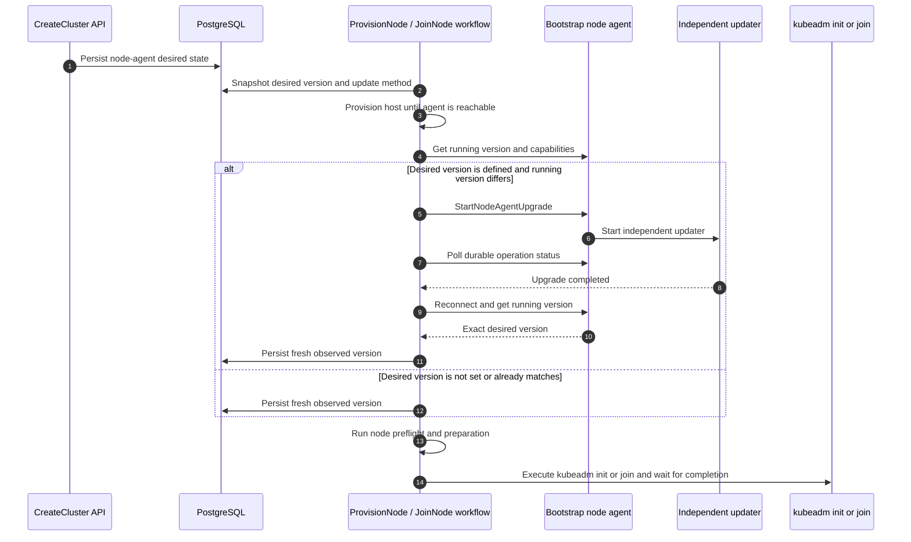
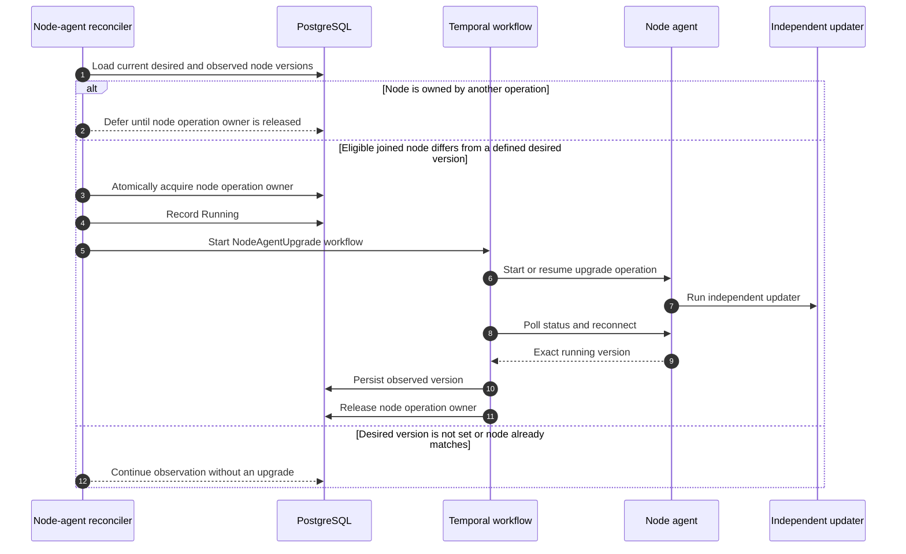

# Controller-driven node-agent desired version update

> Status: selected design draft
>
> Tracks: [dsx-ai-factory/nke#205](https://github.com/dsx-ai-factory/nke/issues/205)
>
> This is the selected controller-driven approach. The earlier
> [cluster-lock rollout design](in-place-rollout-design.md) is retained for
> comparison.

## Problem

NKE records each node's observed agent version but does not maintain a desired
version throughout the cluster lifecycle. Provisioning already depends on the
agent for preflight, file preparation, kubeadm init or join, and status polling.
Waiting until after join to update the agent can leave these steps using an
agent that cannot perform the requested work.

The earlier cluster-lock proposal adds desired state but blocks unrelated
topology and cluster updates while control-plane agents converge. The proposal
below keeps convergence in the lifecycle where it is needed and coordinates
conflicting operations at the node boundary.

## Proposal

**Desired node-agent versions are cluster desired state, set separately for
control plane nodes and worker nodes. Lifecycle workflows converge nodes to the desired version before preflight and
kubeadm. Background reconciliation handles later drift on joined nodes.**

This proposal covers node-agent convergence and the coordination it needs. It
does not redesign cluster orchestration or upgrades of other system components.

### Design invariants

1. When a desired version is defined, kubeadm does not run on a node until its
   agent runs exactly that version.
2. Changing the desired version does not interrupt an operation in flight.
3. No other operation starts on a node while an agent upgrade is still running on it.
   - Rationale: an agent upgrade is disruptive because it restarts the agent and
     breaks the controller's connection to the node.
4. Only one disruptive operation acts on a node at a time. Only deletion and
   remediation may preempt another operation.
5. Background upgrades act only on nodes that have joined the cluster.
6. If a background upgrade fails on a node, no further nodes of the same type
   (control plane or worker) are upgraded to that version until an operator
   retries or changes it.
7. Every controller call to an agent works with any agent version present in
   the cluster. See the
   [Day 1 compatibility contract](#day-1-controller-agent-compatibility-contract).

### Why not the cluster-wide lock?

A cluster-wide lock makes unrelated updates wait for the entire agent rollout,
including retries on a single failing node. Per-node ownership makes only work
on the same node wait.

## API contract

The API persists the desired version on the cluster, separately for
`controlPlane` and `workers`. Per-node observations record what is running. The
authoritative desired version remains on the cluster.

### CreateCluster

`CreateCluster` persists the initial desired versions for control plane nodes and worker nodes:

```json
{
  "nodeAgentConfig": {
    "controlPlane": {
      "version": "v0.1.33"
    },
    "workers": {
      "version": "v0.1.33"
    }
  }
}
```

`nodeAgentConfig` is optional. Without it, NKE does not upgrade node agents in
that cluster.

The API accepts exact release SemVer and canonicalizes it to
`vMAJOR.MINOR.PATCH`.

### UpdateCluster

`UpdateCluster` is the only API path that changes the desired node-agent
version after creation. It uses the same `nodeAgentConfig` shape as
`CreateCluster`.

- The API records the new desired version and returns. It does not wait for
  agents to converge.
- Control plane nodes and worker nodes can be updated independently.
- Downgrades are allowed and follow the same path as upgrades.
- The API rejects a version whose artifact does not exist for the site's
  update method, before any node is touched.
- If upgrades to a version halt after a failure, submitting the same version
  again retries them.

### NKE controller configuration

| Setting | Required | Values | Purpose |
|---|---|---|---|
| `NODE_AGENT_UPDATE_METHOD` | Yes | `apt` or `bundle` | How agents are installed |
| `NODE_AGENT_WORKER_MAX_CONCURRENT` | No | Integer ≥ 1, default `1` | How many worker nodes per cluster may upgrade at once in the background |

Control plane nodes always upgrade one at a time per cluster. This is not
configurable.

## Shared node-agent convergence operation

Both lifecycle workflows and background upgrade workflows use the same
operation:

```text
EnsureNodeAgentVersion(
    nodeID,
    desiredVersion,
    updateMethod
)
```

1. Read and persist the running version and observation time. If no desired
   version is set or it already matches, return `Unchanged`.
2. Discover upgrade capabilities and start or resume the idempotent upgrade
   using the typed RPC or the Day 1 fallback path.
3. Poll durable operation status across agent restarts. Both paths must provide
   equivalent durable status.
4. Establish a fresh authenticated connection, verify the exact desired version,
   and persist the new observation before returning success.

A background upgrade workflow holds node ownership throughout this operation.
The sections below show where each caller invokes it.

## Lifecycle workflow integration

The lifecycle workflow snapshots the node's desired version and update method,
then provisions the host until the bootstrap agent is reachable. It invokes
`EnsureNodeAgentVersion` directly before preflight and preparation. Kubeadm
proceeds only after that operation succeeds or returns `Unchanged`.

### Provisioning and join sequence



### Existing workflow split

For control-plane-controller-managed nodes:

1. `ProvisionNode` provisions the host.
2. Once the bootstrap agent is reachable, `ProvisionNode` invokes
   `EnsureNodeAgentVersion`.
3. It runs the remaining preflight and preparation steps.
4. It marks the node `ReadyToJoin`.
5. The control-plane controller starts the serialized `JoinNode` workflow.
6. `JoinNode` uses the persisted lifecycle snapshot and proceeds with kubeadm
   join.

Lifecycle workflows do not take node ownership. Background upgrades act only on
joined nodes ([invariant 5](#design-invariants)), so nothing else upgrades the
agent between `ProvisionNode` and `JoinNode`, including the `ReadyToJoin`
interval.

For workers and legacy paths where provisioning and join occur in one workflow,
the same workflow runs `EnsureNodeAgentVersion` immediately before the
remaining preflight and join sequence.

## Background reconciliation

After join, the node-agent controller compares the latest desired version with
each node's observed version. Database change events and periodic resynchronization
trigger reconciliation using desired versions, observations, lifecycle and
health conditions, and node ownership.

Without a desired version, NKE only observes. An owned node is deferred. For
an eligible joined node with version drift, the reconciler acquires ownership
and starts a per-node `NodeAgentUpgrade` workflow that calls
`EnsureNodeAgentVersion`. The existing rollout executor is not used, because it
applies one operation across all control-plane nodes and cannot skip a busy
node or target workers.

### Reconciliation sequence



This also covers drift from older OS images or restored artifacts and nodes
that become reachable again. Each attempt records what actually ran, and the next
reconcile compares that observation with the current desired version.

## Execution coordination

An agent upgrade can restart the agent while a join workflow is using it, and
deletion can remove a node while an upgrade is still running. Both workflows
could then fail or act on a node whose state has changed underneath them.
Execution coordination prevents this overlap on the same node.

Here, disruptive work means work that changes the node or requires exclusive
use of its agent: node-agent or Kubernetes upgrade, reboot, certificate renewal,
kubelet reconfiguration, remediation, and deletion. Provisioning and join do not
take ownership, because background upgrades never act on nodes that have not
joined.

The proposal adds one field to the node row in PostgreSQL:

| Field | Problem it solves |
|---|---|
| `node_operation_owner` | Identifies the operation holding the node. Empty means available. Atomic acquisition prevents two operations from starting disruptive work on the same node. |

1. Before disruptive work, acquire ownership atomically if the field is empty.
2. If another operation owns the node, a competing workflow waits and retries,
   and a reconciler defers this node and can continue processing other nodes. Neither
   steals ownership nor aborts the active operation. Deletion and remediation
   are the exception: they cancel the active operation and take ownership.
3. Hold ownership until the operation completes, including agent restarts and
   retries. Only the matching owner may release it. If the owning workflow has ended
   without releasing, the reconciler clears the owner once no agent upgrade is
   running on the node.
4. After release, re-evaluate eligibility and compare the latest desired version
   with the fresh observation before starting another upgrade.

### Example: a desired version changes during join

`CreateCluster` sets the desired version to `v0.1.33`. A node booted with an older
agent is upgraded to `v0.1.33` before kubeadm. Later, while a scale-out node is
joining with a snapshot of `v0.1.33`, `UpdateCluster` changes the desired version to
`v0.1.34`.

The joining node finishes using `v0.1.33` and records that actual version.
After it joins, the reconciler sees `v0.1.33` versus `v0.1.34` and schedules
the next upgrade. Other eligible joined nodes can converge while that node is joining.

## Agent RPC and independent updater

The controller-side model depends on a narrow agent-side contract. The agent
exposes only typed node-agent upgrade operations, while the independent updater
survives the agent process replacement.

When the agent supports typed self-upgrade, this design uses the same
narrow asynchronous RPCs as the cluster-lock design:

```text
StartNodeAgentUpgrade(operation_id, target_version, method)
GetNodeAgentUpgradeStatus(operation_id)
```

`method` is `APT` or `BUNDLE` and is supplied only by NKE controller
configuration. The RPCs accept no package name, URL, path, install arguments,
or command. For older agents that do not expose these RPCs, the Day 1
compatibility contract allows the controller to use the existing shell-script
runbook path instead.

Repeating the same operation ID returns the existing status, and status
remains readable after the agent restarts.

The agent persists request and status on the node and starts the independent
systemd updater without blocking. The updater owns staging, installation,
restart, verification, and local restoration, so retries resume without
depending on the gRPC server process.

## Day 1 controller-agent compatibility contract

Today the NKE controller is usually newer than some agents it manages. During
rollout, different nodes expose different capabilities, so compatibility is a
responsibility of every controller caller of the agent API.

### Compatibility model

Discover capabilities before invoking a newly introduced RPC. Use the typed RPC
when supported. Otherwise, use the equivalent shell-script runbook path. For
node-agent upgrades, that fallback must provide the same durable operation
status, retry behavior, and exact post-restart version verification described
in the shared operation. Because restarting the agent would kill a script it
runs, the fallback launches the update outside the agent's service, for example
with `systemd-run`. An unavailable RPC does not mean the requested work
succeeded. Protobuf changes should remain additive and backward compatible.

This contract avoids a strict controller/agent version matrix: agents baked
into different OS images can vary within one cluster, controllers can be
upgraded ahead of agents, and open source deployments should not need to
upgrade every component in lockstep. Callers select a supported path per node
throughout convergence.
