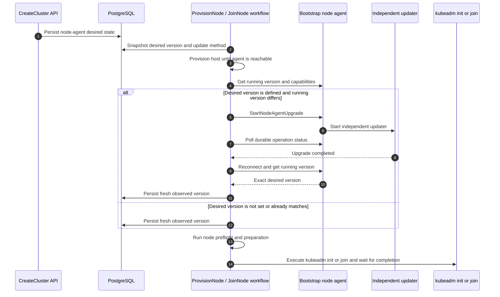
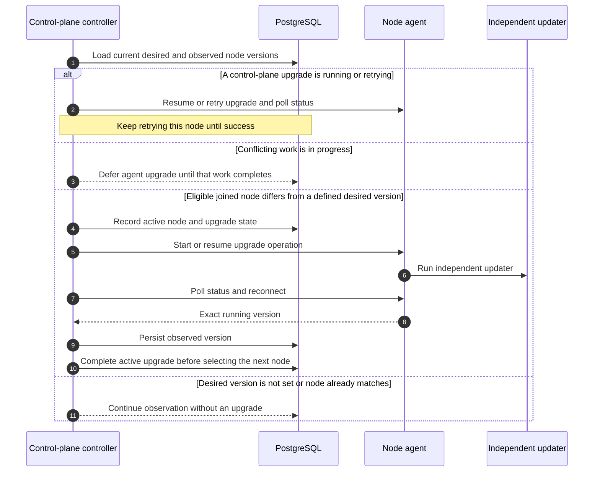

# Controller-driven node-agent desired version update

> Status: selected design draft
>
> Tracks: [dsx-ai-factory/nvke#205](https://github.com/dsx-ai-factory/nvke/issues/205)
>
> This is the selected controller-driven approach. The earlier
> [cluster-lock rollout design](in-place-rollout-design.md) is retained for
> comparison.

## Summary

Today, upgrading the node agent requires rolling bare-metal nodes with a new
OS image that contains the desired agent version. Managing the bare-metal node
lifecycle is difficult and error-prone. This makes an agent upgrade depend on a
node rolling update, even when only the agent needs to change.

NVKE records each node's observed agent version but does not maintain a desired
version. In-place agent updates let NVKE change that version without replacing
the node. New nodes still start with the agent baked into the OS image. If that
version differs from the desired version, NVKE installs the desired version
before preflight and kubeadm.

The earlier cluster-lock proposal adds desired state but blocks unrelated
topology and cluster updates while control-plane agents converge. The proposal
below keeps convergence in the lifecycle where it is needed and coordinates
conflicting operations at the node boundary.

## Proposal

**The desired node-agent version is part of `controlPlaneConfig`. Lifecycle
workflows converge control-plane nodes to that version before preflight and
kubeadm. Background reconciliation handles later drift on joined nodes.**

This proposal covers node-agent convergence and the coordination it needs. It
does not redesign cluster orchestration or upgrades of other system components.
Pool-managed control planes and workers are out of scope. Future worker support
can use roughly the same mechanism.

### Design invariants

1. When a desired version is defined, kubeadm does not run on a control-plane
   node until its agent runs exactly that version.
2. Changing the desired version does not interrupt an operation in flight.
3. No other operation starts on a node while an agent upgrade is still running on it.
   - Rationale: an agent upgrade is disruptive because it restarts the agent and
     breaks the controller's connection to the node.
4. Only one disruptive operation acts on a node at a time. Only deletion and
   remediation may preempt another operation.
5. Background upgrades act only on nodes that have joined the cluster.
6. While a background upgrade runs or retries, no other control-plane node
   starts an agent upgrade. The controller treats failures as transient and
   keeps retrying the same node until its upgrade succeeds.
7. Every controller call to an agent works with any agent version present in
   the cluster. See the
   [Day 1 compatibility contract](#day-1-controller-agent-compatibility-contract).

### Why not the cluster-wide lock?

A cluster-wide lock makes unrelated updates wait for the entire agent rollout,
including retries on a single failing node. The control-plane controller
sequences agent upgrades and defers conflicting work. No node ownership lock
is required.

## API contract

The API persists the desired version in `controlPlaneConfig.nodeAgentConfig.version`.
Per-node observations record what is running. The control-plane configuration
remains the source of the desired version.

### CreateCluster

`CreateCluster` persists the initial desired version in `controlPlaneConfig`:

```json
{
  "controlPlaneConfig": {
    "nodeAgentConfig": {
      "version": "v0.1.33"
    }
  }
}
```

Operators opt in through `CreateCluster` or `UpdateCluster` by setting a nonempty
`controlPlaneConfig.nodeAgentConfig.version`. An absent or empty desired version
disables both in-place updates and the lifecycle version step.

The API accepts exact release SemVer and canonicalizes it to
`vMAJOR.MINOR.PATCH`.

### UpdateCluster

`UpdateCluster` is the only API path that changes the desired node-agent
version after creation. It uses the same `nodeAgentConfig` shape as
`CreateCluster`.

- The API records the new desired version and returns. It does not wait for
  agents to converge.
- Downgrades are allowed and follow the same path as upgrades.
- The controller treats upgrade failures as transient and keeps retrying
  automatically. `GetCluster` reports the current failure while retries continue.
  Operators do not need to resubmit the desired version to trigger retries.

### NVKE controller configuration

| Setting | Required | Values | Purpose |
|---|---|---|---|
| `NODE_AGENT_UPDATE_METHOD` | Yes | `apt` or `bundle` | How agents are installed |

Control plane nodes always upgrade one at a time per cluster. This is not
configurable.

## Shared node-agent convergence operation

Lifecycle workflows and background reconciliation use the same operation:

```text
EnsureNodeAgentVersion(
    nodeID,
    desiredVersion,
    updateMethod
)
```

1. Read and persist the running version and observation time. If no desired
   version is set or it already matches, return `Unchanged`.
2. Discover upgrade capabilities and start or resume the idempotent upgrade
   using the typed RPC or the Day 1 fallback path.
3. Poll durable operation status across agent restarts. Both paths must provide
   equivalent durable status.
4. Establish a fresh authenticated connection, verify the exact desired version,
   and persist the new observation before returning success.

The control-plane controller tracks the active upgrade throughout this operation.
The sections below show where each caller invokes it.

## Lifecycle workflow integration

The lifecycle workflow snapshots the desired version from `controlPlaneConfig`
and the update method. It provisions the host until the agent baked into the
OS image is reachable. It invokes
`EnsureNodeAgentVersion` directly before preflight and preparation. Kubeadm
proceeds only after that operation succeeds or returns `Unchanged`.

If operators opt in to set `controlPlaneConfig.nodeAgentConfig.version` to a
non-empty valid version, they must keep the OS image's agent version equal to
the desired version during rolling node updates. Before a rolling update, operators must update the image or the desired
version so that both match. A newer OS image does not change the desired version
automatically. If the versions differ at boot, NVKE installs the desired version
first, including a downgrade when necessary.

### Provisioning and join sequence



### Existing workflow split

For control-plane-controller-managed nodes:

1. `ProvisionNode` provisions the host.
2. Once the bootstrap agent is reachable, `ProvisionNode` invokes
   `EnsureNodeAgentVersion`.
3. It runs the remaining preflight and preparation steps.
4. It marks the node `ReadyToJoin`.
5. The control-plane controller starts the serialized `JoinNode` workflow.
6. `JoinNode` uses the persisted lifecycle snapshot and proceeds with kubeadm
   join.

Background upgrades act only on
joined nodes ([invariant 5](#design-invariants)), so nothing else upgrades the
agent between `ProvisionNode` and `JoinNode`, including the `ReadyToJoin`
interval.

## Background reconciliation

After join, the control-plane controller compares the desired version in
`controlPlaneConfig` with each control-plane node's observed version. Database
change events and periodic resynchronization trigger reconciliation using
desired versions, observations, lifecycle and health conditions, and active operations.

Without a desired version, NVKE only observes. A node with conflicting work is
deferred. For an eligible joined node with version drift, the controller records
the active upgrade and starts or resumes `EnsureNodeAgentVersion` directly. It persists upgrade
state and polls status on later reconciliations. The control-plane controller
starts only one
background agent upgrade at a time per cluster, across replicas and restarts.

### Reconciliation sequence



This also covers drift from older OS images or restored artifacts and nodes
that become reachable again. Each upgrade records what actually ran, and the next
reconcile compares that observation with the current desired version.

## Execution coordination

An agent upgrade can restart the agent while a join workflow is using it, and
deletion can remove a node while an upgrade is still running. Both operations
can fail or act on a node whose state changed underneath them.
Execution coordination prevents this overlap on the same node.

The control-plane controller sequences background agent upgrades, as it already
sequences joins and requested deletes. It uses the existing cluster-row
transaction to select and record work.

1. Record the active node and upgrade state before starting the asynchronous
   agent operation. The database transaction ends before the upgrade completes.
2. On later reconciliations, resume that upgrade before selecting another node.
   Keep retrying transient failures and make sure that the running version
   matches the target before marking success.
3. Defer conflicting joins, Kubernetes upgrades, rolling replacements, and
   deletions while the agent upgrade runs. Unrelated observation and host
   provisioning can continue. Deletion and remediation can cancel the upgrade
   before proceeding.
4. Operations started outside this controller, such as certificate renewal,
   must use the same scheduling checks. They must not overlap with an agent
   upgrade on the same node.

The controller also publishes the desired version and observed upgrade state
on existing control-plane CAPI Machine objects. It continues to use controller
records for upgrade decisions. It does not consume Machine state yet.

### Example: a desired version changes during join

`CreateCluster` sets the desired version to `v0.1.33`. A node booted with an older
agent is upgraded to `v0.1.33` before kubeadm. Later, while a scale-out node is
joining with a snapshot of `v0.1.33`, `UpdateCluster` changes the desired version to
`v0.1.34`.

The joining node finishes using `v0.1.33` and records that actual version.
After it joins, the reconciler sees `v0.1.33` versus `v0.1.34` and schedules
the next upgrade. Other eligible joined nodes can converge one at a time while
that node is joining.

## Agent RPC and independent updater

The controller-side model depends on a narrow agent-side contract. The agent
exposes only typed node-agent upgrade operations, while the independent updater
survives the agent process replacement.

When the agent supports typed self-upgrade, this design uses the same
narrow asynchronous RPCs as the cluster-lock design:

```text
StartNodeAgentUpgrade(target_version, method)
GetNodeAgentUpgradeStatus()
```

`method` is `APT` or `BUNDLE` and is supplied only by NVKE controller
configuration. The RPCs accept no package name, URL, path, install arguments,
or command. For older agents that do not expose these RPCs, the Day 1
compatibility contract allows the controller to use the existing shell-script
runbook path instead.

Repeated requests for the same target version and method resume the active
upgrade. If the previous upgrade failed, the controller repeats the request to
retry it. Status remains readable after the agent restarts.

The agent persists request and status on the node and starts the independent
systemd updater without blocking. The updater owns staging, installation,
restart, verification, and local restoration, so retries resume without
depending on the gRPC server process.

## Day 1 controller-agent compatibility contract

Today the NVKE controller is usually newer than some agents it manages. During
rollout, different nodes expose different capabilities, so compatibility is a
responsibility of every controller caller of the agent API.

### Compatibility model

Discover capabilities before invoking a newly introduced RPC. Use the typed RPC
when supported. Otherwise, use the equivalent shell-script runbook path. For
node-agent upgrades, that fallback must provide the same durable operation
status, retry behavior, and exact post-restart version verification described
in the shared operation. Because restarting the agent would kill a script it
runs, the fallback launches the update outside the agent's service, for example
with `systemd-run`. An unavailable RPC does not mean the requested work
succeeded. Protobuf changes should remain additive and backward compatible.

This contract avoids a strict controller/agent version matrix: agents baked
into different OS images can vary within one cluster, controllers can be
upgraded ahead of agents, and open source deployments should not need to
upgrade every component in lockstep. Callers select a supported path per node
throughout convergence.
