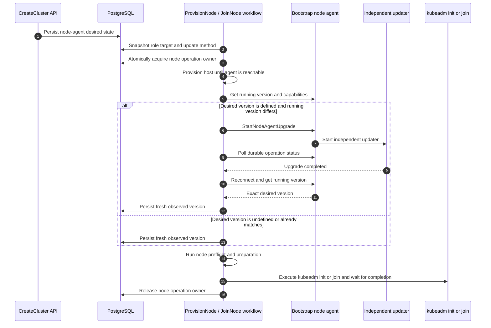
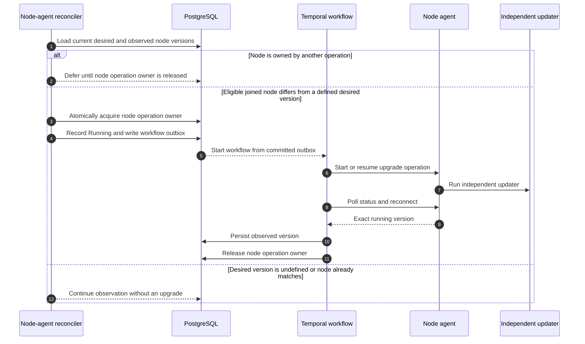

# Controller-driven node-agent desired version update

> Status: selected design draft
>
> Tracks: [dsx-ai-factory/nke#205](https://github.com/dsx-ai-factory/nke/issues/205)
>
> This is the selected controller-driven approach. The earlier
> [cluster-lock rollout design](in-place-rollout-design.md) is retained for
> comparison.

## Problem

NKE records each node's observed agent version but does not maintain a desired
version throughout the cluster lifecycle. Provisioning already depends on the
agent for preflight, file preparation, kubeadm init or join, and status polling.
Waiting until after join to update the agent can leave these steps using an
agent that cannot perform the requested work.

The earlier cluster-lock proposal adds desired state but blocks unrelated
topology and cluster updates while control-plane agents converge. The decision
below keeps convergence in the lifecycle where it is needed and coordinates
conflicting operations at the node boundary.

## Decision

**Desired node-agent versions are cluster desired state, scoped by node role.
Lifecycle workflows converge nodes to their snapshotted target before preflight
and kubeadm; background reconciliation handles later drift on joined nodes.**

This proposal covers node-agent convergence and the coordination it needs; it
does not redesign cluster orchestration or upgrades of other system components.

### Design invariants

- When a desired version is defined, the lifecycle workflow verifies an exact
  match before preflight or kubeadm. If undefined, it records the running version
  without upgrading; required operations still follow the compatibility contract.
- Only one disruptive operation may own a node at a time.
- A desired version change does not preempt an active operation or change its
  snapshotted target.
- Background convergence acts on joined nodes only after lifecycle ownership
  ends.

### Why not the cluster-wide lock?

A cluster-wide lock makes unrelated updates wait for the entire agent rollout,
including retries on a single failing node. Per-node ownership makes only work
on the same node wait. Existing control-plane node-agent upgrades use the
rollout executor for serial execution, node guards, and recovery; worker
upgrades require extending its target selection. Provisioning and join run
outside that executor and participate in the same node ownership mechanism.

### Safety during convergence

| Problem | Rule | Why |
|---|---|---|
| An agent upgrade could restart the agent while join or deletion is using it | Hold node ownership through the operation. A competing workflow waits; the reconciler defers and re-evaluates after release. | Conflicting work cannot run concurrently on that node. |
| A rolling update leaves different nodes exposing different agent capabilities | Follow the [Day 1 compatibility contract](#day-1-controller-agent-compatibility-contract) for every controller-to-agent call. | Health checks, upgrades, and recovery remain usable during partial convergence. |

## API contract

The API persists the target on the cluster, separately for `controlPlane` and
`workers`. Per-node observations record what is running; the authoritative target
remains on the cluster.

### CreateCluster

`CreateCluster` persists the initial role-scoped desired state:

```json
{
  "nodeAgentConfig": {
    "controlPlane": {
      "version": "v0.1.33"
    },
    "workers": {
      "version": "v0.1.33"
    }
  }
}
```

An explicit desired version is an exact release. When the desired version is
omitted, it remains undefined and NKE records each node's actual agent version
by polling the node-agent version RPC.

### UpdateCluster

`UpdateCluster` is the only API path that changes the desired node-agent
version after creation:

```json
{
  "nodeAgentConfig": {
    "controlPlane": {
      "version": "v0.1.34"
    },
    "workers": {
      "version": "v0.1.34"
    }
  }
}
```

The API accepts a new desired version without waiting for agent convergence.
Controllers and workflows update observations and execution status, not desired
state. During initial cluster creation, the desired configuration cannot change.

### Node-agent update method

A required site-scoped NKE controller setting, `NODE_AGENT_UPDATE_METHOD`,
selects `apt` or `bundle`.

## Shared node-agent convergence operation

Both lifecycle workflows and background upgrade workflows use the same
operation after acquiring node ownership:

```text
EnsureNodeAgentVersion(
    nodeID,
    desiredVersion,
    updateMethod
)
```

1. Read and persist the running version and observation time. If the target is
   undefined or already matches, return `Unchanged`.
2. Discover upgrade capabilities and start or resume the idempotent upgrade
   using the typed RPC or the Day 1 fallback path.
3. Poll durable operation status across agent restarts. Both paths must provide
   equivalent durable status.
4. Establish a fresh authenticated connection, verify the exact target version,
   and persist the new observation before returning success.

The caller holds ownership throughout this operation. The sections below show
where each caller invokes it and when that caller releases the node.

## Lifecycle workflow integration

The lifecycle workflow snapshots the role's desired version and update method,
then provisions the host until the bootstrap agent is reachable. It invokes
`EnsureNodeAgentVersion` directly before preflight and preparation; kubeadm
proceeds only after that operation succeeds or returns `Unchanged`.

### Provisioning and join sequence



### Existing workflow split

For control-plane-controller-managed nodes:

1. `ProvisionNode` provisions the host.
2. Once the bootstrap agent is reachable, `ProvisionNode` invokes
   `EnsureNodeAgentVersion`.
3. It runs the remaining preflight and preparation steps.
4. It marks the node `ReadyToJoin`.
5. The control-plane controller starts the serialized `JoinNode` workflow.
6. `JoinNode` uses the persisted lifecycle snapshot and proceeds with kubeadm
   join.

The lifecycle retains node ownership across the `ProvisionNode` to `JoinNode`
handoff, including the `ReadyToJoin` interval. Background convergence cannot
enter between those workflows.

For workers and legacy paths where provisioning and join occur in one workflow,
the same workflow runs `EnsureNodeAgentVersion` immediately before the
remaining preflight and join sequence.

## Background reconciliation

After join, the node-agent controller compares the latest role target with each
node's observed version. Database change events and periodic resynchronization
trigger reconciliation using desired versions, observations, lifecycle and
health conditions, and node ownership.

An undefined target requires observation only. An owned node is deferred. For
an eligible joined node with version drift, the rollout executor's node guard
acquires ownership and the upgrade workflow calls `EnsureNodeAgentVersion`.

### Reconciliation sequence



This also covers drift from older OS images or restored artifacts and nodes
that become reachable again. Each attempt records what actually ran; the next
reconcile compares that observation with the current target.

## Execution coordination

An agent upgrade can restart the agent while a join workflow is using it;
deletion can remove a node while an upgrade is still running. Both workflows
could then fail or act on a node whose state has changed underneath them.
Execution coordination prevents this overlap on the same node.

Here, disruptive work means work that changes the node or requires exclusive
use of its agent: provisioning, join, node-agent or Kubernetes upgrade,
remediation, and deletion. Join itself need not interrupt an existing node;
it is included because an agent restart can interrupt join.

The proposal adds one field to the node row in PostgreSQL:

| Field | Problem it solves |
|---|---|
| `node_operation_owner` | Identifies the operation holding the node; empty means available. Atomic acquisition prevents two operations from starting disruptive work on the same node. |

1. Before disruptive work, acquire ownership atomically if the field is empty.
   Lifecycle workflows do this directly; existing-node upgrades use the rollout
   executor's node guard.
2. If another operation owns the node, a competing workflow waits and retries;
   a reconciler defers this node and can continue processing other nodes. Neither
   steals ownership nor aborts the active operation.
3. Hold ownership until the operation completes, including agent restarts and
   retries. Only the matching owner may release it. Lifecycle ownership spans
   provisioning and join as described above.
4. After release, re-evaluate eligibility and compare the latest desired version
   with the fresh observation before starting another upgrade.

### Example: a desired version changes during join

`CreateCluster` sets the desired version to `v0.1.33`. A node booted with an older
agent is upgraded to `v0.1.33` before kubeadm. Later, while a scale-out node is
joining with a snapshot of `v0.1.33`, `UpdateCluster` changes the role target to
`v0.1.34`.

The joining node remains owned by its lifecycle operation and finishes using
`v0.1.33`. It records that actual version and releases ownership after join.
The reconciler then sees `v0.1.33` versus `v0.1.34` and schedules the next
upgrade. Other eligible joined nodes can converge while that node is joining.

## Agent RPC and independent updater

The controller-side model depends on a narrow agent-side contract. The agent
exposes only typed node-agent upgrade operations, while the independent updater
survives the agent process replacement.

When the agent supports typed self-upgrade, this design uses the same
narrow asynchronous RPCs as the cluster-lock design:

```text
StartNodeAgentUpgrade(operation_id, target_version, method)
GetNodeAgentUpgradeStatus(operation_id)
StartNodeAgentRollback(operation_id, upgrade_operation_id)
```

`method` is `APT` or `BUNDLE` and is supplied only by NKE controller
configuration. The RPCs accept no package name, URL, path, install arguments,
or command. For older agents that do not expose these RPCs, the Day 1
compatibility contract allows the controller to use the existing shell-script
runbook path instead.

Repeating the same operation ID and request returns existing status; different
inputs for the same ID return `AlreadyExists`. A conflicting updater operation
returns `FailedPrecondition`. Status remains readable after agent restart.

The agent persists request and status under
`/var/lib/nke/agent-upgrades/<operation-id>/` and starts the independent systemd
updater without blocking. The updater owns staging, installation, restart,
verification, and local restoration. Atomic status writes and a local singleton
guard make retries resumable without depending on the gRPC server process.

## Day 1 controller-agent compatibility contract

Today the NKE controller is usually newer than some agents it manages. During
rollout, different nodes expose different capabilities, so compatibility is a
responsibility of every controller caller of the agent API.

### Compatibility model

Discover capabilities before invoking a newly introduced RPC. Use the typed RPC
when supported; otherwise use the equivalent shell-script runbook path. For
node-agent upgrades, that fallback must provide the same durable operation
status, retry behavior, and exact post-restart version verification described
in the shared operation. An unavailable RPC does not mean the requested work
succeeded. Protobuf changes should remain additive and backward compatible.

This contract avoids a strict controller/agent version matrix: agents baked
into different OS images can vary within one cluster, controllers can be
upgraded ahead of agents, and open source deployments should not need to
upgrade every component in lockstep. Callers select a supported path per node
throughout convergence.
