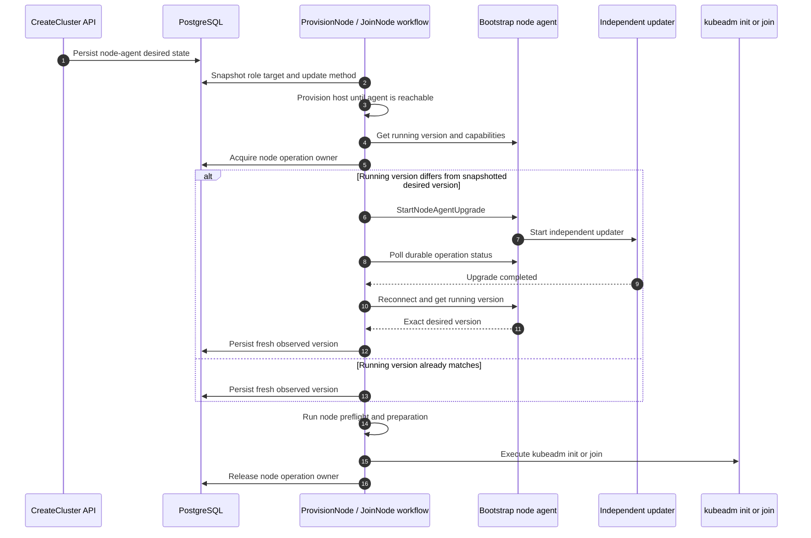
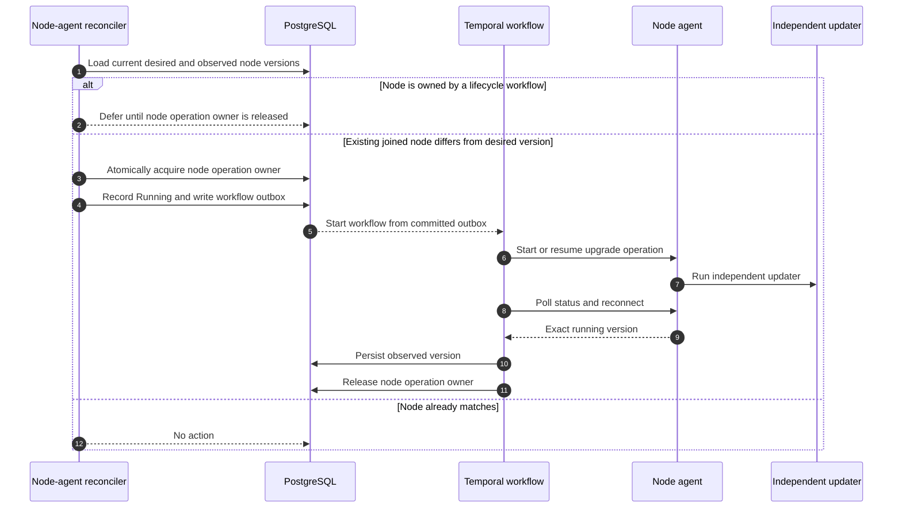

# Controller-driven node-agent desired version update

> Status: selected design draft
>
> Tracks: [dsx-ai-factory/nke#205](https://github.com/dsx-ai-factory/nke/issues/205)
>
> This is the selected controller-driven approach. The earlier
> [cluster-lock rollout design](in-place-rollout-design.md) is retained for
> comparison.

## Problem

NKE records each node's observed agent version, but today it neither establishes
an authoritative desired agent version when a cluster is created nor
continuously converges nodes to that version afterward. The existing
cluster-lock proposal adds desired state, but a control-plane rollout blocks
unrelated topology and cluster updates for the duration of convergence.

Node provisioning also depends on the agent before kubeadm. Preflight, file
preparation, kubeadm init, kubeadm join, and join-status polling all call the
agent. Deferring agent convergence until after a node joins can therefore leave
the lifecycle workflow dependent on an agent that is too old for the requested
cluster configuration.

The earlier cluster-lock rollout proposal solved safety by blocking conflicting
cluster-wide changes during node-agent rollout. The remaining design question is
whether normal convergence needs that broad lock, or whether NKE can keep the
same safety properties with lifecycle ownership, reconciliation, and narrower
execution coordination. The following decision summarizes the controller-driven
approach selected from that discussion.

## Decision

NKE treats the node-agent version as cluster desired state from the beginning
of the cluster lifecycle.

`CreateCluster` persists the initial node-agent desired state. When a host
becomes reachable, the workflow responsible for its pre-join lifecycle invokes
the in-place node-agent upgrade operation directly. It verifies that the
running agent matches the workflow's snapshotted desired version before
continuing with node preflight, kubeadm initialization, or kubeadm join. The
lifecycle workflow does not wait for a separate controller to converge the
node.

After the node completes its lifecycle operation and becomes an existing joined
node, a dedicated node-agent controller continuously reconciles its observed
running version with the cluster's latest desired version. Existing
control-plane node-agent upgrades use the existing rollout executor for serial
execution, node guards, and recovery; worker upgrades require extending its
target selection.

Normal node-agent convergence does not hold a long-lived cluster-wide update
lock. Provisioning and join run outside the rollout executor, so this design
adds `node_operation_owner` instead of introducing another rollout engine.

### Safety during convergence

| Problem | Rule | Why |
|---|---|---|
| Provisioning and background convergence could act on the same node | The lifecycle workflow owns the node until join completes; the reconciler waits. For existing joined nodes, an executor node guard acquires the same ownership before an upgrade. | One disruptive operation directs a node at a time. |
| A rolling update temporarily leaves different nodes on different agent versions | The controller follows the Day 1 compatibility contract: discover each agent's capabilities, use the typed RPC when available, and use the fallback path when needed. | NKE can continue checking health, driving upgrades, and recovering failures while the fleet is only partially converged. |

## API contract

The safety model starts with how desired state enters the system. The API only
needs to define the desired node-agent version; the lifecycle and
reconciliation sections define how that intent is executed.

`CreateCluster` persists node-agent desired state by role:

```json
"nodeAgentConfig": {
  "controlPlane": {
    "version": "v0.1.33"
  },
  "workers": {
    "version": "v0.1.33"
  }
}
```

An explicit desired version is an exact release. When the desired version is
omitted, it remains undefined and NKE records each node's actual agent version
by polling the node-agent version RPC.

`UpdateCluster` is the only API path that changes the desired node-agent
version after provisioning:

```json
"nodeAgentConfig": {
  "controlPlane": {
    "version": "v0.1.34"
  },
  "workers": {
    "version": "v0.1.34"
  }
}
```

A different desired version updates desired state. Active lifecycle and
reconciliation attempts keep using their snapshotted desired version; if desired
state changes while a node operation is running, the reconciler handles the
remaining desired-versus-observed drift after the node operation finishes or
releases ownership. Unrelated cluster updates are not rejected merely because
node-agent convergence is active.

### Node-agent update method

A required site-scoped NKE controller setting, `NODE_AGENT_UPDATE_METHOD`,
selects `apt` or `bundle`.

## Lifecycle workflow integration

The node lifecycle workflow is the first consumer of node-agent desired state.
When a desired version is defined, it must ensure the agent is compatible before
running kubeadm because preflight, preparation, init, join, and join-status
polling all depend on the agent.

Infrastructure provisioning continues until the host is running and its
bootstrap agent is reachable. The workflow that owns the node's pre-join
lifecycle then performs node-agent convergence directly.

Conceptually, both lifecycle workflows and the background reconciler use one
shared operation:

```text
EnsureNodeAgentVersion(
    nodeID,
    desiredVersion,
    updateMethod
)
```

It:

1. Gets the running node-agent version.
2. Records the observed version and returns `Unchanged` when the desired
   version is undefined.
3. Returns `Unchanged` when the running version already matches the
   snapshotted target.
4. Discovers whether the agent supports the typed self-upgrade RPC.
5. Starts or resumes the idempotent in-place upgrade through the typed RPC or
   the Day 1 fallback path.
6. Polls durable operation status across agent restarts. The typed RPC and
   fallback path must provide equivalent durable status.
7. Establishes a fresh authenticated connection.
8. Verifies the exact running version.
9. Persists the observed version and observation time.
10. Returns success only after exact verification.

The workflow proceeds to node preparation or kubeadm only after this operation
succeeds.

### Provisioning and join sequence



There is no final reread-and-repeat loop. The workflow uses snapshot semantics:

> A lifecycle workflow must bring the node to its snapshotted, compatible
> desired agent version before proceeding. A desired version accepted after that
> workflow begins does not preempt it and is reconciled afterward.

During initial cluster creation, the desired configuration cannot change.

### Existing workflow split

For control-plane-controller-managed nodes:

1. `ProvisionNode` provisions the host.
2. Once the bootstrap agent is reachable, `ProvisionNode` invokes
   `EnsureNodeAgentVersion`.
3. It runs the remaining preflight and preparation steps.
4. It marks the node `ReadyToJoin`.
5. The control-plane controller starts the serialized `JoinNode` workflow.
6. `JoinNode` uses the persisted lifecycle snapshot and proceeds with kubeadm
   join.

For workers and legacy paths where provisioning and join occur in one workflow,
the same workflow runs `EnsureNodeAgentVersion` immediately before the
remaining preflight and join sequence.

## Background reconciliation

Lifecycle workflows cover nodes while they are being created or joined. After
that ownership ends, the background reconciler keeps existing nodes aligned
with the latest desired node-agent version.

The node-agent controller handles continuous convergence outside active
lifecycle workflows.

It watches:

- cluster desired node-agent versions;
- node observed agent versions;
- node lifecycle and health conditions;
- `node_operation_owner`;
- database change events;
- periodic database resynchronization.

### Reconciliation sequence



The controller handles:

- a newer desired node-agent version accepted during an earlier lifecycle workflow;
- replacement nodes booted from an older OS image;
- nodes restored or reprovisioned from older artifacts;
- drift detected by periodic health observation;
- temporarily unreachable nodes that later recover.

## Execution coordination

Lifecycle integration and background reconciliation define when node-agent
convergence runs. Execution coordination prevents two workflows or controllers
from running disruptive operations on the same node at the same time. For this
design, provisioning, join, node-agent upgrade, Kubernetes upgrade,
remediation, and deletion are treated as disruptive for the node they act on.

If disruptive operations overlap, one workflow can restart or replace the agent
while another workflow is using it, or can change node state while another
workflow is still making kubeadm progress. The proposal introduces one
persisted coordination field:

| Field | Problem it solves |
|---|---|
| `node_operation_owner` | Prevents overlapping disruptive work on the same node. A workflow atomically acquires it before acting and releases it when finished; another workflow waits, skips, or explicitly supersedes according to the operation type. |

Provisioning and join acquire `node_operation_owner` directly because they run
outside the rollout executor. Existing-node node-agent upgrades acquire it
through the rollout executor's node guard. If desired state changes while an
operation owns a node, the new reconcile waits for the owner to release the node
and then compares desired state with the freshly observed agent version.

## Day 1 controller-agent compatibility contract

Execution coordination prevents conflicting actions on the same node, but
rollout still leaves the fleet temporarily mixed across agent versions. The Day
1 compatibility contract is capability-based rather than a strict
controller-version and agent-version matrix.

Today the NKE controller is usually newer than some node agents it manages.
During rollout, the controller should assume that different nodes may expose
different agent capabilities and choose the safest supported path per node.

- Agent protobuf changes remain additive and backward compatible where
  possible.
- The controller discovers agent capabilities before invoking a newly added
  RPC.
- If the agent supports the typed RPC, the controller uses it.
- If the agent does not support the typed RPC, the controller may fall back to
  the existing shell-script runbook path for that operation.
- The design does not require a rigid rule such as controller `X` only supports
  agent `Y..Z`; that would be too restrictive for mixed environments and open
  source deployments.

## Agent RPC and independent updater

The controller-side model depends on a narrow agent-side contract. The agent
exposes only typed node-agent upgrade operations, while the independent updater
survives the agent process replacement.

When the agent supports typed self-upgrade, this design uses the same
narrow asynchronous RPCs as the cluster-lock design:

```text
StartNodeAgentUpgrade(operation_id, target_version, method)
GetNodeAgentUpgradeStatus(operation_id)
StartNodeAgentRollback(operation_id, upgrade_operation_id)
```

`method` is `APT` or `BUNDLE` and is supplied only by NKE controller
configuration. The RPCs accept no package name, URL, path, install arguments,
or command. For older agents that do not expose these RPCs, the Day 1
compatibility contract allows the controller to use the existing shell-script
runbook path instead.

The same operation ID and request returns existing status; different inputs for
the same ID return `AlreadyExists`. A conflicting updater operation returns
`FailedPrecondition`. Status remains readable after agent restart.

The agent persists request and status under
`/var/lib/nke/agent-upgrades/<operation-id>/` and starts the independent systemd
updater without blocking. The updater owns staging, installation, restart,
verification, and local restoration. Atomic status writes and a local singleton
guard make retries resumable without depending on the gRPC server process.
