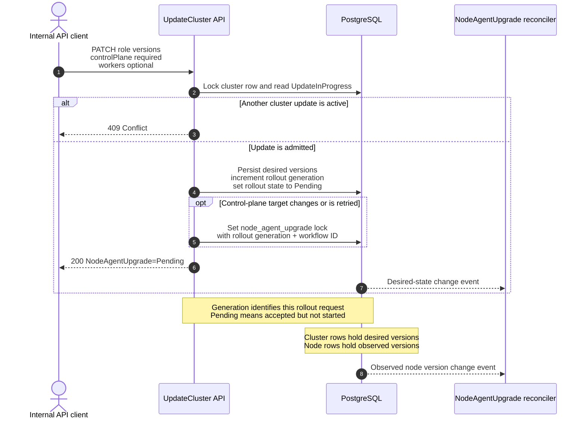
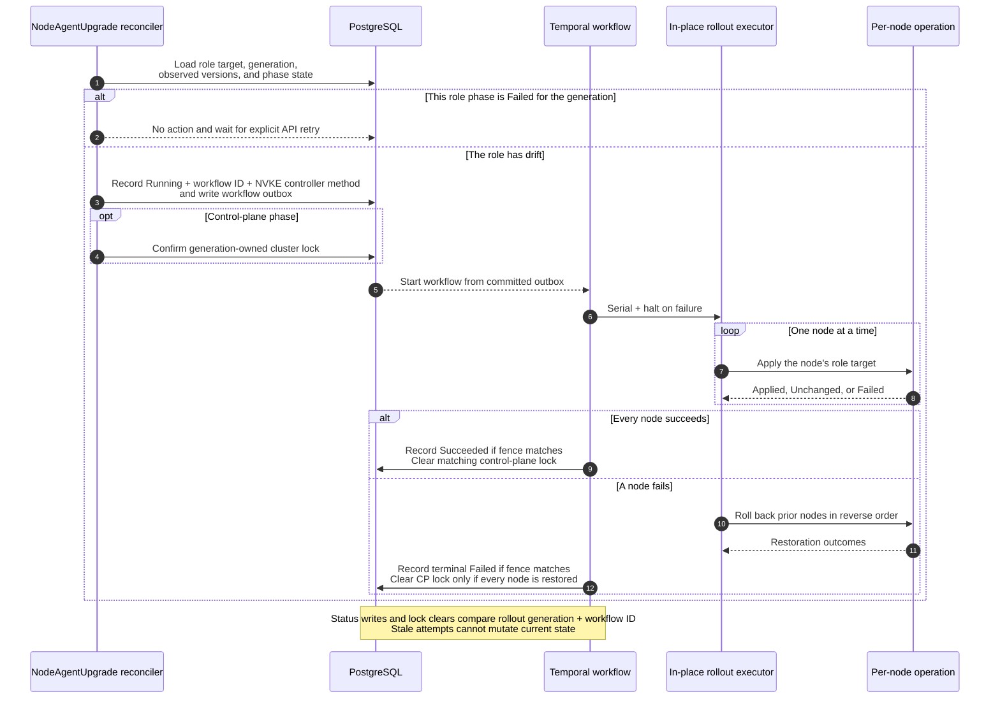
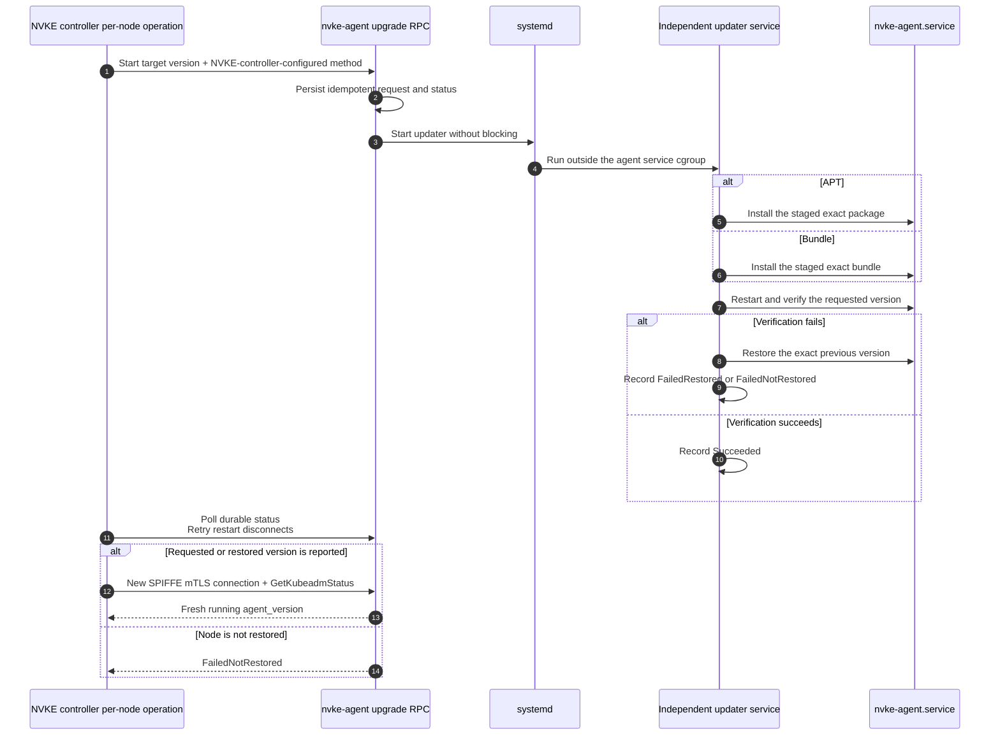

# Node-agent desired-state in-place rollout

> Status: draft for review
>
> Tracks: [dsx-ai-factory/nvke#205](https://github.com/dsx-ai-factory/nvke/issues/205)
>
> This is the cluster-lock design that was considered before selecting the
> controller-driven desired-state approach.

## Problem

NVKE records each node's observed agent version, but it has no cluster-scoped
desired agent configuration or controller that converges nodes to it. APT also
cannot safely replace the agent from inside `nvke-agent.service`: the Debian
`prerm` stops that service, so systemd can terminate the package transaction.

## Solution summary

`UpdateCluster` persists the desired node-agent version. A
DB-backed controller reconciles the actual node-agent version to the desired
version by invoking a Temporal workflow through the existing in-place rollout
framework, one node at a time. This design prioritizes in-place rollout for
control-plane node agents while preserving the capability to roll out node
agents installed on worker nodes. Control-plane rollout holds the cluster update
lock; worker rollout does not. The APT or bundle update method is configured
through NVKE controller configuration. The agent RPC delegates self-replacement to an
independent systemd updater.

## Architecture sequences

### 1. API and database model



### 2. Reconciliation and rollout orchestration



### 3. Per-node agent upgrade and restore



## Non-goals

- Parallel node-agent upgrades.
- Node-agent artifact publication or qualification.

## Existing integration points

- `nodeagentreadiness` runs as the `node-agent-health` controller roughly every
  two minutes. It gets `agent_version` from `GetKubeadmStatus` and writes
  `nodes.agent_version`.
- `UpdateCluster` already locks the cluster row and uses
  `conditions.updateInProgress` to serialize cluster updates.
- `dbreconcile/dbwrapper` publishes cluster and node changes to DB-backed
  controller sources and periodically resyncs them.
- `controller/internal/rollout` already provides serial execution,
  `RollbackHaltOnAnyFailure`, local restore outcomes, and reverse-order
  rollback. Its target selection currently includes control-plane nodes only.

## API and persisted state

### UpdateCluster contract

Add `nodeAgentConfig` to `UpdateClusterRequest` and the `Cluster` response:

```json
{
  "nodeAgentConfig": {
    "controlPlane": {
      "version": "v0.1.31"
    },
    "workers": {
      "version": "v0.1.30"
    }
  }
}
```

- Omitting top-level `nodeAgentConfig` from an update request leaves the current
  desired state unchanged. When it is supplied, `controlPlane` is required and
  `workers` is optional.
- Each supplied role requires only `version`. The API does not expose the
  installation method.
- Omitting `workers` from a supplied config clears any worker target and stops
  worker reconciliation.
- Setting top-level `nodeAgentConfig` to `null` clears all targets when no
  node-agent rollout is running.
- Accept exact release SemVer and canonicalize it to `vMAJOR.MINOR.PATCH`.
  Downgrades are allowed. An identical canonical config is a no-op unless the
  current control-plane or worker phase is `Failed`; resubmitting it then
  explicitly starts a new generation.
- Return `409` when another `UpdateInProgress` operation owns the lock.
- On change or explicit retry, one transaction increments the desired-state
  generation, persists the desired versions, and records
  `nodeAgentUpgrade.state=Pending`. It sets
  `UpdateInProgress=node_agent_upgrade` when the control-plane target changes or
  its failed phase is retried. The controller acquires the same fenced lock for
  later control-plane drift, such as a replacement node. Worker-only changes do
  not set the cluster lock. Return `200` with the node-agent state; the HTTP
  handler does not start Temporal.

The generation is a monotonically increasing revision for an accepted desired
configuration or explicit retry. `Pending` means that revision is committed in
PostgreSQL but the reconciler has not yet recorded `Running` or started its
Temporal workflow.

### Node-agent update method

A required site-scoped NVKE controller setting, `NODE_AGENT_UPDATE_METHOD`,
selects `apt` or `bundle`. The reconciler validates it and snapshots the
resolved value into each workflow and node operation. Changing this setting does
not reinstall an agent or alter an in-flight workflow; it applies to the next
desired-state generation. Artifact locations and qualification remain release
configuration, not API input.

### Database model

Add cluster columns:

```text
desired_control_plane_node_agent_version text NOT NULL DEFAULT ''
desired_worker_node_agent_version        text NOT NULL DEFAULT ''
node_agent_config_generation             bigint NOT NULL DEFAULT 0
```

The existing `nodes.agent_version` remains actual state. Add
`nodes.agent_version_observed_at` so pre-restart observations cannot satisfy
post-upgrade verification.

The cluster's `nodeAgentUpgrade` condition stores the desired-config snapshot,
resolved method, generation, and separate control-plane and worker phase status.
Each phase stores the unique Temporal workflow ID that owns that rollout
attempt, `Pending | Running | Succeeded | Failed`, attempt timing, and a
sanitized message. `Failed` is terminal for that role phase and generation.
`UpdateInProgress` remains the shared cluster mutation lock; add
`node_agent_upgrade` to its operation-type enum for the control-plane phase only.
Its entry also carries the rollout generation and Temporal workflow ID used to
ensure that only the same rollout attempt can clear the lock.

## Reconciliation and topology lock

Add a cluster-scoped `nodeagentupgrade` controller:

1. Reconcile on cluster desired-state changes, mapped node actual-state changes,
   and the existing periodic resync.
2. Return when the config is absent or the cluster is not provisioned or is
   deleting. Do not launch work for a role phase that is `Failed` in the current
   generation; a failed control-plane phase also prevents the worker phase.
3. Target provisioned, non-deleting control-plane nodes. Include workers only
   when `nodeAgentConfig.workers` is present. Wait while a target node is
   provisioning, deleting, recycling, or under repair.
4. Compare each target with its role's exact version. The `node-agent-health`
   controller refreshes the stored version roughly every two minutes. After
   changing a node, the per-node operation also reconnects and calls
   `GetKubeadmStatus`; require that post-restart call to report the exact target
   version. A stored pre-upgrade version does not satisfy verification.
   Reconcile control-plane nodes before starting the optional worker phase.
5. On control-plane drift, atomically acquire the cluster update lock with the
   rollout generation and Temporal workflow ID. Worker drift does not acquire
   that lock.
6. Record `Running`, snapshot `NODE_AGENT_UPDATE_METHOD`, and write the workflow
   outbox entry. The workflow rechecks node lifecycle, agent readiness, and RPC
   support before changing each node.
7. Every workflow status write and lock clear performs a compare-and-swap on the
   cluster ID, desired generation, and Temporal workflow ID. A zero-row update
   means the workflow is stale; it stops without changing status or releasing a
   lock.

Temporal may perform bounded activity retries inside one running workflow. Once
they are exhausted and the workflow finishes unsuccessfully, the controller
records the role phase as `Failed` and does not create a replacement workflow
for that role and generation. After correcting the cause, an operator must
resubmit either the same desired config or a new one through `UpdateCluster`;
admission increments the generation and creates a new attempt. A failed worker
phase does not prevent later control-plane drift from converging. New nodes are
reconciled using the configured target unless their role phase is `Failed`.

The cluster-wide topology lock applies only to the control-plane phase. While it
is active, API handlers and reconcilers block scaling, provisioning, scheduling,
recycling, repair, replacement, and deletion. Health and status observation
continue. Clear the lock only when the matching fenced workflow converges or
fully restores every affected control-plane node. Retain it when any such node
is not proven restored.

A failed-and-restored control-plane phase clears its matching lock but remains
`Failed` until explicit retry. `FailedNotRestored` means both the requested
upgrade and the automatic rollback failed. Keep the same
`UpdateInProgress=node_agent_upgrade` topology lock and emit a critical alert;
this is not a separate failed-lock type. The retained lock prevents normal
topology changes while the control-plane agent state is unknown. Using
out-of-band node access, the on-call operator restores and verifies the exact
previous version on every affected control-plane node. An operator-only recovery
command then clears the lock only if it still belongs to the same failed rollout
attempt. It checks the stored generation (the rollout revision) and Temporal
workflow ID. If either value changed, the command leaves the lock in place
because the recovery request is based on stale state. Periodic reconciliation
never clears a retained lock after `FailedNotRestored`.

Worker rollout is serial but does not set `UpdateInProgress` or block unrelated
cluster mutations. It rechecks the selected worker's lifecycle immediately
before each node operation and stops the current attempt if that node or the
desired generation changed. A worker failure is terminal for its role phase and
generation but never retains a cluster-wide lock.

## In-place rollout orchestration

Extend rollout target selection without changing the control-plane default used
by etcd encryption and OIDC:

```text
TargetControlPlane
TargetWorkers

Strategy:       Serial
RollbackPolicy: HaltOnAnyFailure
```

Run control-plane and worker rollout as separate role phases. The worker phase
starts only after control-plane convergence and does not inherit the
control-plane cluster lock. Order each role by node name. Snapshot the desired
generation, resolved method, role target, and Temporal workflow ID when a phase
starts; derive each per-node operation ID from the rollout and node IDs.

For each target node, the rollout operation:

1. Reads the live running version and returns `OutcomeUnchanged` on an exact
   match.
2. Starts the upgrade and polls durable status. Agent disconnects during restart
   are retryable.
3. On success, reconnects over SPIFFE mTLS, calls `GetKubeadmStatus`, requires
   the exact target version, and persists `agent_version` with a fresh
   `agent_version_observed_at`.
4. Maps a verified local restore to `OutcomeFailedRestored`; otherwise it
   returns `OutcomeFailedNotRestored`.

The first failure stops forward progress. Even `OutcomeFailedRestored` causes
all previously applied nodes in that role phase to roll back in reverse order.
A worker failure does not roll back an already-converged control plane. Clear a
control-plane cluster lock only when it still belongs to the same rollout
attempt and every affected control-plane node is proven restored.

## Agent RPC and independent updater

Add narrow asynchronous RPCs:

```text
StartNodeAgentUpgrade(operation_id, target_version, method)
GetNodeAgentUpgradeStatus(operation_id)
StartNodeAgentRollback(operation_id, upgrade_operation_id)
```

`method` is `APT` or `BUNDLE` and is supplied only from NVKE controller
configuration; it is not cluster API input. The RPCs accept no package name,
URL, path, install arguments, or command. The Debian package remains named
`nvke-agent`. `InstallPackages` normalizes each package argument by removing an
`=version` or `:architecture` qualifier and also recognizes
`nvke-agent_*.deb` paths; it rejects every match.
`InstallBundle` rejects the existing `agent` bundle component. Capability
preflight must not fall back to either generic RPC.

The same operation ID and request returns existing status; different inputs for
the same ID return `AlreadyExists`. A concurrent updater operation returns
`FailedPrecondition`. Status remains readable after agent restart and records
the action, method, previous and target versions, phase, outcome, artifact
identity, timestamps, and sanitized error.

The RPC atomically writes the request and initial status under
`/var/lib/nvke/agent-upgrades/<operation-id>/`, then runs:

```text
systemctl start --no-block nvke-agent-updater@<operation-id>.service
```

PID 1 starts `nvke-agent-updater` in a separate service cgroup. The updater owns
staging, installation, restart, local verification, and local restore. A
singleton lock prevents overlapping jobs, and atomic status writes make retries
and updater restarts resumable without depending on the gRPC server process.

### APT method

Before stopping the agent, resolve and verify the exact target and rollback
`.deb` files. Install the target noninteractively with `--allow-downgrades`, then
verify `dpkg-query`, the installed binary version, and
`nvke-agent.service`. The configured repository suite and APT select the node's
OS release and native architecture; the RPC supplies only the exact version. On
failure, restore and verify the exact previous package.

### Bundle method

Before stopping the agent, verify the exact bundle and snapshot the current
binary and agent-owned service configuration. Use a fixed agent-owned entrypoint
without caller arguments and preserve `/etc/default/nvke-agent`. On failure,
restore the snapshot, reload systemd, restart the service, and verify the exact
previous version.

The updater reports `FailedRestored` only after verifying the previous version;
otherwise it reports `FailedNotRestored`.

## Observability

Track completed node-agent upgrades with one bounded outcome label: `success`
or `failure`.

## Compatibility and bootstrap

Existing agents reach the first release containing the RPC and updater through
the one-time bash-based exact-version APT bootstrap runbook. Afterward, the
controller manages upgrades and downgrades. Clusters without `nodeAgentConfig`
remain unchanged, and preflight fails before mutation if any targeted node lacks
the dedicated RPC.
