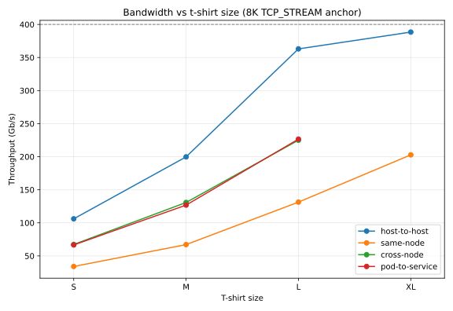
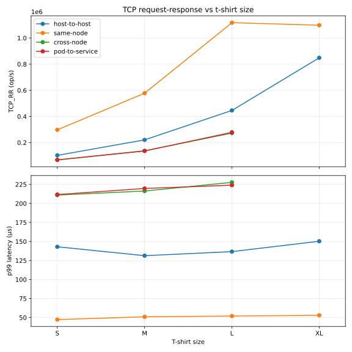

# OVN-Kubernetes data-plane throughput

Scenario: [k8s-netperf-throughput](../../workloads/cni/k8s-netperf-throughput/README.md)

## TL;DR

OVN-Kubernetes data-plane throughput on Kubernetes 1.34.2, measured with
upstream k8s-netperf across four network paths (host-to-host, pod-to-pod
same-node, pod-to-pod cross-node, pod-to-service) at four concurrency levels.

Cross-node — the representative overlay path — reaches **225.01 Gb/s at L
(56.2% of the 400 Gb/s line rate)**. Host-to-host, which bypasses the CNI
entirely, peaks at **388.46 Gb/s (97.1%)**. TCP efficiency clears the 99% bar
on every cell. UDP loss stays low on uncongested paths and climbs sharply on
the loaded overlay — 16–34% cross-node at S through L.

**Key finding — overlay forwarding runs on the host CPU.** TCP efficiency is
healthy throughout: every cell clears 99%. The ~0.05% of retransmits at full
load originates in the receiver's NIC queue and softirq handling, not in packets
dropped inside OVS (OVS `lost` delta was zero). The more interesting result is
*where* the overlay work runs. All OVN-Kubernetes and OVS forwarding — Geneve
encapsulation and decapsulation, and the OVS datapath — executes on the host
CPU. Per-core data makes this plain: one receiver core sits pinned near 100% on
`ovs-vswitchd` and receive softirq while the 64-core node averages only 30–40%.
Offloading OVN-Kubernetes and OVS onto a programmable NIC is the natural next
step, and should return host CPU and softirq headroom.

*Notation: `8K` = netperf message size in bytes; `pN` = N parallel streams.
Request-response percentiles are client-side round-trip latency measured by the
netperf client, not server-side.*

## Scope of this publication

**This is not a maximum-scale claim.** The 11-node topology and the S–XL
concurrency range are what this run measured, not a ceiling on OVN-Kubernetes
or on NKE. A different cluster should apply the scenario's `sizing.derivation`
rather than read XL as "as far as it goes."

This result publishes only cells the checked-in scenario and engine configs
reproduce, apart from the two deviations below.

**XL cross-node and XL pod-to-service are omitted.** Those cells were originally
measured with a modified k8s-netperf build raising the ClusterIP data-port count
from 16 to 64. Stock k8s-netperf compiles the base data port in as
`NetperfServerDataPort = 42424` and exposes 16 ports from there. That patch is not checked in anywhere, so the numbers cannot be
reproduced from anything published here. Publishing an unreproducible figure
would defeat the purpose of the scenario, so the rows are dropped rather than
carried with a caveat. They will return if and when the port-count change is
available upstream or as a checked-in patch.

Two deviations of the original run from the scenario's matrix are noted inline
below: the XL host-to-host stream and UDP phases ran at `p64` rather than `p32`,
and XL same-node request-response ran at `p16` rather than `p32`.

## Environment

Full detail, including the sizing rule for scaling to different hardware, is in
the [scenario](../../workloads/cni/k8s-netperf-throughput/scenario.yaml).

| | |
|---|---|
| Nodes | 11 — 3 control-plane, 7 worker, 1 monitoring |
| Worker CPU | AMD EPYC 9334, 64 logical cores (x86_64) |
| Worker memory | ~377 GiB |
| Worker NIC | 2 × 200 Gb/s = 400 Gb/s aggregate |
| Host MTU / pod MTU | 9000 / 8940 |
| Kubernetes | 1.34.2 |
| CNI | OVN-Kubernetes, downstream build of upstream commit d5f19be |
| OVN | 25.09 |
| Open vSwitch | 2.17 |
| Container runtime | containerd 1.7.28 |
| OS / kernel | Ubuntu 22.04.4 LTS / 5.15.0-113-generic |
| Engine | k8s-netperf v0.1.41, upstream build |

## Results summary

Each size reports a single **anchor**: the 8 KB TCP_STREAM message at that
size's stream count. Holding the message size fixed is what makes sizes and
paths comparable. Throughput and CPU are measured over the same anchor window
(3 × 60 s samples).

Column guide:

- **Size** — one label per size × path cell (`S-h2h`, `M-cross`, …).
- **Anchor** — `8K pN` = 8192-byte message, N parallel streams.
- **Gb/s (% line)** — mean throughput across 3 samples, and that as a percentage
  of the 400 Gb/s aggregate line rate. Read the percentage, not the absolute:
  it is what carries across different hardware.
- **TCP retrans** — mean TCP retransmissions. Higher means more congestion on
  the path.
- **UDP loss** — mean `UDP_STREAM` loss at that size's UDP anchor. UDP has no
  flow control, so loss shows the offered rate exceeding what the path absorbs.
- **Node CPU% (avg/pk)** — utilization of the busiest involved worker node
  (64 logical cores).
- **Node mem (GiB)** — whole-node used memory. Flat at ~10.7 GiB everywhere: the
  workload is CPU- and NIC-bound, not memory-bound.
- **netperf pods CPU (cores)** — combined peak CPU across the active client and
  server pods, i.e. the pair summed, not per-pod.

| Size | Anchor | Gb/s (% line) | TCP retrans | UDP loss | Node CPU% (avg/pk) | Node mem (GiB) | netperf pods CPU (cores) |
| ---- | ------ | ------------- | ----------- | -------- | ------------------ | -------------- | ------------------------ |
| S-h2h | 8K p4 | 106.09 (26.5%) | 0.3 | 4.00% | 9.9 / 12.0 | 10.6 | 7.5 |
| M-h2h | 8K p8 | 199.76 (49.9%) | 12 | 3.63% | 19.2 / 22.1 | 10.8 | 14.7 |
| L-h2h | 8K p16 | 363.05 (90.8%) | 14460 | 2.71% | 31.0 / 39.4 | 10.8 | 27.6 |
| XL-h2h | 8K p64 ‡ | 388.46 (97.1%) | 148938 | 32.04% | 38.8 / 54.0 | 10.8 | 38.9 |
| S-same | 8K p4 | 34.06 (8.5%) | 242 | 0.01% | 12.2 / 12.9 | 10.7 | 6.7 |
| M-same | 8K p8 | 67.11 (16.8%) | 547 | 1.18% | 20.6 / 24.5 | 10.8 | 13.0 |
| L-same | 8K p16 | 131.35 (32.8%) | 996 | 0.60% | 37.0 / 47.8 | 10.8 | 26.7 |
| XL-same | 8K p32 | 202.83 (50.7%) | 30123 | 14.21% | 71.2 / 89.2 | 10.9 | 50.9 |
| S-cross | 8K p4 | 67.33 (16.8%) | 1144 | 17.44% | 8.6 / 9.3 | 10.7 | 6.1 |
| M-cross | 8K p8 | 130.82 (32.7%) | 3398 | 16.02% | 14.6 / 16.9 | 10.7 | 12.4 |
| L-cross | 8K p16 | 225.01 (56.2%) | 6576 | 33.90% | 25.0 / 32.0 | 10.9 | 24.1 |
| S-svc | 8K p4 | 66.61 (16.6%) | 1049 | 11.55% | 8.6 / 8.9 | 10.6 | 6.0 |
| M-svc | 8K p8 | 126.85 (31.7%) | 3050 | 6.97% | 14.5 / 16.6 | 10.9 | 12.4 |
| L-svc | 8K p16 | 226.60 (56.6%) | 6924 | 27.73% | 25.1 / 31.2 | 10.8 | 23.0 |

‡ XL host-to-host's stream and UDP phases were measured at `p64`, not the `p32`
the scenario's matrix specifies. The host-network path saturates later than the overlay paths, so the
original run pushed it further. Reproducing the scenario as checked in gives XL
host-to-host at `p32`, which will read lower.

XL cross-node and XL pod-to-service are absent by design — see
[Scope of this publication](#scope-of-this-publication).

Cross-node and pod-to-service stop at L because that is where their published
data stops, not because the plotted lines end there for any other reason.

## TCP request-response summary

Request-response uses smaller messages than the stream anchor: 256 B at S and M,
1 KB at L and XL. p99 is client-side round-trip latency.

| Size | RR anchor | TCP RR op/s avg | TCP RR p99 (µs) |
| ---- | --------- | --------------- | --------------- |
| S-h2h | 256B p4 | 102304.35 | 143.00 |
| M-h2h | 256B p8 | 220749.46 | 131.33 |
| L-h2h | 1K p16 | 445949.40 | 136.67 |
| XL-h2h | 1K p32 | 848649.77 | 150.33 |
| S-same | 256B p4 | 297544.32 | 47.33 |
| M-same | 256B p8 | 578096.93 | 51.00 |
| L-same | 1K p16 | 1117309.29 | 52.00 |
| XL-same | 1K p16 ‡ | 1098033.13 | 53.00 |
| S-cross | 256B p4 | 67964.00 | 211.00 |
| M-cross | 256B p8 | 137437.06 | 216.33 |
| L-cross | 1K p16 | 272593.96 | 227.67 |
| S-svc | 256B p4 | 67346.68 | 211.67 |
| M-svc | 256B p8 | 135658.65 | 219.67 |
| L-svc | 1K p16 | 278514.86 | 224.00 |

‡ XL same-node request-response ran at `p16`, not `p32`. That is why XL-same
reads marginally *below* L-same: it is the same concurrency, not a regression.

**The request-response knee.** TCP_RR counts round trips per second, which
scales with transactions in flight rather than bandwidth (roughly, op/s ≈
streams × transactions in flight ÷ RTT; this run used netperf's `-b 2` burst).
Host-to-host doubles cleanly from S to XL: 102k → 221k → 446k → 849k. The
overlay's lower rate is the veth and OVS tax — at the same `p16`, cross-node
manages ~273k round trips against host-to-host's ~446k, because every overlay
round trip pays for Geneve wrap and unwrap plus extra veth and OVS hops. At equal
concurrency that makes the mean overlay round trip ~1.6× as long as
host-to-host's, and same-node's ~0.4×, and the longer round trip caps the rate
directly.
Pod-to-service tracks cross-node almost exactly at ~278k, so the added Service
and conntrack layer adds effectively nothing.

## Acceptance gate

Judged against the `slo` block in the
[scenario](../../workloads/cni/k8s-netperf-throughput/scenario.yaml).

- **Execution completeness** — every published size × path cell produced its
  samples (3 × 60 s) with no fatal errors. **PASS.**
- **TCP efficiency ≥ 99%** (scenario gate; efficiency as defined in RFC 6349
  §4.2) — efficiency is
  `(transmitted − retransmitted) / transmitted`. The RFC defines this in bytes;
  approximated here with near-uniform MSS packets. Worst case is XL
  host-to-host: ~148,938 retransmissions over a 388 Gb/s × 60 s transfer
  (~327M packets of ~8900 B) → ~0.05% retransmitted → **~99.95% efficiency**.
  All cells ≥ 99%. **PASS.**
- **UDP loss ≤ 5%** (scenario gate) — within budget on
  host-to-host and same-node at S, M and L (≤ 4.00%), but **exceeded on every
  overlay cell** (cross-node 16.02–33.90%, pod-to-service 6.97–27.73%) and at XL
  on host-to-host (32.04%) and same-node (14.21%). **FAIL on overlay paths.**

**Overall: PASS on completeness and TCP efficiency; the UDP-loss gate is not met
on the OVN-Kubernetes overlay paths.**

The UDP failure is reported rather than tuned away. UDP has no flow control, so
at saturation the overlay drops traffic the host-network path does not — that is
the measurement, not a defect in the run.

## Observations

- **host-to-host** (CNI bypassed) is the raw NIC ceiling: throughput grows from
  ~106 Gb/s at S to 388.46 Gb/s at XL, 97.1% of line rate. UDP loss stays small
  from S to L, then jumps to 32% at XL as the link fills. Retransmissions follow
  the same curve, from near zero to 148,938 at XL.

- **pod-to-pod same-node** is a counterintuitive outlier: 8K throughput is
  *lower than cross-node at every size* (~34–203 Gb/s against ~67–225 Gb/s),
  even though traffic never leaves the node. There is no kernel loopback
  shortcut — packets hairpin through veth → OVS → OVN pipeline → OVS → veth on
  the same worker, so every frame pays the OVS and veth switching overhead twice
  plus OVN flow and conntrack work, all on one node's CPUs. Both pods also
  compete for the same 64 cores (50.9 combined pod cores at XL, against 38.3
  spread over two nodes cross-node). The bottleneck here is userspace
  (`netperf`/`netserver` pegged), not the receive-softirq pattern seen
  cross-node. Small-message request-response remains the fastest path
  (p99 47–53 µs, up to ~1.1M op/s) because it avoids the bulk switching ceiling.
  The stream path stays clean through L (UDP loss < 1.2%, retransmissions
  < 1,000), then degrades sharply at XL — 14.21% loss and 30,123
  retransmissions — once the node's CPU saturates (71%/89% avg/peak).

- **pod-to-pod cross-node** (Geneve overlay) is the representative pod data
  path: throughput scales close to linearly to 225.01 Gb/s at L (56.2% of line
  rate). The node-wide CPU figure (25.0%/32.0% avg/peak) *understates* the real
  limit — per-core data on the receiver shows a single core maxed on receive
  softirq, because NIC receive-side scaling funnels each high-rate flow onto one
  queue. That core runs near 100% (`ksoftirqd` plus `netserver`) while the
  64-core node averages 30–40%. `ovs-vswitchd` takes further host CPU on this
  path. The high overlay UDP loss (16–34%) and retransmissions line up with
  receiver buffer pressure (`rx_out_of_buffer`), not with OVS or conntrack
  datapath drops — OVS `lost` delta was zero throughout. Request-response p99 is
  higher than same-node (~211–228 µs against 47–53 µs), reflecting the extra
  Geneve hop.

- **pod-to-service** tracks cross-node almost exactly on both throughput and
  request-response rate, so on this stack the ClusterIP and conntrack layer adds
  no measurable overhead over the overlay path it sits on.

## Reproducing this

See [How to replicate](../../workloads/cni/k8s-netperf-throughput/README.md#how-to-replicate)
in the scenario. Everything needed is checked in: the engine configs, the pinned
upstream tool and version, and the four invocations.

Absolute throughput will differ on different hardware and is not the comparison
to make. The portable comparison is the **host-to-host reference against the
cross-node overlay path on your own cluster** — that delta is the encapsulation
overhead, and it is what this scenario exists to measure.

The two charts above are generated directly from this file's own tables, so
they can never drift from the numbers next to them.
