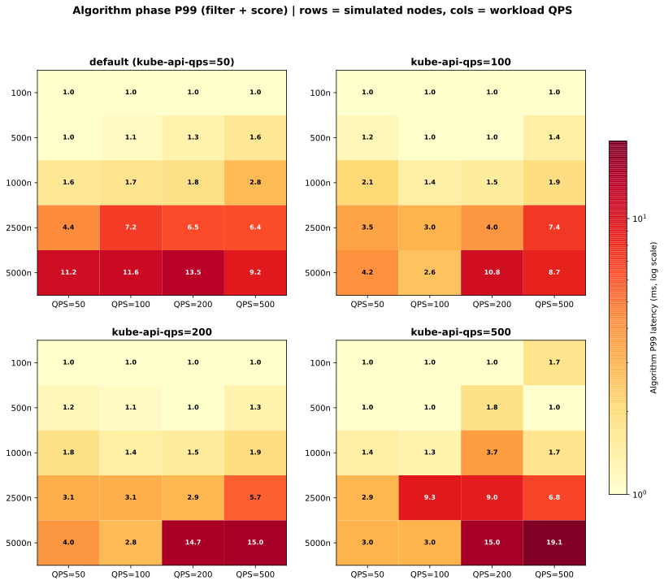
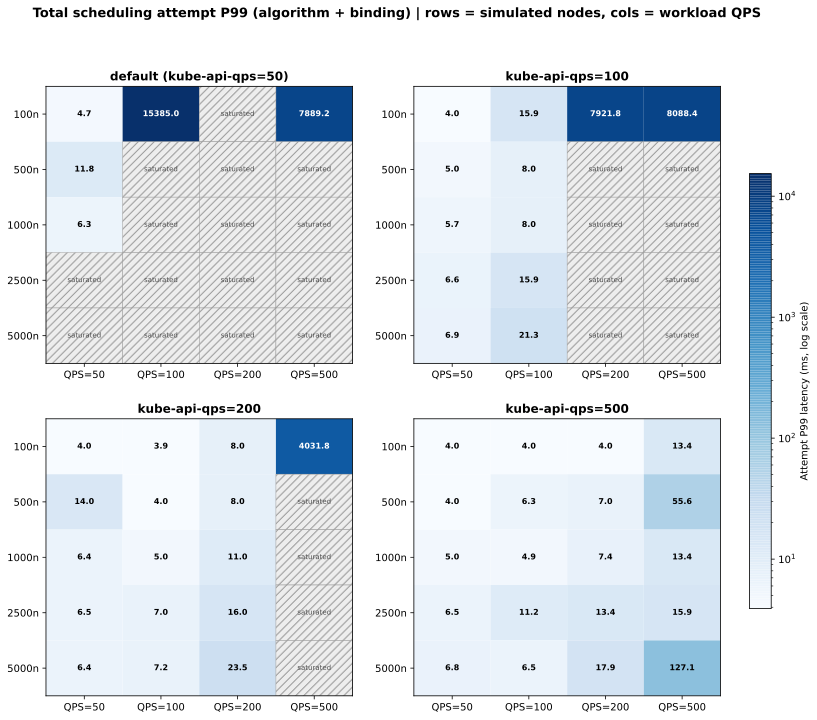
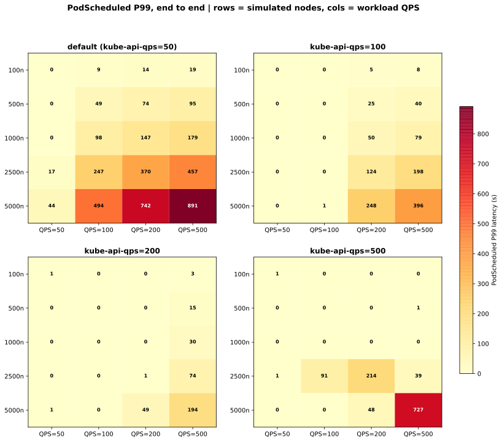
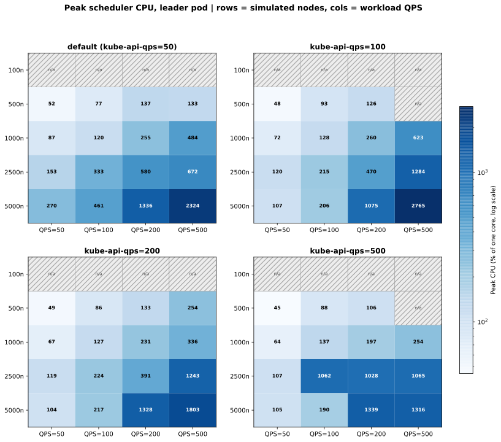
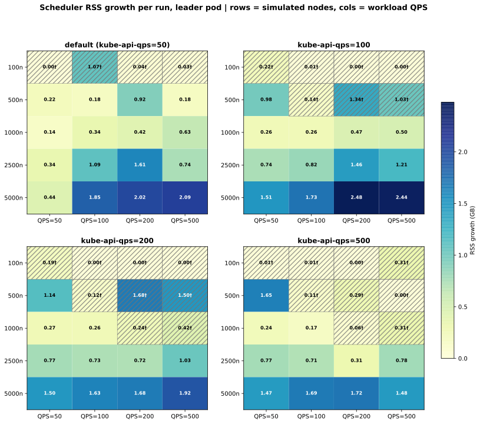
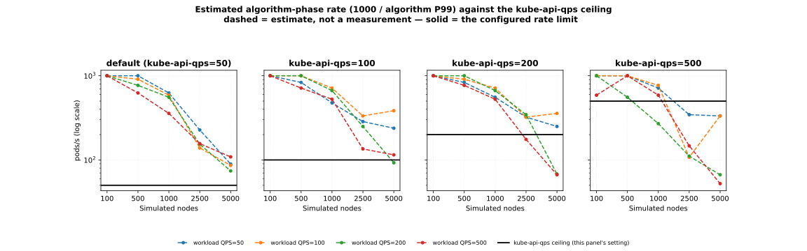

# Scheduler baseline — Kubernetes 1.34.2

## TL;DR

An 80-cell matrix — scheduler `kube-api-qps` [50, 100, 200, 500] × workload
submission QPS [50, 100, 200, 500] × [100, 500, 1000, 2500, 5000] simulated
nodes — shows that **through 1,000 nodes, the scheduler kept pace whenever its
`kube-api-qps` met the workload rate**: every such cell showed at most 1 s
PodScheduled P99, and every cell where it fell short queued.

At 2,500 and 5,000 nodes that no longer holds in every cell: several queued
despite an adequate rate limit, up to 727 s. Algorithm-phase P99 (filter +
score) stays at or near 1 ms through 500 nodes, rises to 3.7 ms at 1,000, and
peaks at **19.1 ms at 5,000 nodes**.

The practical consequence: run `kube-api-qps` at or above your expected
steady-state pod creation rate. Below it, pods queue for binding and
end-to-end PodScheduled latency grows with the gap — up to 891 s in the worst
cell measured.

**All 100–5,000 node counts here are KWOK fake nodes**, not machines. See
Environment.

## Scope of this publication

**Every node count in this result is simulated.** The runs executed on a
47-node cluster; the 100–5,000 "nodes" are KWOK fake nodes with no kubelet and
no container runtime behind them, and the pods scheduled onto them were pause
pods that never started. What is measured is the scheduler's decision and
binding path. Nothing here measures kubelet, image pull, container start, or
any real workload — a 5,000-node tier is 5,000 simulated nodes, and reading it
as 5,000 machines would be wrong.

**This is a characterization, not a pass/fail run.** There is no single
threshold across 80 cells. Cells where workload QPS exceeds the scheduler's
ceiling are *expected* to queue and show large PodScheduled latency; that
behaviour is the finding. See Acceptance gate for the three bars that do
apply.

**All 80 cells ran; none were dropped.** Where a cell shows no value it is
labelled with the reason:

| Marker | Meaning |
|---|---|
| `0` | PodScheduled P99 below one second — no measurable queue wait |
| `saturated` | Attempt-latency histogram backed up past its top bucket (16,384 ms). The recorded value is a floor, not a measurement. Read PodScheduled P99 for these cells. |
| `n/a` | Run too short for more than 2 Prometheus scrapes — CPU cannot be computed |
| `†` | 3 or fewer Prometheus scrapes — RSS growth is unreliable |

`kube-api-qps` here means the scheduler's client QPS, however it was set.

**Throughput is not tabulated per cell.** This page reads only PodScheduled
P99: a cell with no queue wait placed pods as fast as they were submitted, and
a cell that queued fell short of the workload rate. Through 1,000 nodes, cells
queued exactly when `kube-api-qps` was below the workload QPS; at larger tiers
the PodScheduled table shows where they queued regardless. The derived chart
below is computed from the algorithm-latency table on this page.

## Environment

| | |
|---|---|
| Real nodes | 47 — 3 control-plane, 42 worker, 2 monitoring |
| Simulated nodes | 100 / 500 / 1,000 / 2,500 / 5,000 per tier (KWOK) |
| Worker node | 128 cores, ~1007 GiB memory |
| Control-plane / monitoring node | 64 cores, ~377 GiB memory |
| CPU | AMD EPYC 9004 series |
| Kubernetes | 1.34.2 |
| CNI | OVN-Kubernetes, downstream build of upstream commit d5f19be |
| OVN | 25.09 |
| Open vSwitch | 2.17 |
| Container runtime | containerd 1.7.28 |
| OS / kernel | Ubuntu 22.04.4 LTS / 5.15.0-113-generic |
| etcd | 3.6.5 |
| Engine | kube-burner v2.7.0 |
| Node simulator | KWOK — not pinned by this scenario |

The real worker nodes carried the control plane and the load generator. They
did not run the scheduled pods; the fake nodes did.

Node-to-pod ratio is 1:10 throughout, so a tier of N nodes submits N × 10
pods: 1,000 pods at 100n up to 50,000 pods at 5,000n. Submission burst equals
QPS in every cell.

## Results summary

Rows are (simulated nodes, scheduler `kube-api-qps`); columns are workload
submission QPS. Each of the 80 cells is one kube-burner invocation.

### Algorithm phase P99 — filter + score (ms)

The scheduling cycle proper, excluding binding. This is the number that scales
with cluster size.

| Nodes | sched qps | QPS=50 | QPS=100 | QPS=200 | QPS=500 |
|---|---|---|---|---|---|
| 100 | 50 | 1.0 | 1.0 | 1.0 | 1.0 |
| 100 | 100 | 1.0 | 1.0 | 1.0 | 1.0 |
| 100 | 200 | 1.0 | 1.0 | 1.0 | 1.0 |
| 100 | 500 | 1.0 | 1.0 | 1.0 | 1.7 |
| 500 | 50 | 1.0 | 1.1 | 1.3 | 1.6 |
| 500 | 100 | 1.2 | 1.0 | 1.0 | 1.4 |
| 500 | 200 | 1.2 | 1.1 | 1.0 | 1.3 |
| 500 | 500 | 1.0 | 1.0 | 1.8 | 1.0 |
| 1000 | 50 | 1.6 | 1.7 | 1.8 | 2.8 |
| 1000 | 100 | 2.1 | 1.4 | 1.5 | 1.9 |
| 1000 | 200 | 1.8 | 1.4 | 1.5 | 1.9 |
| 1000 | 500 | 1.4 | 1.3 | 3.7 | 1.7 |
| 2500 | 50 | 4.4 | 7.2 | 6.5 | 6.4 |
| 2500 | 100 | 3.5 | 3.0 | 4.0 | 7.4 |
| 2500 | 200 | 3.1 | 3.1 | 2.9 | 5.7 |
| 2500 | 500 | 2.9 | 9.3 | 9.0 | 6.8 |
| 5000 | 50 | 11.2 | 11.6 | 13.5 | 9.2 |
| 5000 | 100 | 4.2 | 2.6 | 10.8 | 8.7 |
| 5000 | 200 | 4.0 | 2.8 | 14.7 | 15.0 |
| 5000 | 500 | 3.0 | 3.0 | 15.0 | 19.1 |

### Total scheduling attempt P99 — algorithm + binding (ms)

Dequeue to bound. Where the binding queue backs up past the histogram's top
bucket (16,384 ms) the cell reads `saturated`: the histogram cannot express
the value, so PodScheduled P99 is the authoritative number for those cells.

| Nodes | sched qps | QPS=50 | QPS=100 | QPS=200 | QPS=500 |
|---|---|---|---|---|---|
| 100 | 50 | 4.7 | 15385.0 | saturated | 7889.2 |
| 100 | 100 | 4.0 | 15.9 | 7921.8 | 8088.4 |
| 100 | 200 | 4.0 | 3.9 | 8.0 | 4031.8 |
| 100 | 500 | 4.0 | 4.0 | 4.0 | 13.4 |
| 500 | 50 | 11.8 | saturated | saturated | saturated |
| 500 | 100 | 5.0 | 8.0 | saturated | saturated |
| 500 | 200 | 14.0 | 4.0 | 8.0 | saturated |
| 500 | 500 | 4.0 | 6.3 | 7.0 | 55.6 |
| 1000 | 50 | 6.3 | saturated | saturated | saturated |
| 1000 | 100 | 5.7 | 8.0 | saturated | saturated |
| 1000 | 200 | 6.4 | 5.0 | 11.0 | saturated |
| 1000 | 500 | 5.0 | 4.9 | 7.4 | 13.4 |
| 2500 | 50 | saturated | saturated | saturated | saturated |
| 2500 | 100 | 6.6 | 15.9 | saturated | saturated |
| 2500 | 200 | 6.5 | 7.0 | 16.0 | saturated |
| 2500 | 500 | 6.5 | 11.2 | 13.4 | 15.9 |
| 5000 | 50 | saturated | saturated | saturated | saturated |
| 5000 | 100 | 6.9 | 21.3 | saturated | saturated |
| 5000 | 200 | 6.4 | 7.2 | 23.5 | saturated |
| 5000 | 500 | 6.8 | 6.5 | 17.9 | 127.1 |

### PodScheduled P99 — end to end (s)

kube-burner's own measurement, timed off the pod watch stream. `0` means no
measurable queue wait (sub-second). This is the metric to read when attempt
latency saturates.

| Nodes | sched qps | QPS=50 | QPS=100 | QPS=200 | QPS=500 |
|---|---|---|---|---|---|
| 100 | 50 | 0 | 9 | 14 | 19 |
| 100 | 100 | 0 | 0 | 5 | 8 |
| 100 | 200 | 1 | 0 | 0 | 3 |
| 100 | 500 | 1 | 0 | 0 | 0 |
| 500 | 50 | 0 | 49 | 74 | 95 |
| 500 | 100 | 0 | 0 | 25 | 40 |
| 500 | 200 | 0 | 0 | 0 | 15 |
| 500 | 500 | 0 | 0 | 0 | 1 |
| 1000 | 50 | 0 | 98 | 147 | 179 |
| 1000 | 100 | 0 | 0 | 50 | 79 |
| 1000 | 200 | 0 | 0 | 0 | 30 |
| 1000 | 500 | 0 | 0 | 0 | 0 |
| 2500 | 50 | 17 | 247 | 370 | 457 |
| 2500 | 100 | 0 | 0 | 124 | 198 |
| 2500 | 200 | 0 | 0 | 1 | 74 |
| 2500 | 500 | 1 | 91 | 214 | 39 |
| 5000 | 50 | 44 | 494 | 742 | 891 |
| 5000 | 100 | 0 | 1 | 248 | 396 |
| 5000 | 200 | 1 | 0 | 49 | 194 |
| 5000 | 500 | 0 | 0 | 48 | 727 |

### Peak scheduler CPU — leader pod (%)

Percent of one core. `n/a` marks runs too short for more than 2 Prometheus
scrapes.

| Nodes | sched qps | QPS=50 | QPS=100 | QPS=200 | QPS=500 |
|---|---|---|---|---|---|
| 100 | 50 | n/a | n/a | n/a | n/a |
| 100 | 100 | n/a | n/a | n/a | n/a |
| 100 | 200 | n/a | n/a | n/a | n/a |
| 100 | 500 | n/a | n/a | n/a | n/a |
| 500 | 50 | 52 | 77 | 137 | 133 |
| 500 | 100 | 48 | 93 | 126 | n/a |
| 500 | 200 | 49 | 86 | 133 | 254 |
| 500 | 500 | 45 | 88 | 106 | n/a |
| 1000 | 50 | 87 | 120 | 255 | 484 |
| 1000 | 100 | 72 | 128 | 260 | 623 |
| 1000 | 200 | 67 | 127 | 231 | 336 |
| 1000 | 500 | 64 | 137 | 197 | 254 |
| 2500 | 50 | 153 | 333 | 580 | 672 |
| 2500 | 100 | 120 | 215 | 470 | 1284 |
| 2500 | 200 | 119 | 224 | 391 | 1243 |
| 2500 | 500 | 107 | 1062 | 1028 | 1065 |
| 5000 | 50 | 270 | 461 | 1336 | 2324 |
| 5000 | 100 | 107 | 206 | 1075 | 2765 |
| 5000 | 200 | 104 | 217 | 1328 | 1803 |
| 5000 | 500 | 105 | 190 | 1339 | 1316 |

### Scheduler RSS growth per run — leader pod (GB)

Peak minus baseline within the run. `†` marks cells with 3 or fewer Prometheus
scrapes, where the run drained faster than the scrape interval and the figure
is unreliable.

| Nodes | sched qps | QPS=50 | QPS=100 | QPS=200 | QPS=500 |
|---|---|---|---|---|---|
| 100 | 50 | 0.00† | 1.07† | 0.04† | 0.03† |
| 100 | 100 | 0.22† | 0.01† | 0.00† | 0.00† |
| 100 | 200 | 0.19† | 0.00† | 0.00† | 0.00† |
| 100 | 500 | 0.01† | 0.01† | 0.00† | 0.31† |
| 500 | 50 | 0.22 | 0.18 | 0.92 | 0.18 |
| 500 | 100 | 0.98 | 0.14† | 1.34† | 1.03† |
| 500 | 200 | 1.14 | 0.12† | 1.68† | 1.50† |
| 500 | 500 | 1.65 | 0.11† | 0.29† | 0.00† |
| 1000 | 50 | 0.14 | 0.34 | 0.42 | 0.63 |
| 1000 | 100 | 0.26 | 0.26 | 0.47 | 0.50 |
| 1000 | 200 | 0.27 | 0.26 | 0.24† | 0.42† |
| 1000 | 500 | 0.24 | 0.17 | 0.06† | 0.31† |
| 2500 | 50 | 0.34 | 1.09 | 1.61 | 0.74 |
| 2500 | 100 | 0.74 | 0.82 | 1.46 | 1.21 |
| 2500 | 200 | 0.77 | 0.73 | 0.72 | 1.03 |
| 2500 | 500 | 0.77 | 0.71 | 0.31 | 0.78 |
| 5000 | 50 | 0.44 | 1.85 | 2.02 | 2.09 |
| 5000 | 100 | 1.51 | 1.73 | 2.48 | 2.44 |
| 5000 | 200 | 1.50 | 1.63 | 1.68 | 1.92 |
| 5000 | 500 | 1.47 | 1.69 | 1.72 | 1.48 |

### Throughput: what bounds it

Through 1,000 nodes, a cell queued exactly when the scheduler's
`kube-api-qps` was below the workload QPS. At 2,500 and 5,000 nodes, several cells
with an adequate rate limit still queued — see the PodScheduled table.

The chart below is **derived from the algorithm-latency table above**, not
measured separately. It plots 1000 / algorithm P99, in pods/s, against the
`kube-api-qps` ceiling. It is an estimate: P99 overstates a typical cycle,
and the algorithm phase excludes the rest of the scheduling cycle.

Where the dashed line sits above the solid one, the estimate shows the
scheduling cycle has headroom. That is the whole matrix at `kube-api-qps` 50,
and all but one cell at 100.

The two cross at the higher settings and the larger tiers. At `kube-api-qps`
200 the estimate first falls below the limit at 2,500 nodes (1000 / 5.7 ms ≈ 175
pods/s) and drops to 67 pods/s at 5,000; at 500 it does so from 1,000 nodes
upward, reaching its lowest point at 5,000 nodes — 1000 / 19.1 ms ≈ 52 pods/s.
In those cells the PodScheduled table is the measurement to read.

## Acceptance gate

This is a characterization; there is no aggregate pass/fail. Three bars from
the scenario's `slo` block apply per cell:

| Metric | Gate | Result |
|---|---|---|
| `pod_scheduled_p99_s` | ≤ 600 s (`error`) | **Fail in 3 of 80 cells** — see below |
| `scheduler_error_attempts_per_s` | ≤ 0 (`error`) | **Pass** — no attempts returned `error` in any cell |
| `algorithm_p99_ms` | ≤ 20 ms (`warning`) | **Pass** — worst cell 19.1 ms |

**Three cells breach `pod_scheduled_p99_s`**, and they are reported rather
than omitted:

| Cell | PodScheduled P99 |
|---|---|
| 5000n / sched=50 / QPS=500 | 891 s |
| 5000n / sched=50 / QPS=200 | 742 s |
| 5000n / sched=500 / QPS=500 | 727 s |

The first two are cells where workload QPS is ten and four times the
scheduler's ceiling — the queue behaviour the matrix exists to characterize,
not a scheduler fault. The third is *not* explained by rate mismatch and is
discussed in Observations.

All three cells fail the gate. The gate is set at kube-burner's configured
10 m threshold, which is deliberately loose because the matrix sets out to
produce queueing; the first two exceed it for that reason, the third does not.

## Observations

### Through 1,000 nodes, queueing follows the client-side rate limit

Through 1,000 nodes, whether a cell queued depends only on the rate limit:
cells that met the workload rate showed at most 1 s PodScheduled P99 and cells
short of it queued, whatever the node count. That is the signature of a
configured rate limit rather than a resource constraint. At 2,500 and 5,000 nodes it no longer holds in every cell. For a
tenant cluster, set `kube-api-qps` to the expected steady-state pod creation
rate.

### Algorithm latency tracks node count, not rate

Algorithm P99 sits at 1.0–1.8 ms through 500 nodes regardless of either QPS
axis, first moves at 1,000 nodes, and reaches 19.1 ms at 5,000. The driver is
the node snapshot the scheduler refreshes at the start of each scheduling
cycle: a larger candidate set costs more to filter and score.

At 5,000 nodes, the effect of raising scheduler QPS depends on the workload
rate. At the two higher rates, raising it from 100 to 500 makes algorithm
latency worse — 10.8 → 14.7 → 15.0 ms at QPS=200 and 8.7 → 15.0 → 19.1 ms at
QPS=500 — which is consistent with more concurrent binding goroutines
contending on the snapshot refresh. At QPS=50 the opposite happens: 11.2 →
4.2 → 4.0 → 3.0 ms across the four settings.

### At workload QPS 500, CPU falls as scheduler QPS rises past 100

At 5,000 nodes and workload QPS 500, peak CPU is 2,765% at `kube-api-qps` 100
but 1,316% at 500 — the higher setting uses less CPU. The scheduler dispatches
each binding as its own goroutine. At a low rate limit, many goroutines
compete for few permitted requests per second and the Go runtime's scheduling
overhead dominates. Raising the limit drains them faster and concurrency
drops. Setting `GOMAXPROCS` is not recommended at these cluster sizes; it
risks stalling request processing.

### RSS growth tracks pods in flight

Reliable RSS growth runs from 0.14 GB (1,000n, low rate) to 2.48 GB (5,000n,
sched=100, QPS=200), scaling with the number of pods queued rather than with
node count alone. **Scheduler memory limits cannot be set from this
characterization**: they depend on workload volume, cluster size and any
out-of-tree plugins, none of which this run varies.

### The 2,500-node cells at kube-api-qps 500 are anomalous

The 2,500-node row at `kube-api-qps` 500 is flat at roughly 1,050% CPU across
QPS 100, 200 and 500 — 1,062%, 1,028% and 1,065% — where the same tier at
`kube-api-qps` 200 rises with load, 224% → 391% → 1,243%. A CPU figure that
does not move with the workload rate is the anomaly; two of the three are far
above their neighbours and the third is below.

In the same row, PodScheduled P99 reaches 91 s and 214 s at QPS 100 and 200 —
rates *below* the scheduler's configured ceiling, where every cell through
1,000 nodes shows at most 1 s. A Prometheus scrape artifact would
account for the CPU figures but not for these: PodScheduled latency comes from
kube-burner's watch stream, not from Prometheus. The 5000n / sched=500 /
QPS=500 cell at 727 s may be the same effect one tier up.

This tier is also where KWOK node readiness becomes fragile: without tuning the
controller's lease and status update rate, fake nodes flip Ready/NotReady and
inflate the unschedulable queue. A node-readiness disturbance would produce
exactly this signature, and the scenario README treats KWOK tuning at this tier
as a prerequisite for that reason.

Treat this block as unexplained rather than as a scheduler property.

### Short runs at small tiers cannot report resources

Every 100-node cell reports `n/a` for CPU: at 1,000 pods and 50+ pods/s the run
completes in under 30 s, which is fewer than 3 Prometheus scrapes. RSS is
affected further up: all 16 cells at 100 nodes are flagged unreliable, along
with 9 of 16 at 500 nodes and 4 of 16 at 1,000. Nothing at 2,500 or 5,000
nodes is affected — those runs are long enough. This is a
measurement-window limitation, not a property of the scheduler — a reader
replicating this scenario at small tiers should either lengthen the run or
accept that resource figures start at 500 nodes.

### Reading the latency ranges

Two quantities scale differently and are easy to conflate.

**Algorithm P99** is bounded by node count. It sits at 1.0–1.8 ms through 500
nodes, reaches 3.7 ms at 1,000, and tops out at 19.1 ms at 5,000 — the range
widens with the candidate set, not with either rate.

**Attempt P99 at matched rates** — scheduler `kube-api-qps` equal to workload
QPS — is not a single range. At 100 and 200 it stays within 8–24 ms at every
node tier. At 500 it reaches 55.6 ms (500 nodes) and 127.1 ms (5,000). At 50
the 2,500- and 5,000-node cells saturate, so no value exists to quote.
