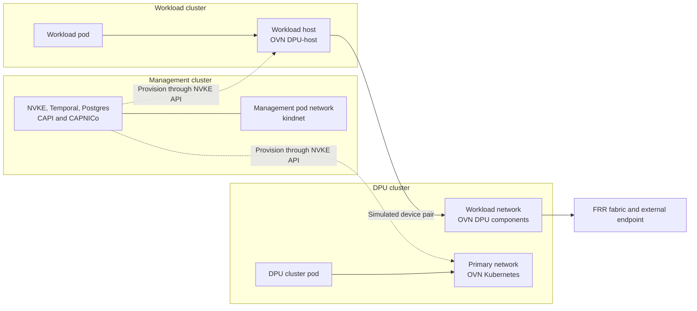
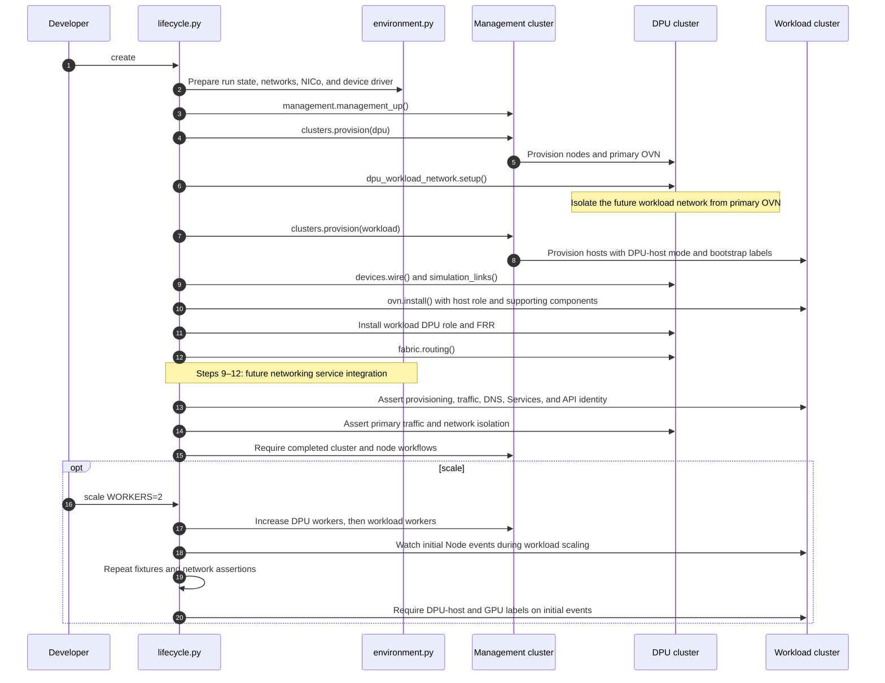
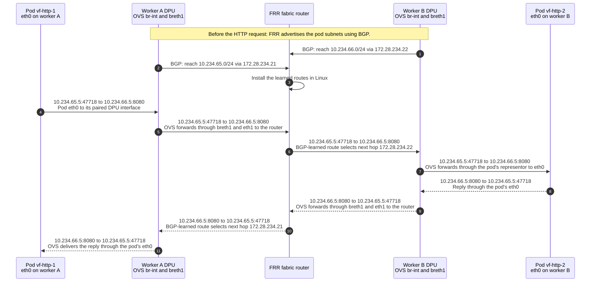
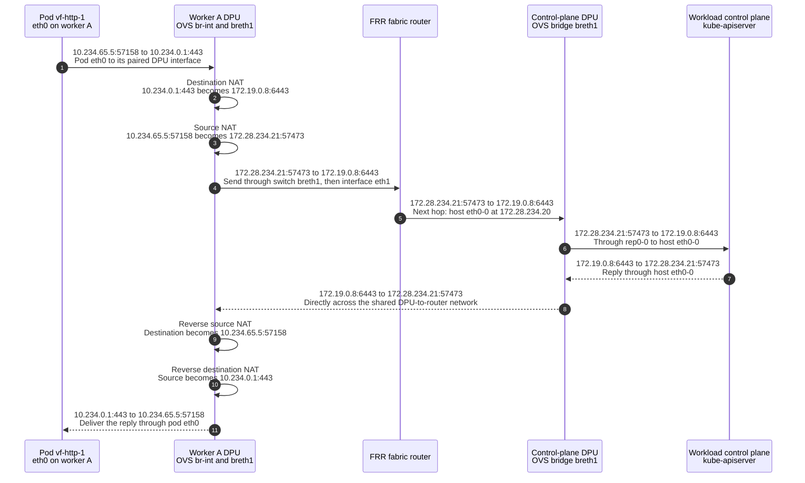

# nais-dpu-sim

NAIS stands for NVIDIA AI Infrastructure SDN, a software stack for software-defined networking.

A DPU is a processor that handles host networking.

`nais-dpu-sim` provisions workload and DPU clusters through the NVKE API and installs the NAIS networking components used by this simulation.

The workload cluster uses OVN no-overlay pod networking, with traffic between hosts routed through paired DPUs and the fabric instead of GENEVE tunnels.

Managed control-plane isolation can be built on top of this simulation.
The current workload control-plane host remains a Kubernetes Node and shares the simulated network with workers.

## Why upstream OVN-kubernetes over NVIDIA OVN-kubernetes

This simulation selects [upstream OVN-Kubernetes](https://github.com/ovn-kubernetes/ovn-kubernetes) because the compared [NVIDIA downstream code](https://github.com/dsx-ai-factory/ovn-kubernetes) still expects physical NIC details during pod setup.
NIC means network interface card.
The simulator connects hosts and DPUs with veth pairs, software cables with two interfaces.

- During [host device discovery](https://github.com/dsx-ai-factory/ovn-kubernetes/blob/b2d0eaa65375970d6edb0dc8978b2f662e0d2daf/go-controller/pkg/cni/cni_dpu.go#L36-L64), NVIDIA OVN asks for the physical parent card's PCI address and MAC address. A veth interface has its own MAC address, but no physical parent card to report.
- During [DPU pod matching](https://github.com/dsx-ai-factory/ovn-kubernetes/blob/b2d0eaa65375970d6edb0dc8978b2f662e0d2daf/go-controller/pkg/node/base_node_network_controller_dpu.go#L45-L68), NVIDIA OVN compares that parent card's MAC address with the physical card addresses known to the DPU. The simulator has no physical card address for this comparison.
- During [DPU port setup](https://github.com/dsx-ai-factory/ovn-kubernetes/blob/b2d0eaa65375970d6edb0dc8978b2f662e0d2daf/go-controller/pkg/node/base_node_network_controller_dpu.go#L338-L377), NVIDIA OVN programs the hardware port's peer MAC address and, when configured, hardware rate limits. A veth pair has no hardware port that accepts those commands.

OVN upstream [identifies simulated devices by interface names](https://github.com/ovn-kubernetes/ovn-kubernetes/blob/d6a3812d1bc1c36bf24c7eda0e86e9b13d84907d/go-controller/pkg/util/dpuops_linux.go#L347-L560), such as `eth0-4` and `rep0-4`.
[inputs.json](inputs.json) pins the published upstream v1.4.0 image and matching chart source, without local OVN patches.
The simulation tests upstream software behavior. NVIDIA release compatibility and physical hardware offload require separate tests.

## Cluster and network architecture

`nais-dpu-sim` creates a management cluster, a workload cluster, and a DPU cluster.
The repository's `kind-up` target creates the management cluster with the [shared Kind configuration](../controller-capi-kind.yaml) used by backend CI.
NVKE runs in the management cluster and provisions the workload and DPU clusters through its API.

The DPU cluster runs its own primary network plus `ovnkube-node-dpu` pods that configure networking for paired workload hosts.
OVS is Open vSwitch, the software switch that forwards packets.
When a workload pod starts, the host records its assigned device in a pod annotation, a Kubernetes metadata field.
The [DPU controller](https://github.com/ovn-kubernetes/ovn-kubernetes/blob/d6a3812d1bc1c36bf24c7eda0e86e9b13d84907d/go-controller/pkg/node/controllers/dpu/dpu_util.go#L81-L351) reads that annotation, finds the matching `rep0-*` interface, and attaches it to the DPU's OVS bridge `br-int`.

`ovnkube-controller` converts workload Pods, Services, and NetworkPolicies into OVN network configuration.
[`ovn-northd` and `ovn-controller`](https://github.com/ovn-kubernetes/ovn-kubernetes/blob/d6a3812d1bc1c36bf24c7eda0e86e9b13d84907d/docs/design/architecture.md#L28-L58) compile that configuration into rules that OVS uses to forward packets.

| Cluster | Networking | Helm configuration |
|---|---|---|
| Management | kindnet for management pods, with kube-proxy for Services | [Shared Kind configuration](../controller-capi-kind.yaml), without a CNI Helm values file |
| Workload | ovn-kubernetes in DPU-host mode, with pod networking handled by paired DPUs | [values-workload-host.yaml](charts/values-workload-host.yaml) |
| DPU | ovn-kubernetes for the DPU cluster's own pods | [values-dpu-primary.yaml](charts/values-dpu-primary.yaml) |
| DPU | ovn-kubernetes DPU components for the workload cluster, with routed networking through the fabric | [values-dpu-workload.yaml](charts/values-dpu-workload.yaml) |



Dashed arrows show provisioning through the NVKE API.
The solid arrows show how pods connect to their networks and the fabric.

[dpu_workload_network.py](simulator/dpu_workload_network.py) separates the DPU's workload network from its primary network with a dedicated Linux network namespace.
A network namespace is an isolated set of Linux interfaces.
Each network has its own OVS database and sockets.

[charts.py](simulator/charts.py) pairs each values file with its upstream Helm base configuration and expected components.
The `chart-check` command makes sure that the rendered components and pinned images match that configuration.

## Read the code in this order

The root [nais-dpu-sim.py](nais-dpu-sim.py) calls the command entry point in `cli.py`.

| Order | Module | What to read there |
|---|---|---|
| 1 | [cli.py](simulator/cli.py) and [lifecycle.py](simulator/lifecycle.py) | Commands, initial cluster preparation, and cleanup |
| 2 | [environment.py](simulator/environment.py), [config.py](simulator/config.py), and [charts.py](simulator/charts.py) | Build inputs, run state, Docker networks, NICo, and the device-wiring container |
| 3 | [management.py](simulator/management.py) and [clusters.py](simulator/clusters.py) | Management bootstrap, API requests, node discovery, and exported access |
| 4 | [devices.py](simulator/devices.py) and [dpu_workload_network.py](simulator/dpu_workload_network.py) | Simulated device pairs, uplinks, and isolation between DPU networks |
| 5 | [ovn.py](simulator/ovn.py) and [fabric.py](simulator/fabric.py) | Component installation, device resources, credentials, and routing |
| 6 | [validation.py](simulator/validation.py) and [traffic.py](simulator/traffic.py) | Provisioning and OVN runtime checks in `validation.py`, with all traffic probes and packet capture in `traffic.py` |
| 7 | [runtime.py](simulator/runtime.py) | Shared run state and access through Docker, Kubernetes, and the NVKE API |

[resume.py](simulator/resume.py) handles recovery of retained runs.
[scale.py](simulator/scale.py) adds workers and updates saved DPU records.

[workloads.py](simulator/workloads.py) holds the small HTTP server used by traffic assertions.
[inputs.json](inputs.json) pins the source revisions and images used by the build.
[tools/fabric-capture.py](tools/fabric-capture.py) observes packets at the router.
The [images](images) directory holds Dockerfiles, and the [Makefile](Makefile) owns the build steps.

## Follow the provisioning sequence

The NVKE API saves each cluster and its workflow request together. A queue processor starts provisioning through Temporal.
The node agent registers hosts with DPU-host and node-pool labels, then installs OVN with `nvke.ovnDpuHost=true`.
This mode skips host OVS setup and kube-proxy installation.
The simulator configures the paired DPUs and routing before waiting for workload nodes to become Ready.



For steps 9–12, the proposed integration lets NVKE request workload networking from a networking service and wait for completion.
In production, the proposed service coordinates these operations:

- Read NICo's host/DPU inventory and identify each host physical function (PF), its virtual functions (VFs), and their matching interfaces on the DPU. Each host VF connects to its corresponding DPU representor, the interface that OVS uses to forward that VF's traffic.
- Prepare the host VFs for allocation to pods and configure the DPU representors and uplinks. Coordinate host preparation with the NVKE node agent and device provisioning with NICo/DPF.
- Create a DPF `DPUService` to deploy the workload OVN components on the assigned DPUs. Supply the workload cluster's API endpoint and credential references so those components can watch its Pods, Services, and NetworkPolicies.
- Install FRR and `frr-k8s` on the assigned DPUs, with access to routing configuration in the workload cluster. Create base `FRRConfiguration` objects with fabric peer addresses and routing parameters, plus `RouteAdvertisements` to select pod networks for advertisement.

Today, `lifecycle.py` calls the local setup functions directly. A future mock service can expose them through the proposed interface.

See [development.md](development.md) for host preparation, builds, manual runs, and cleanup.

## Workload network interfaces

```text
       Workload host                         Paired DPU
..........................    ...................................................
:                        :    :                                                 :
: [Pod: eth0] -----------:----: rep0-N --> [OVS br-int]                         :
:                        :    :                  |                              :
:                        :    :                  v                              :
: eth0-0  ---------------:----: rep0-0 --> [OVS breth1] --> eth1 ---------------:--> fabric router
:                        :    :                                                 :
:........................:    :.................................................:
                                                                  Shared DPU-to-router network
```

The fabric router is a Docker container that runs FRR routing software.
It represents a router in the physical network that connects production machines.

The shared DPU-to-router network is the Docker network `172.28.234.0/24` that connects the DPUs and the fabric router.
Each DPU has an OVS software switch named `breth1`.
That switch connects its paired host to the shared DPU-to-router network.
The control-plane DPU has the same arrangement as the worker's DPU.

The top cable connects the pod's `eth0` to its DPU representor, shown as `rep0-N`.
The number `N` depends on the allocated device.
OVS forwards the pod's traffic through `br-int` to switch `breth1` and interface `eth1`.

The bottom cable connects the host to the shared DPU-to-router network through the reserved pair `eth0-0` and `rep0-0`.

The pod's `eth0` is inside the pod's network namespace.
The host's `eth0-0` is inside the worker host's root network namespace.

## Follow a packet between workload pods

### Source and destination applications

Pod `vf-http-1` on worker A sends an HTTP request to pod `vf-http-2` on worker B.
Both are test pods that run small HTTP servers.
For this request, the simulator runs a client command inside `vf-http-1` and connects directly to `vf-http-2` on port `8080`.

| Component | Example address | Purpose |
|---|---|---|
| Pod `vf-http-1`, worker A | `10.234.65.5` | Sends the request from its `eth0` |
| Pod `vf-http-2`, worker B | `10.234.66.5` | Receives the request on its `eth0`, port `8080` |
| Worker A host interface `eth0-0` | `172.28.234.21` | Next hop toward worker A's pod subnet |
| Worker B host interface `eth0-0` | `172.28.234.22` | Next hop toward worker B's pod subnet |
| FRR router interface `eth0` | `172.28.234.254` | Connects the router to the shared DPU-to-router network |

### How FRR learns where the pods are

BGP is a protocol that routers use to exchange routes to IP networks.
The simulator creates a `RouteAdvertisements` resource that selects the workload cluster's pod network.
OVN generates routing configuration for those pod subnets, and `frr-k8s` applies it to FRR on the DPUs.
FRR on each DPU advertises its host's pod subnet and next-hop address to the fabric router.

The fabric router learns these routes through BGP and installs them in its Linux routing table:

```text
10.234.65.0/24 via 172.28.234.21 dev eth0 proto bgp
10.234.66.0/24 via 172.28.234.22 dev eth0 proto bgp
```

The first route tells the router how to reach pods on worker A.
The second tells it how to reach pods on worker B.
`proto bgp` identifies BGP as the source of each route.
These routes exist before the application sends its request.
The router's Linux network stack uses them to forward application packets.

### Packet lifecycle

The request starts as `10.234.65.5:47718` to `10.234.66.5:8080`.
The source port `47718` identifies this client connection and changes between connections.
The destination matches worker B's advertised subnet, `10.234.66.0/24`.
The fabric router therefore forwards the packet toward `172.28.234.22`.
That next-hop address selects where to forward the packet. Its destination remains the pod at `10.234.66.5:8080`.



The pod IP addresses and ports remain unchanged throughout each direction. This path uses no NAT or GENEVE tunnel.

## Follow a packet from a workload pod to kube-apiserver

The same pod, `vf-http-1` on worker A, now sends an HTTPS request to the workload cluster's API Service.
This path adds Service address translation and a static route to the control-plane host.

| Component | Example address | Meaning |
|---|---|---|
| API Service | `10.234.0.1:443` | The workload cluster's `kubernetes` Service |
| API endpoint | `172.19.0.8:6443` | kube-apiserver on the workload control-plane host |
| Control-plane host interface `eth0-0` | `172.28.234.20` | The control-plane host's `eth0-0` address |

NAT means network address translation, which changes packet addresses or ports.
Destination NAT replaces the Service address with the actual API endpoint.
Source NAT replaces the pod's source IP and port with `172.28.234.21:57473`.
The DPU records these translations and reverses them for replies.

[fabric.py](simulator/fabric.py) installs a static route to the API endpoint through the control-plane host's `eth0-0` address:

```sh
ip route replace 172.19.0.8/32 via 172.28.234.20 dev eth0
```



The reply's destination, `172.28.234.21`, is on the shared DPU-to-router network, so the control-plane host can reach it without the fabric router.

NAT preserves the pod's TLS connection. The pod sees the API Service address, `10.234.0.1:443`, as the responder.
