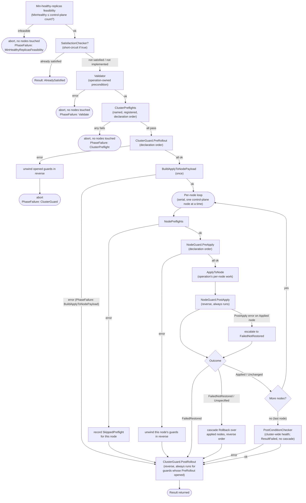

# rollout — the control-plane rollout executor

`internal/rollout/` runs a single configuration change across the
control-plane nodes of a Kubernetes cluster **safely**: one node at a
time, with health checks before and around each change, and automatic
rollback if a node ends up in a bad state.

You bring the *operation* — the actual per-node work, e.g. "write this
apiserver auth config and confirm the apiserver comes back healthy." The
executor brings the *sequencing*: ordering, preflight gates, guards, a
min-healthy-replicas feasibility check, rollback, and a structured result
you can act on.

> **First time here?** Read the four sections in order: **Concepts** →
> **Writing an operation** → **What the executor does** → **How failures
> travel**. The last one explains the one genuinely subtle part of the
> system; it assumes no Temporal knowledge.

---

## Concepts (the cast)

| Term | What it is |
|---|---|
| **Operation** | The work you supply. Must know its `Name` and how to `ApplyToNode` a single node. Everything else is optional (see below). |
| **Capability** | An optional thing an operation can also do — build a shared payload, check if the work is already done, validate, roll back, check a post-condition. You add one by implementing an interface; `Compile` auto-detects it. |
| **Preflight** | A named, registered check that can refuse to proceed. *Cluster* preflights run once up front; *node* preflights run per node. A refusal stops things **before** any change is made. |
| **Guard** | A named, registered "bracket" around a change: a `Pre` step before and a `Post` step after, with the `Post` steps running in reverse order. Use them to open/close a maintenance window, silence alerts, drain/uncordon, etc. The kube-vip drain/restore guard lives in `guards/kubevip/`. |
| **Outcome** | The per-node verdict your operation returns (`OutcomeApplied`, `OutcomeUnchanged`, `OutcomeFailedRestored`, …). **The executor makes every decision off this enum** — see the table further down. |
| **RolloutSpec** | The declarative "how": the strategy, how many control-plane replicas must stay healthy, the rollback policy, and the names of the preflights/guards to run. |
| **Executor** | `temporal.Execute(...)` — the engine that walks the operation across the cluster according to the spec and returns a `Result`. It runs inside a Temporal workflow body. |
| **Result** | The structured outcome: an overall `Status`, an optional cluster-scope `PhaseFailure`, and every touched node (partition with the `Applied()` / `Unchanged()` / `Failed()` accessors). Call `Result.Err()` to get a plain Go `error` for the failure cases. |

### File layout

| Path | What's there |
|---|---|
| `*.go` (this package) | Pure interfaces and value types — `Operation`, `Outcome`, `RolloutSpec`, `Result`, plus the preflight/guard/registry vocabulary. No Temporal or DB imports; this is the vocabulary. |
| `temporal/` | The production executor. `temporal.Execute(...)` is the entry point, called from a workflow body. (Why Temporal matters for *error handling* is explained below — you don't need to understand Temporal to write an operation.) |
| `adapters/cwe/` | Glue that makes CWE's `db.Cluster`/`db.Node` satisfy the interfaces here. `Loader` loads a cluster and its node inventory from postgres; the node adapters carry the node-agent endpoint. |
| `nodeagent/` | The SPIFFE-mTLS `Dialer` the adapters, preflights, and operations use to reach each node's node-agent. |
| `preflights/` | The registered default preflights: node-agent-reachable and kube-API-healthy (cluster scope), node-agent-ready and node-agent-version (node scope). |
| `guards/kubevip/` | The kube-vip drain/restore node guard. |
| `operations/dryrun/` | `DryRunOperation` — a reference operation that implements *every* optional capability but mutates nothing (`ApplyToNode` returns `OutcomeUnchanged`). It exercises every code path and is the model to copy when writing a new operation. |
| `operations/etcd/` | The etcd-encryption operations — the framework's **first live consumer**. |
| `operations/oidc/` | The OIDC-enable operation. |

---

## Writing an operation

**1. Implement the required core** (`Operation`):

```go
func (o *MyOp) Name() string { return "my-op" }

func (o *MyOp) ApplyToNode(ctx context.Context, node rollout.Node, payload rollout.ApplyToNodePayload) (rollout.Outcome, error) {
    // do the per-node work; return the Outcome that describes what happened.
}
```

**2. Optionally implement any of these** — `Compile` auto-detects
whichever you provide:

| Implement… | …to get | Runs |
|---|---|---|
| `ApplyToNodePayloadBuilder` | a payload built **once** and handed byte-identical to every node | before the per-node loop |
| `SatisfactionChecker` | a fast "already done?" short-circuit | first; if true, no node is touched |
| `Validator` | an operation-owned precondition | before cluster preflights |
| `RollbackHandler` | the framework's undo across **already-applied** nodes during a cascade — distinct from an operation self-restoring one node (`OutcomeFailedRestored`) | only on cascade |
| `PostConditionChecker` | a final cluster-wide health check | after the last node |

**3. Wrap and run:**

```go
op := rollout.Compile(&MyOp{})       // auto-wires whatever capabilities MyOp implements
result, err := temporal.Execute(ctx, cluster, op, spec)
// Simplified. Execute runs inside a Temporal workflow: `ctx` is a
// workflow.Context and production callers pass it through
// WithRolloutNodeAgentApplyOptions — see "Using it from a workflow" below.
```

Adding a capability later is backward-compatible — implement the
interface and `Compile` picks it up on the next call. Nothing else
changes.

---

## What the executor does

It walks the operation across the cluster in a fixed sequence, gating at
each step. Anything that fails **before** a node is touched aborts
cleanly with nothing changed; once nodes are being changed, an
unrecoverable failure triggers a reverse-order rollback.



> **Min-healthy-replicas is an entry-time feasibility gate only.** It is
> checked once, before any node is touched (`MinHealthy ≤ control-plane
> count?`), and never re-evaluated mid-loop — a healthy `Applied`/`Unchanged`
> node always advances. Availability *during* the roll is protected by the
> per-node health verification inside `ApplyToNode` and the guards, not by a
> running quorum recount.

### The Outcome is the steering wheel

Your operation's per-node `Outcome` is what the executor branches on —
not the error it returns alongside it. (Why that distinction matters is
the subject of the next section.)

| Outcome | Meaning | Executor's reaction |
|---|---|---|
| `OutcomeApplied` | change made, node verified healthy | advance to the next node |
| `OutcomeUnchanged` | node already in desired state | advance; counts as healthy, same as `OutcomeApplied` |
| `OutcomeFailedRestored` | apply failed, but the operation put the node back itself | **halt**, no cascade under the default `CascadeOnUnrecoverable` policy (the cluster is coherent); **cascades** under `HaltOnAnyFailure` |
| `OutcomeFailedNotRestored` | apply failed **and** restore failed — node state unknown | **cascade**: roll back already-applied nodes in reverse |
| `OutcomeSkippedPreflight` | a node preflight refused; node never touched | halt, no cascade |
| `OutcomeUnspecified` (zero value) | operation returned without setting an outcome | treated as unknown → cascade. **Fail-closed: silence can't masquerade as success.** |

> **Self-restore vs. cascade rollback — two different layers.**
> `OutcomeFailedRestored` is the *operation* recovering a single node on
> its own (it reverted its own half-done change). The `RollbackHandler` is
> the *framework* undoing the change across the nodes that **already
> applied successfully**, and it runs only on a **cascade**. A cascade is
> triggered by `OutcomeFailedNotRestored` or `OutcomeUnspecified` under any
> policy — and, under the `HaltOnAnyFailure` rollback policy, by *any*
> failure including a clean `OutcomeFailedRestored`. Under the default
> `CascadeOnUnrecoverable` policy a clean `OutcomeFailedRestored` halts
> without cascading. The two layers are independent: an operation may
> implement either, both, or neither.

---

## How failures travel (the one subtle part)

This is where the system needs a moment of explanation, because failures
don't move the way they would in an ordinary Go program. You don't have
to be a Temporal expert to write a correct operation — you just have to
know the two rules below and the decision they imply.

### Why it's not an ordinary function call

The executor splits into two roles:

- a **worker** that actually touches the world — dials the node-agent,
  edits the apiserver config (in Temporal terms, an *activity*); and
- a **coordinator** that decides what to run next and reacts to results,
  but never touches the world itself (a *workflow*).

The coordinator's defining feature is that it must be able to **resume
after a crash** — possibly on a different machine. To make that possible,
every result the worker hands back is **written down as plain
bytes/JSON** and later **read back**. Think of it as a logbook the
coordinator can replay.

That write-down/read-back step has two consequences that drive the whole
error design:

1. **A Go `error` doesn't survive the trip intact.** What gets written
   down is its **message text** (plus an optional short **code** you
   attach on purpose). The concrete error *type and its fields are lost*
   — on the way back you get a generic error, so `errors.As(&MyError{})`
   will not find your type. (Plain data — an `int`, a `string`, a struct
   of plain fields — survives perfectly.)

2. **You can't return a result *and* an error together.** If the worker
   hands back an error, its result value is **thrown away**. It's one or
   the other.

### The two lanes

Because of those two rules, "something went wrong" travels in one of two
lanes, and they mean different things:

**Lane 1 — return the `error`.** Meaning: *"I couldn't produce an
answer."* Environmental/infrastructure trouble — couldn't dial the agent,
couldn't load the cluster, timed out. This is the lane the system watches
for **retries**. You tag it:
- transient (a blip) → let it retry;
- pointless to retry (a misconfiguration, e.g. preflight not registered)
  or *dangerous* to retry (a cleanup/rollback step — retrying could act
  on a half-restored node) → mark it non-retriable.

**Lane 2 — return `(response, nil)` and put the failure detail in a field
on the response.** Meaning: *"I ran, and the business answer is: it
failed — here's what happened."* This lane exists precisely because of
rule #2: the verdict you need to keep (the `Outcome`, any partial state
for cleanup) lives in the **response**, so it must **not** ride the error
return, or it would be thrown away.

Inside that response, the structured parts stay structured — `Outcome`
is still an enum, guard state is still bytes, and they round-trip fine.
**Only the error itself is reduced to a string** (`ApplyErr`,
`BuildErr`, …), because the error is the one thing that can't survive the
trip. That string is informational (it shows up in logs and the final
error message); nothing branches on it — the branching is done off the
`Outcome` enum.

### So, as an operation/activity author, which lane?

> **No meaningful result to preserve on failure?** Use a plain `error`
> (Lane 1). Failure is just failure.
>
> **A result you need to keep even on failure** (an `Outcome`, partial
> state)? Return `(response, nil)` and put the error message in a string
> field on the response (Lane 2). Never put a result you care about in
> the same return as a non-nil error.

A concrete example — the `ApplyToNode` activity:

```go
func (a *Activities) ApplyToNode(ctx, req) (*ApplyToNodeResponse, error) {
    op, cluster, err := a.resolve(...)
    if err != nil { return nil, err }            // Lane 1: couldn't even start

    outcome, applyErr := op.ApplyToNode(...)      // it ran — verdict is `outcome`
    resp := &ApplyToNodeResponse{Outcome: outcome}
    if applyErr != nil {
        resp.ApplyErr = applyErr.Error()          // Lane 2: keep the verdict, stringify the detail
    }
    return resp, nil                              // (resp, nil) so the Outcome survives
}
```

Note what's *not* here: the operation never reports "which node, how far
we got." That's assembled by the coordinator as it loops and collects
each node's result into the final `Result`.

### What the caller sees

All of that is internal. As a caller (inside a workflow body — see the
next section for the exact form) you get a clean two-step:

```go
result, err := temporal.Execute(ctx, cluster, op, spec)
if err != nil {
    // Setup/programmer error before the rollout could meaningfully begin
    // (bad spec, operation not registered). The rollout did not run.
    return err
}
if err := result.Err(); err != nil {
    // The rollout ran and did not finish successfully. `result` still has
    // the full per-node breakdown for reporting.
    log.Warn("rollout failed", "err", err)
}
```

- `Result.Err()` returns `nil` for `ResultCompleted` and
  `ResultAlreadySatisfied`, and a `*RolloutError` for everything else.
- **`PhaseFailure != nil`** → a cluster-scope phase aborted the rollout.
  `Phase` is one of the seven `Phase*` constants (`PhaseMinHealthyReplicas`
  = `"MinHealthyReplicasFeasibility"`, `PhaseSatisfactionCheck`,
  `PhaseValidate`, `PhaseClusterPreflight`, `PhaseClusterGuard`,
  `PhaseBuildApplyToNodePayload`, `PhasePostCondition` =
  `"ClusterPostCondition"`); `Name` is the failing preflight/guard for
  the named phases.
- **`Failed()`** → real per-node failures only (each has a real
  `NodeID`/`NodeName`). A cluster-scope abort does **not** invent a node
  entry — though `Failed()` may hold genuine entries from a cascade
  rollback that ran after the trigger.

---

## Using it from a workflow / registering in production

A `Registry` holds the operations/preflights/guards; one
activity-registration call then wires every operation onto the worker (you
do not register activities per operation). CWE builds the registry once at
worker startup in `internal/temporal/register.go` (package aliases shown as
they appear there):

```go
rolloutRegistry := rollout.NewRegistry()
preflights.RegisterDefaults(rolloutRegistry, rolloutDialer)
rolloutkubevip.RegisterDefaults(rolloutRegistry, rolloutDialer)
rolloutetcd.RegisterDefaults(rolloutRegistry, rolloutDialer, k8sClient, cfg.PodNamespace)
rolloutoidc.RegisterDefaults(rolloutRegistry, rolloutDialer, rolloutMethodChecker, k8sClient, cfg.NkeOIDCAuth)
rollouttemporal.NewActivities(rolloutLoader, rolloutRegistry).Register(w)
// Plus a companion activity that loads a cluster for a workflow by ID:
rollouttemporal.NewClusterLoaderActivity(rolloutLoader, cfg.NodeAgentPort).Register(w)
```

To add a new operation in production:

1. Implement it in its own package under `operations/` (model it on
   `operations/dryrun`, which implements every capability).
2. Give the package a `RegisterDefaults(reg *rollout.Registry, …deps)` that
   `Compile`s and registers each operation:
   ```go
   func RegisterDefaults(reg *rollout.Registry, dialer nodeagent.Dialer, /* … */) {
       reg.RegisterOperation(rollout.Compile(NewMyOperation(/* … */)))
   }
   ```
3. Call that `RegisterDefaults` from `register.go`, alongside the etcd and
   oidc ones.
4. Invoke it from a workflow body:
   ```go
   cluster, err := rollouttemporal.LoadClusterForWorkflow(ctx, input.ClusterID)
   // …
   result, err := rollouttemporal.Execute(
       rollouttemporal.WithRolloutNodeAgentApplyOptions(ctx),
       cluster,
       rollout.Compile(operation),
       spec,
   )
   ```

Activity inputs are deliberately tiny and serialisable — an operation
*name* plus cluster/node IDs, never the operation value itself (it holds
Go function references, which can't cross the worker boundary; the worker
re-resolves the operation from the registry by name and reloads the
cluster through the injected `Loader`).

## Where this is invoked

CWE's live consumers of the executor are the in-place control-plane
workflows under `internal/temporal/`:

- `internal/temporal/workflows/enable_etcd_encryption.go` (and
  `rotate_etcd_encryption_key.go`) — the etcd-encryption rollout, the
  framework's first production consumer.
- `internal/temporal/workflows/enable_oidc.go` — the OIDC-enable rollout,
  which rolls `--authentication-config` onto each control-plane apiserver.

`operations/dryrun/DryRunOperation` is the reference operation — it
implements every optional capability and mutates nothing, so it exercises
the whole executor without touching a cluster. Copy it when writing a new
operation.
