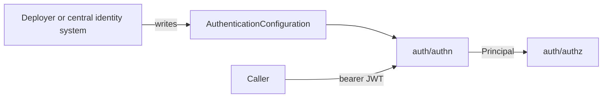

# Authentication set by configuration for NVKE APIs

**Status:** proposed
**Date:** 2026-11-06

## Context

NVKE APIs serve people, automation and other services. Each kind of caller gets its identity from a different issuer:

- A person signs in to the identity provider of the deployer, the organization running NVKE.
- A workload in Kubernetes holds a service account token.
- A workload with a SPIFFE identity holds a JWT-SVID.

Which issuers to trust differs per deployment. A standalone deployment may trust one test issuer. A deployment under a central identity system trusts whatever that system manages.

[`auth/authn`](../../auth/authn/config.go) reads its trust settings from a typed document, `AuthenticationConfiguration` in `auth.nvke.nvidia.com/v1alpha1`. It refuses unknown fields. Each issuer entry names a key-set URL (JWKS), signing algorithms and admit rules: the claims a token must carry. A verified token becomes a [`Principal`](../../auth/authn/principal.go) with the issuer name, subject and claims.

The controller's HTTP API uses `auth/authn`. The controller chart ships with `apiAuth.enabled: false`, and this record keeps that default.

## Decision

We will set who an NVKE API trusts through a versioned configuration document, not code. A deployer can write that document by hand, or a central identity system can write it for them.

An NVKE API is one that people, automation or other services call over the network, such as the controller's HTTP API. The node agent's gRPC API is out of scope: only the controller calls it, over mutual TLS. The metrics listener is out of scope too.

- The `AuthenticationConfiguration` schema is the public contract for authentication. A new field is optional. Removing or renaming a field needs a new `apiVersion`.
- Callers present a bearer JWT. Trusting a new issuer then takes only its key-set URL, with no credential store or certificate authority in NVKE.
- The document lists any number of issuers. Each issuer's keys, algorithms, admit rules and audience override apply only to its own tokens.
- An API accepts no other credential: no API keys, basic auth, session cookies or token format of its own.
- An API reads the caller only from the `Principal`, and passes it to authorization.
- Only probes, version and API documentation skip the token. [`routes.go`](../../auth/authn/routes.go) lists them.
- Permissive mode is a rollout step. It applies to the whole deployment: each failed check is logged and counted, and the request is served.

## Consequences

Trust changes without a code change or a new build. NVKE reads the document at startup, so a change applies on restart.

Any system that can write a Kubernetes ConfigMap can manage authentication. That system writes against the schema, so a breaking schema change breaks it too.

Every caller needs a token from a configured issuer. A tool that sends no token, or sends an API key, must change before the deployment enforces.

A stolen token works until it expires. NVKE APIs check tokens against each issuer's public keys and hold no caller secrets, so revoking access is the issuer's job. A service account token stays valid after its pod is deleted.

If an enforcing API cannot fetch an issuer's keys at startup, it does not start. A permissive API starts, and fetches the keys on a later refresh.

## Options considered

- **A versioned document, with bearer JWTs (chosen):** any deployer or system can set trust, and NVKE stores no credentials.
- **Trust set in code or build flags:** no schema to keep stable, but every change needs a new build.
- **An NVKE admin endpoint that a central system calls:** changes apply at once, but it adds a privileged API to secure, and a standalone deployment needs a client for it.
- **Mutual TLS client certificates:** strong for workloads, but people don't hold certificates, and each deployment needs a certificate authority.
- **API keys issued by NVKE:** easy for scripts, but NVKE would store, rotate and revoke them.
