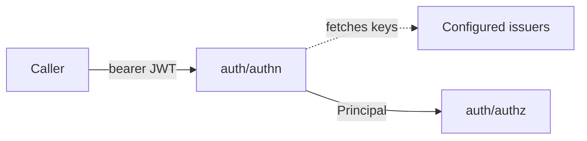

# Bearer JWT authentication for NVKE APIs

**Status:** proposed
**Date:** 2026-11-06

## Context

NVKE APIs serve people, automation and other services. Each kind of caller gets its identity from a different issuer:

- A person signs in to the identity provider of the deployer, the organization running NVKE.
- A workload in Kubernetes holds a service account token.
- A workload with a SPIFFE identity holds a JWT-SVID.

Every one of these issuers signs JWTs. The deployer chooses which issuers to trust.

[`auth/authn`](../../auth/authn/config.go) verifies a bearer JWT against the issuers in its config. Each issuer entry must name a key-set URL (JWKS), signing algorithms and admit rules: the claims a token must carry. It may override the deployment's audiences. A verified token becomes a [`Principal`](../../auth/authn/principal.go) with the issuer name, subject and claims.

The controller's HTTP API uses `auth/authn`. The controller chart ships with `apiAuth.enabled: false`, and this record keeps that default.

## Decision

We will authenticate every caller of an NVKE API with a bearer JWT, verified by `auth/authn` against issuers the deployer configures.

An NVKE API is one that people, automation or other services call over the network, such as the controller's HTTP API. The node agent's gRPC API is out of scope: only the controller calls it, over mutual TLS. The metrics listener is out of scope too.

- The deployer lists any number of issuers. Adding or removing one changes no code.
- Each issuer's keys, algorithms, admit rules and audience override apply only to its own tokens.
- An API accepts no other credential: no API keys, basic auth, session cookies or token format of its own.
- An API reads the caller only from the `Principal`, and passes it to authorization.
- Only probes, version and API documentation skip the token. [`routes.go`](../../auth/authn/routes.go) lists them.
- Permissive mode is a rollout step. It applies to the whole deployment: each failed check is logged and counted, and the request is served. A deployer uses it to move callers onto tokens before enforcing.

## Consequences

One deployment trusts its identity provider and Kubernetes service accounts. A test deployment trusts a local issuer. Neither needs a code change.

Every caller needs a token from a configured issuer. A tool that sends no token, or sends an API key, must change before the deployment enforces.

A stolen token works until it expires. NVKE APIs check tokens against each issuer's public keys and hold no caller secrets, so revoking access is the issuer's job. A service account token stays valid after its pod is deleted.

If an enforcing API cannot fetch an issuer's keys at startup, it does not start. A permissive API starts, and fetches the keys on a later refresh.

## Options considered

- **Bearer JWTs from configured issuers (chosen):** one verifier covers people and workloads, with no credential store.
- **One issuer per deployment:** simpler config, but people and workloads get their identity from different issuers.
- **Mutual TLS client certificates:** strong for workloads, but people don't hold certificates, and each deployment needs a certificate authority.
- **Kubernetes `TokenReview` for service accounts:** revokes a token when its pod goes, but calls the Kubernetes API server on every request and covers only service accounts.
- **API keys issued by NVKE:** easy for scripts, but NVKE would store, rotate and revoke them.
