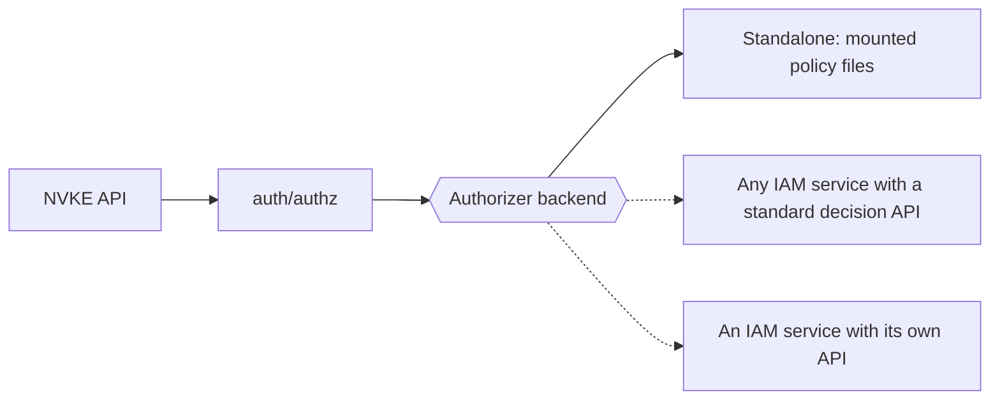

# Pluggable authorization for NVKE APIs

**Status:** proposed
**Date:** 2026-11-06

## Context

NVKE runs in two kinds of environment:

- **Standalone:** on a laptop, in CI, or at a site with no central authorization service. The deployer writes the policy.
- **Managed service:** as part of an AI factory, under a central identity and access management (IAM) service that owns roles, policy and tenants for every service in it. Each AI factory brings its own service, with its own policy format.

An API that takes its decisions from one source cannot run in the other environment. An API that writes its own authorization also repeats shared rules, such as tenant isolation, and can get them wrong.

Callers reach authorization already authenticated, as [`20261106-configuration-driven-jwt-authentication.md`](20261106-configuration-driven-jwt-authentication.md) describes. That record also defines NVKE APIs.

## Decision

We will authorize every request to an NVKE API through one shared library, [`auth/authz`](../../auth/authz/authorizer.go), and plug the source of each decision in behind it as a backend.

Requests the Kubernetes API server authorizes are out of scope, and keep Kubernetes RBAC.

- Every API asks `auth/authz` for each decision. No API calls a policy engine or an authorization service itself.
- A backend implements the library's `Authorizer` interface. The deployer picks the backend in configuration. Changing the backend changes no API code.
- The standalone backend, [`localbundle`](../../auth/authz/localbundle/localbundle.go), evaluates Cedar policy from files the deployer mounts. Its typed configuration, `AuthorizationConfiguration`, is a public contract that a person or an automated system can write. A new field is optional. Removing or renaming a field needs a new `apiVersion`. A ConfigMap carries the document today, and a custom resource could carry it later.
- Managed-service backends are not built. One will call any authorization service through a standard decision API, such as [OpenID AuthZEN](https://openid.net/specs/authorization-api-1_0.html). An IAM service with its own API gets its own backend.
- The library holds the rules every backend must apply, such as tenant isolation. Its [conformance suite](../../auth/authz/authztest/conformance.go) tests each backend against them.
- Each API publishes the actions and resource types it checks. Policy in every backend names them.

## Consequences

The same API runs on a laptop with mounted files and as a managed service under an AI factory's central IAM service.

Supporting a new authorization service takes one backend, not a change to every API.

Tenant isolation depends on each backend applying the library's rules. The conformance suite catches a backend that skips them, but the library does not re-check an allow at run time. NVKE supports only the backends it ships and tests. A backend that passes the suite elsewhere is supported by whoever runs it.

The interface carries only what every backend can answer. A feature that only one IAM service offers waits until the interface carries it for every backend.

The `Authorizer` interface, the configuration schema, and each API's action and resource type names are public contracts. Changing one breaks every backend or policy that uses it, including ones written outside NVKE.

A backend that asks a remote service for each decision depends on that service. While it is down, an enforcing API refuses requests. Each such backend states how long it caches answers.

## Options considered

- **One library with pluggable backends (chosen):** every API runs standalone and as a managed service in any AI factory with no code change.
- **Every API calls a standard decision API, such as AuthZEN, directly:** one client serves any service that speaks it, but a standalone deployment then needs its own decision service, and each API repeats the shared rules.
- **Each API calls the AI factory's IAM service directly:** simplest in one AI factory, but no API runs without that service or in another AI factory.
- **Local policy files only:** runs anywhere, but a central IAM service can manage policy only by writing files into every deployment.
