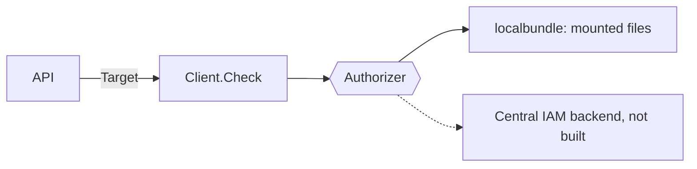

# Pluggable authorization for NVKE APIs

**Status:** proposed
**Date:** 2026-11-06

## Context

NVKE runs in two kinds of deployment:

- **Standalone:** on a laptop, in CI, or at a site with no central identity and access management (IAM) service.
- **Managed:** under a central IAM service that owns roles, policies and tenants for every service on the platform. A deployer, such as a cloud partner, may bring its own central IAM service with its own policy format.

An API built for one kind cannot serve the other.

The [`auth/authz`](../../auth/authz/authorizer.go) package separates an API from the source of its decisions. The API calls [`Client.Check`](../../auth/authz/client.go) for each request. The `Client` asks a backend, which implements the `Authorizer` interface.

[`localbundle`](../../auth/authz/localbundle/localbundle.go) is the only backend. It evaluates Cedar policy from files the deployer mounts. No API on `main` calls `auth/authz` yet.

Callers reach `auth/authz` already authenticated, as [`20261106-configuration-driven-jwt-authentication.md`](20261106-configuration-driven-jwt-authentication.md) describes. That record also defines NVKE APIs and permissive mode.

## Decision

We will authorize every request to an NVKE API through the `auth/authz` `Authorizer` interface, so that each API runs both standalone and under a central IAM service.

Requests the Kubernetes API server authorizes are out of scope, and keep Kubernetes RBAC.

Each API:

- Calls `Client.Check` for every request. The API supplies the action and the resource's owning tenant. The backend evaluates policy, finds the caller's tenant, and decides whether the caller is an operator. An operator may act in any tenant.
- Picks its backend from configuration. Changing the backend changes no API code.
- Runs standalone with `localbundle`. Its typed configuration, `AuthorizationConfiguration` in `auth.nvke.nvidia.com/v1alpha1`, is a public contract. A deployer can write it by hand, or a central IAM service can write it. A ConfigMap carries it today, but the schema is the contract, so a custom resource could carry it later.
- Publishes its actions and resource types. Policy in every backend names them.
- Calls `Client.Ready` at startup and exits if the backend cannot answer. In enforcing mode, a backend error refuses the request.

Each backend:

- Implements `Authorizer`, calls [`CheckIsolation`](../../auth/authz/tenant.go) before any policy, and passes [`authztest.Run`](../../auth/authz/authztest/conformance.go).
- States how long it caches answers, if it calls a remote service.
- Holds every link to the central IAM service. It may load mounted files, fetch policy and evaluate it locally, or ask a remote service for each decision. The API cannot tell which.

## Consequences

The same API runs in CI with mounted files and in production under a central IAM service.

A new central IAM service needs one backend, not a change to each API.

Tenant isolation depends on each backend calling `CheckIsolation`. The conformance suite catches a backend that skips it. The `Client` does not re-run `CheckIsolation` on an allow.

The interface carries only what every backend can answer. A feature that only one IAM service offers waits until the interface carries it for every backend.

Renaming an action or resource type breaks every policy that names it. Each API treats these names as part of its interface.

A backend that calls a remote service for each decision depends on that service. While it is down, an enforcing API refuses requests.

NVKE ships no default policy bundle, so a standalone deployer writes one.

## Options considered

- **One Go interface with pluggable backends (chosen):** each API runs standalone and managed with no code change.
- **One standard decision protocol, such as OpenID AuthZEN:** one client serves every IAM service that speaks it, but a standalone deployment then needs its own decision service.
- **Each API calls the central IAM service directly:** simplest when managed, but no API runs without the service.
- **Local policy files only:** runs anywhere, but a central IAM service can manage it only by writing files into every deployment.
