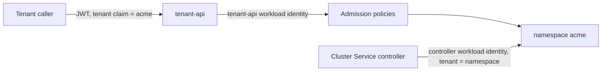

# Tenant isolation in the Cluster Service: tenants from tokens, a namespace per tenant

**Status:** proposed
**Date:** 2026-11-19

## Context

The Cluster Service runs two stateless HTTP APIs, tenant-api for tenants and operator-api for operators, and the Cluster Service controller, which turns `NVKECluster` objects into clusters through CWE. All three keep their state in a datastore cluster, the state store. Depending on the deployment model, that is either a separate cluster or the same cluster these services run in.

[Configuration-driven JWT authentication](../../../docs/adrs/20261106-configuration-driven-jwt-authentication.md) settles how an API verifies a caller's token, and [`auth/authz`](../../../auth/authz) with the `localbundle` backend settles authorization policy. This record settles where the tenant comes from and how the state store keeps tenants apart.

## Decision

We will take the tenant only from a verified token, keep each tenant's objects in a namespace of its own, and hold that boundary in the state store with static RBAC and admission policies.

### 1. The tenant is a token claim; NVKE keeps no per-tenant identity configuration

tenant-api trusts a small set of operator-supplied issuers, listed in its `AuthenticationConfiguration`. For each issuer the operator names the claim that holds the tenant, and that value is the tenant ID. NVKE configures nothing per tenant: no issuer, IdP, client or mapping of its own. Federating customer IdPs and assigning tenant IDs are the operator's responsibility.

Every trusted issuer must meet this contract:

- The tenant claim is a single string.
- Its value is the canonical tenant ID: immutable, and never reused for another tenant.
- The value is a valid DNS label, because it names the tenant's namespace.
- Each tenant ID is unique across the trusted issuers.
- The operator tenant value is issued only to operators.
- Tokens carry the audience configured for the API they call. tenant-api and operator-api are configured with different audiences, so a token for one is refused by the other.

Request paths, bodies and headers never set the tenant. An operator is a caller whose tenant equals the configured operator tenant, from an issuer marked `operators: true`. Only the operator can configure such an issuer.

### 2. One namespace per tenant, living from the tenant's first cluster to its last

- The namespace is named by the tenant ID and carries the label `nvke.nvidia.com/tenant: "true"`.
- tenant-api creates it on the tenant's first `createCluster`. Reads never create one, and tenant-api never updates or deletes one.
- When a tenant's last cluster is deleted, the Cluster Service controller deletes its namespace.
- Reserved names are refused: anything starting `kube-`, `nvke-` or `management-`, and `default`.
- Downstream of the API services, namespaces are the tenant isolation boundary. The controller and everything downstream read the tenant from the object's namespace, never from a token.

### 3. Components act as themselves, with static cluster-wide RBAC

A caller's token stops at the API. tenant-api, operator-api and the controller act on the state store with their own workload identity. There is no impersonation, and no caller token reaches the store.

Helm renders one ClusterRole and ClusterRoleBinding per component. Nothing is created per tenant except the namespace.

| Identity | Granted | Never granted |
| --- | --- | --- |
| tenant-api | namespaces: get, create · `nvkeclusters`: full lifecycle · catalog kinds: read | Secrets, ConfigMaps, namespace update or delete, catalog writes |
| operator-api | Catalog kinds: full lifecycle | `nvkeclusters`, Secrets, namespaces |
| Cluster Service controller | `nvkeclusters`: read, watch, patch, status · catalog kinds: read · ConfigMaps: read, cluster-wide, for templates · namespaces: delete | Secrets, namespace create |

tenant-api stamps the caller's principal, tenant and request ID as annotations on every write, so the store's audit log, which only shows tenant-api, links back to a person.

### 4. Admission policies hold the tenant boundary

Cluster-wide RBAC lets tenant-api create any namespace and write `NVKECluster` objects in any namespace, and lets the controller delete any namespace. Four ValidatingAdmissionPolicies, each with `failurePolicy: Fail`, ship in the same chart and close that gap:

1. tenant-api may create only namespaces that carry the tenant label and have no reserved name.
2. Nobody may add, change or remove the tenant label after a namespace is created.
3. `NVKECluster` objects may be created or updated only in namespaces that carry the tenant label, by any writer.
4. The controller may delete only namespaces that carry the tenant label. Deletes by any other identity are unaffected.

## Consequences

Onboarding a tenant needs no NVKE change; its first cluster create makes its namespace, and deleting its last cluster removes it. In return, NVKE trusts its issuers fully. An issuer that emits a wrong or reused tenant ID hands that caller another tenant's namespace and clusters. The issuer contract is the control, so the operator must confirm an issuer meets it before trusting that issuer.

A tenant whose ID is not a DNS label, or matches a reserved name, can't use NVKE.

Isolation in the datastore depends on the admission policies being installed. A missing RoleBinding fails closed; a missing admission policy fails open.

The admission policies proposed here forbid adding or editing the tenant label for everyone, so any manual edit to it needs a named exception or a temporary pause of the admission policy.

## Options considered

**Where the tenant comes from**

- **Per-tenant issuers or IdPs configured in NVKE:** each tenant could bring its own IdP, but NVKE becomes the federation point, its configuration grows with every tenant, onboarding needs an NVKE change, and one bad entry could vouch for any tenant.
- **Tenant in the request path, header or body:** easy to route, but any caller can name any tenant, so it still needs checking against the token.
- **Tenant looked up per request from a tenant registry:** one source of truth, but a runtime dependency on every request.

**How tenants are kept apart in the store**

- **Namespaces pre-created at tenant onboarding:** tenant-api would not need to create namespaces, but NVKE needs a namespace to place `NVKECluster` objects in anyway, and it has no tenant onboarding event to hook.
- **One shared namespace, tenant as a label or field:** nothing to create, but isolation rests on every query filtering correctly, nothing in the store enforces it, and cluster names collide across tenants.

**Identity at the state store**

- **Impersonate the caller:** the store's audit log would name the person, but tenant-api needs the broad `impersonate` verb, and the store needs RBAC for every tenant user and group.
- **Forward the caller's token to the store:** the store would have to trust every tenant issuer and map its claims, so its trust would grow with every issuer NVKE adds.
