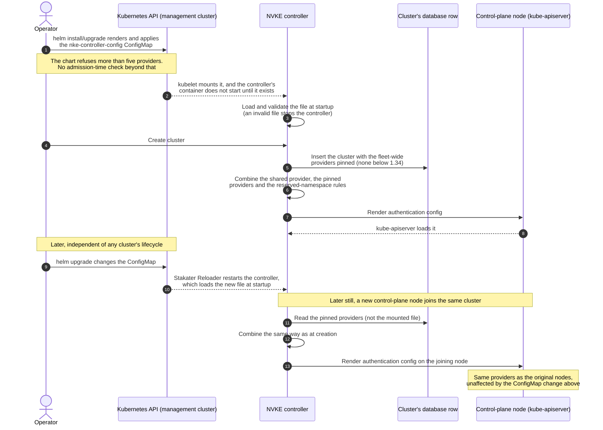

# Multiple OIDC provider support: design

> **Status:** the fleet-wide providers are implemented, in [#1325](https://github.com/dsx-ai-factory/nvke/pull/1325), [#1355](https://github.com/dsx-ai-factory/nvke/pull/1355), [#1425](https://github.com/dsx-ai-factory/nvke/pull/1425), [#1426](https://github.com/dsx-ai-factory/nvke/pull/1426), [#1527](https://github.com/dsx-ai-factory/nvke/pull/1527) and [#1628](https://github.com/dsx-ai-factory/nvke/pull/1628) (`discoveryURL` on fleet-wide providers). This document was written before that implementation, so "today" means the NVKE controller as it was then. The per-cluster provider API in **Future scope: per-cluster provider API** is not implemented yet.
>
> **Release scope.** A later release needs both fleet-wide and per-cluster control over OIDC providers. This document covers both: the fleet-wide provider ConfigMap proposed below ships first, for the initial OSS release; the per-cluster provider API described in **Future scope: per-cluster provider API** ships in a later release, adding per-cluster control on top of the fleet-wide mechanism rather than replacing it.

## Problem

NVKE supports one OIDC provider today: the shared `NvkeOIDCAuth` provider, set once via environment variables and pushed to every cluster for management-plane (SPIFFE) authentication. That is the wrong tool for human or tenant access. An operator who wants to give people cluster-maintenance access, or hand a tenant access to their own cluster, would have to reuse the same identity NVKE itself uses to manage the cluster. This design gives operators a way to register their own providers without touching that.

## Goals

- Let an operator register one or more OIDC providers, once, that NVKE applies to every cluster it subsequently creates: no per-cluster configuration, no operator-built orchestration required.
- Combine those providers with the existing shared NVKE OIDC provider (if enabled) into a single Kubernetes `AuthenticationConfiguration` per cluster, the same way today's shared-only case already does.
- Guarantee that no operator-configured provider can produce a final username or group inside a namespace reserved by Kubernetes, kubeadm, NVIDIA, or NVKE (`system:`, `kubeadm:`, `nke:`, `nvke:`, `nvidia:`, and, whenever a SPIFFE trust domain is configured, `spiffe://<trust domain>/`), or one of the exact identities NVKE's own services hold after a token exchange, in a way operators cannot remove or override.

## Non-goals (initial OSS release)

- Propagating a provider-set change to already-running clusters. A cluster keeps the fleet-wide providers it was created with; a later edit affects only subsequently created clusters. Rolling a change out to running clusters would need its own rollout and failure-mode analysis, weighing replacing a node against in-place-editing the `AuthenticationConfiguration` file across the control plane, analogous to the existing brownfield `EnableOIDC` workflow. That is the extension point: this release does not build anything that would be incompatible with reusing that rollout framework later.
- Per-cluster provider overrides or opt-outs. All clusters in the fleet get the same combined provider set in this release; there is, for example, no way yet to give a self-managed cluster running NVKE's own components stricter controls than the rest of the fleet. See **Future scope: per-cluster provider API** for a later release that adds this.
- Operator-supplied CEL expressions for username/group mapping.
- Adding fleet-wide providers to clusters that already exist. A cluster created before `oidc.providers` was set, or without `nke-controller-config`, has no pinned providers and gets none later. The `EnableOIDC` rollout, which turns the shared provider on for an existing cluster, keeps the providers a cluster was created with but adds none.
- Continuous validation feedback surfaced back to the operator on its own, outside of a `helm upgrade` or a controller restart. This release validates when the chart renders and when the controller starts; nothing watches for a problem in between.
- Changing how NVKE itself accesses a tenant cluster for lifecycle management. That access uses the kubeadm-issued `admin.conf` client certificate on every cluster already, independent of any OIDC provider; the shared provider adds an optional SPIFFE-based path on top once enabled, it does not replace `admin.conf`. A cluster with zero OIDC providers configured, fleet-wide, per-cluster, or shared, is unaffected on the NVKE side.

## Proposed solution

We add a single Helm-templated ConfigMap, `nke-system/nke-controller-config`, that folds together the fleet-wide provider list this design is about and the rest of `nvke-controller`'s non-secret configuration, which today is scattered across environment variables set by the chart from a single reflection-driven struct, `internal/config/config.go`'s `Config`. That struct is not OIDC-specific; the shared provider's settings are just one slice of it. Carving out only that slice for a ConfigMap and leaving the rest as environment variables would mean operators and readers learn two different places to look for what is, underneath, the same kind of setting. So this design does not carve out a slice: every field in `Config` that reaches the controller as a plain value moves into this ConfigMap, mirroring the struct's own shape directly rather than inventing a second name for anything it already names. Only the handful of fields that reach the controller as `secretKeyRef`-backed credentials keep the environment-variable path, because that path is how they avoid ever appearing as plain text in the first place; see **Migration** for the exact boundary.

```yaml
apiVersion: v1
kind: ConfigMap
metadata:
  name: nke-controller-config
  namespace: nke-system
data:
  config.yaml: |
    fieldManager:
      name: cloud-workflow-engine
      rebootMachineName: cloud-workflow-engine-reboot-machine
      machineHealthIssueName: cloud-workflow-engine-machine-health-issue
    managedByLabelValue: cloud-workflow-engine
    metricsListenAddress: 127.0.0.1:9090
    supportedInfraProviders: ["nico"]
    tracing:
      enabled: false
      endpoint: ""
      insecure: true
      serviceName: cloud-workflow-engine
    certRenewal:
      controllerEnabled: true
      interval: 12h
      thresholdDays: 30
    kubeadmImageRepository: registry.k8s.io
    cniImageRegistry: ""
    installCNIAfterInit: false
    nicoControllersEnabled: true
    profilesDir: ./profiles
    runbooksDir: ""
    tenantAccessEnabled: false
    nodeAgent:
      spireAttestationMethod: tpm
      dsxImds:
        endpoint: http://169.254.169.254
        pluginChecksum: ""
        operatorTenant: ""
      tlsJWT:
        enabled: false
        issuer: ""
        jwksURI: ""
        algorithms: []
        subjectTrustDomain: ""
        dsxIdentityExchangeURL: ""
        subjectTenant: ""
        subjectService: ""
      externalMTLSEnabled: false
    oidc:
      managementOIDCAuth:
        enabled: true
        issuerURL: https://spire.example.com
        discoveryURL: https://spire.example.com/.well-known/openid-configuration
        caBundleSecretRef:
          namespace: nke-system
          name: nke-oidc-ca-bundle
          key: ca.pem
      providers:
        - name: corporate
          issuerURL: https://login.example.com/tenant
          # Optional: where tenant API servers fetch the discovery document
          # when they cannot reach issuerURL itself.
          discoveryURL: https://login.internal.example.com/tenant/.well-known/openid-configuration
          audiences: ["nvke-tenant-cluster"]
          usernameClaim: sub
          usernamePrefix: "corporate:"
          groupsClaim: groups
          groupsPrefix: "corporate:"
          requiredClaims:
            tenant_id: acme
          caBundle: |
            -----BEGIN CERTIFICATE-----
            ...
            -----END CERTIFICATE-----
    temporal:
      hostPort: localhost:7233
      namespace: cloud-workflow-engine
      taskQueue: cloud-workflow-engine-tasks
      tls:
        caCert: ""
        clientCert: ""
        clientKey: ""
        serverName: ""
    spire:
      spiffeEnabled: false
      spiffeEndpointSocket: unix:///tmp/spire-agent/agent.sock
      spiffeJWTExchangeEndpoint: ""
      serverNamespace: spire-server
      className: spire-mgmt-spire
      tpmPubhashesConfigMapName: tpm-pubhashes
      serverPort: "9091"
      joinTokenTTL: 1h
    teleport:
      enabled: false
      identityFile: ""
      proxyAddress: ""
      environment: non-prod
      managedByLabelValue: nke-cloud-workflow-engine
      tokenNamePrefix: nke-cwe-
    permissiveMode: false
```

Eight keys, `fieldManager`, `tracing`, `certRenewal`, `nodeAgent`, `temporal`, `spire`, `teleport`, and `oidc`, group a subsystem's fields under one name instead of sitting flat at the top level. `tracing`, `teleport` and `nodeAgent` mirror nested structs `Config` already has (`TracingConfig`, `TeleportConfig`, and `NodeAgentConfig` with its own `tlsJWT` and `dsxImds` blocks); `NodeAgentExternalMTLSEnabled` is still a flat `Config` field, but it shares the `NODE_AGENT_` prefix, so it sits in `nodeAgent` as well. The other five have no struct behind them: for four, `Config` keeps the fields flat with a shared name prefix (`FieldManager*`, `CertRenewal*`, `Temporal*`, `Spire*`/`Spiffe*`), and `oidc` holds the shared provider and the new fleet-wide list side by side. The schema groups them anyway, for the same readability reason: a flat `providers` key next to `supportedInfraProviders` reads as "providers of what," and a flat `className` next to a dozen unrelated keys says less than `spire.className` does. Every prefix in `Config` that repeats across three or more fields got this treatment; a prefix shared by only one or two fields (`managedByLabelValue`, `supportedInfraProviders`, `tenantAccessEnabled`, `permissiveMode`) stayed flat, since grouping a single field buys nothing. `oidc.managementOIDCAuth` replaces the `NKE_OIDC_AUTH_*` environment variables one for one (`Enabled` becomes `enabled`, and so on), including keeping its CA bundle as a Secret reference rather than inline PEM, matching today's behavior and letting it keep rotating through whatever already manages that Secret. `oidc.providers` is the new fleet-wide list this design adds; each entry is inline PEM for its own CA bundle rather than a Secret reference, since a CA bundle is public certificate material with nothing to protect by indirecting through a Secret, and asking an operator to manage a Secret per provider buys nothing. Each entry can also set an optional `discoveryURL`, as `oidc.managementOIDCAuth` already can, for an issuer the tenant API servers cannot reach at its own URL, such as one behind split DNS or inside the management plane: kube-apiserver then fetches the discovery document from there, while tokens still carry `issuerURL` as their `iss` claim. Every other key, grouped or not, is an existing `Config` field renamed from its `SCREAMING_SNAKE_CASE` env var to the camelCase Go field it already was under the hood; none of them need to look alike just because they live in the same document now.

There is no per-cluster aspect to `oidc.providers`. An operator sets the list once, through the chart value of the same name, and from then on it applies to every cluster NVKE creates on Kubernetes 1.34 or later (see **Kubernetes version floor**). It accepts at most 5 entries: `AuthenticationConfiguration` supports at most 64 JWT authenticators in total, and a handful of those stay reserved for platform-managed providers, the shared one included.

We picked a ConfigMap over a CRD. A CRD would have given us admission-time schema validation for free, and NVKE already manages other CRDs on its own management cluster, so it would not have been a new capability. But it comes with real costs that this design does not need to pay: Helm's CRD story is awkward (a separate `crds/` directory that only installs and never upgrades, no clean way to apply a custom resource in the same release as its own CRD), and every field this schema gains later would mean thinking about CRD versioning. A ConfigMap avoids all of that. It loses the admission-time validation, and the chart does not add a `values.schema.json` to stand in for it. The controller's loader is strict instead: it rejects an unknown or misspelled key, a value of the wrong type, or a document that fails validation, and refuses to start rather than run on part of a configuration. Restating those rules in Helm would leave two schemas to keep in step, which is the reason the chart's `nke-auth-config` template already gives for not doing so. A CI check renders the chart and runs the result through the same loader, so a chart change that breaks the document fails before it merges. The tradeoff is that an operator's malformed value surfaces when the controller restarts rather than at `helm upgrade` time, which is how `nke-auth-config` behaves today.

This is a two-way door, not a one-way one: nothing about how NVKE resolves, validates, or applies this configuration depends on it living in a ConfigMap rather than a CRD or some future operator API for managed Kubernetes. Moving it later, if one of those turns out to be the better long-term home, is cheap.

The controller does not fetch this ConfigMap through the Kubernetes API. It mounts it as a volume, the same way the chart already mounts `nke-auth-config` for API bearer-token auth today. That gets us two things for free, matching that existing precedent exactly:

- **No startup-ordering risk.** Kubernetes will not start the controller's container until the ConfigMap it references actually exists, so the "is it there yet" question a `client.Get` would raise never comes up; kubelet blocks the mount, not the controller's own code, until it is. `nke-auth-config`'s own template already carries this comment: "a missing ConfigMap holds the pod in `ContainerCreating`... rather than starting it unconfigured."
- **No new RBAC grant.** Kubelet fetches the ConfigMap with its own credentials, not the pod's ServiceAccount token.

That second point does not extend to the shared provider's CA bundle Secret, which the controller still fetches live through the API, the same way it does today, since it is referenced by name inside the ConfigMap rather than mounted directly.

The controller reads the mounted file once, at startup, the same one-time read the REST server, Temporal registration, and the kubeadm activity already depend on today (see Migration), so a later `helm upgrade` only takes effect once the controller restarts and reads the file again. The chart already has a mechanism for exactly this, again matching `nke-auth-config`: a `configmap.reloader.stakater.com/reload` annotation that makes [Stakater Reloader](https://github.com/stakater/Reloader) restart the Deployment whenever the named ConfigMap's content changes. `nke-controller-config` gets the same annotation, for the same reason.

Concretely, `deployment.yaml` gains a volume, a mount, the path to the mounted file, and a reload annotation, following the exact shape `nke-auth-config` already uses:

```yaml
metadata:
  annotations:
    # Existing $reloadConfigMaps list gains nke-controller-config alongside nke-auth-config.
    configmap.reloader.stakater.com/reload: "nke-auth-config,nke-controller-config"
spec:
  template:
    spec:
      containers:
        - env:
            - name: CONTROLLER_CONFIG_PATH
              value: /etc/nke/controller-config/config.yaml
          volumeMounts:
            - name: nke-controller-config
              mountPath: /etc/nke/controller-config
              readOnly: true
      volumes:
        # Not optional: a missing ConfigMap holds the pod in ContainerCreating
        # with the name in its events, rather than starting it unconfigured.
        - name: nke-controller-config
          configMap:
            name: nke-controller-config
```

NVKE folds `oidc.providers` into the same `AuthenticationConfiguration` that already carries the shared provider today: same file, same place on every control-plane node. One complication: the file on disk can change at any moment, on the operator's own schedule, disconnected from any particular cluster's lifecycle. So when a cluster is created, NVKE pins the providers from the loaded file onto the new cluster's database row, in the same insert that creates it, and nothing updates them afterwards. Every control-plane node, even one that joins the cluster much later, builds its `AuthenticationConfiguration` from the providers pinned on that row, not from whatever the file says at that later moment. Otherwise two control-plane nodes behind the same VIP could enforce different auth rules. Only the fleet-wide list is pinned: the shared provider keeps today's behavior and is read from the live configuration whenever NVKE renders the file. The `EnableOIDC` rollout builds from the same inputs, so turning the shared provider on later keeps a cluster's pinned providers.

Every provider an operator configures, not the shared one, carries CEL rules that operators cannot remove: reject any username or group that begins with `system:`, `kubeadm:`, `nke:`, `nvke:`, `nvidia:` (the list `controllerconfig.ReservedIdentityPrefixes()` holds, which is authoritative), or the SPIFFE trust domain (`spiffe://<trust domain>/`), and any that exactly matches one of NVKE's own exchanged identities. This runs against the *final* mapped value, after prefixing, so it also catches the annoying edge cases: an empty prefix plus a claim of `system:masters`, or a prefix/claim split like `sys` + `tem:masters` that a simple check would not catch. Outside those reserved namespaces, operators keep control: existing unprefixed bindings still work, and two providers can map to the same identity on purpose if that is what someone wants. The controller also refuses to start with a provider whose own `usernamePrefix` or `groupsPrefix` lies inside one of the fixed reserved namespaces, since every login through it would fail.

The SPIFFE rules are not tied to the shared provider. The `nke-rbac` manifest that TenantAccess applies to tenant clusters binds NVKE's own services, by bare SPIFFE ID, to roles up to `cluster-admin`, and the chart renders it whenever `spiffe.trustDomain` is set, whether or not the shared provider is enabled. So the trust-domain prefix is reserved whenever a trust domain is configured. A deployment that uses the RFC 8693 token exchange (`spiffe.jwtExchangeEndpoint`) needs one more step: the exchange reissues each token under its own trust domain and rewrites the path, so the subjects `nke-rbac` binds in that case cannot be derived from `spiffe.trustDomain`. Those are reserved by exact match instead, taken from the `kind: User` subjects of the same `nke-rbac` manifest, so the reserved list is exactly the set of identities that hold bindings and cannot drift from the chart.

### Kubernetes version floor

NVKE renders `AuthenticationConfiguration` as `apiserver.config.k8s.io/v1`, which kube-apiserver reads only from Kubernetes 1.34; versions 1.30 to 1.33 know the kind only as `v1beta1`. A cluster created below 1.34 is therefore pinned with no fleet-wide providers, and the controller logs the skip. Rendering `v1beta1` for those versions would lift the floor, for the shared provider as well.

# Control flow and validation

The `AuthenticationConfiguration` mechanism `kube-apiserver` reads from already supports multiple providers and CEL validation rules structurally; this design is the first to actually use either. The sequence below walks through loading `nke-controller-config`, pinning its providers at cluster creation, the reserved-namespace protection layered on top of it, and how a control-plane node that joins later stays consistent with the rest of its cluster.



The pinning shown above does not know or care whether a provider came from `nke-controller-config` or, later, from a per-cluster API: it is a straightforward input either way. The existing shared-provider path, once folded into `oidc.managementOIDCAuth`, changes where its settings live, not what happens with them: a cluster that does not use the new `oidc.providers` list behaves as it does today.

**Why pin at creation, instead of reading the file fresh on every join:** the ConfigMap can change at any time, on the operator's own schedule, with no relationship to any particular cluster's lifecycle. Reading it fresh on every join would mean two control-plane nodes behind the same VIP could end up enforcing different auth rules, depending on what the file happened to say when each one joined.

Validation happens before any cluster sees the file, at two points:

- **When the chart renders**: the chart refuses more than five providers, and any `env:` entry that sets a variable `nke-controller-config` carries.
- **At startup**: the strict loader checks the whole file, from required fields, types, and unknown keys to cross-provider rules such as unique provider names, issuers and discovery URLs, the provider cap, and provider prefixes inside a reserved namespace. A provider's `discoveryURL` gets the checks kube-apiserver would otherwise apply at bootstrap: an absolute https URL with no credentials, query or fragment, different from the provider's `issuerURL`, and not shared with any other provider or the enabled shared one. A file that fails keeps the controller from starting. CI runs the chart's own render through the same loader, so a chart change that breaks the document fails before it merges.

Testing comes in three layers:

- Unit tests for the provider-combining logic, including deliberately hostile inputs, run the reserved-namespace rules through kube-apiserver's own JWT authenticator.
- An envtest suite starts a real kube-apiserver with the rendered file and checks which identities it accepts.
- A handful of end-to-end tests against a real cluster, including one that changes the ConfigMap between a cluster's creation and a later control-plane node joining, confirm that node still gets the same providers as its peers. These are in review in [#1416](https://github.com/dsx-ai-factory/nvke/pull/1416); the unit and envtest layers are merged.

## Security considerations

Write access to the `nke-controller-config` ConfigMap, which in practice means whoever can run `helm upgrade` against the NVKE release, decides who can authenticate to every cluster NVKE creates from that point on. That was already true of the shared-provider settings before this design; folding the rest of `nvke-controller`'s configuration into the same document does not add a new authentication risk, but it does widen the blast radius of that same write access to everything else in the file, cert renewal, tracing, SPIRE addressing, and so on. None of that is new access an operator did not already have through the chart's `values.yaml`; it is the same values reachable through one ConfigMap instead of scattered `env:` blocks. It should be scoped and owned accordingly, not handed out as casually as an ordinary chart value.

The reserved-namespace CEL rule is the control that actually matters here. Remove it and an operator-configured provider can mint `system:masters` and bypass Kubernetes authorization entirely. It is implemented in code the operator cannot edit, so a misconfigured IDP can only lock someone out of their own identities, not into a platform-owned one. It is also a deny list, which means it only protects what someone remembered to add: a reserved namespace introduced elsewhere in the platform later needs to be added here too. The SPIFFE rules also depend on inputs from outside the provider list, the trust domain and the exchanged subjects. Combining an operator provider without them would silently leave every SPIFFE-bound identity unprotected, so the combination step requires them whenever the `nke-rbac` manifest exists, rather than treating their absence as nothing to reserve.

The fleet-wide providers' CA bundles are stored inline as plain PEM rather than a Secret reference, unlike the shared provider's. A CA bundle is public certificate material, not a key, so a Secret would add no confidentiality here. The tradeoff is that this ConfigMap carries no sensitivity beyond ordinary read access to ConfigMaps in its namespace.

One more thing worth naming: every tenant cluster's kube-apiserver fetches discovery documents and signing keys from the operator-supplied issuer URLs. Today that is fine, since only someone who already has write access to the ConfigMap, through the Helm release, controls the URLs. That is the same trust boundary as the point above. It stops being fine if that boundary ever loosens.

Kubernetes will not start the controller's container at all if the ConfigMap a volume mount references does not exist, so a missing `nke-controller-config` never reaches application code in the first place. A malformed one can: if the mounted file fails to parse or fails validation, the controller refuses to start rather than falling back to defaults for whatever it could not read. This config gates, among other things, whether the API server enforces authentication at all, and failing open on it, silently, is a worse outcome than a startup failure that is loud and immediately visible. See **Migration: existing environment-variable configuration** for what this means for a site that already has the shared provider enabled today.

# Migration: existing environment-variable configuration

Moving `nvke-controller`'s configuration into `nke-controller-config` is not a costless rename for a site running today. The whole `Config` struct, OIDC included, is populated once, synchronously, at controller startup, by a single reflection-driven call (`env.ParseAsWithOptions[Config]`, from `github.com/caarlos0/env`) that walks every field's `env`/`envPrefix` tag; there is no hand-written parsing code anywhere to point at and change field by field. At least three independent subsystems rely on parts of it already being in memory before they run:

- The REST server, which decides at construction time whether the API enforces OIDC auth at all, among other startup decisions.
- Temporal workflow and rollout registration.
- The activity that builds `AuthenticationConfiguration` for a new cluster.

Not everything in `Config` moves into `nke-controller-config`, though. `secretKeyRef`-backed credentials keep the environment-variable path, because indirecting through a Secret is how they avoid ever appearing as plain text anywhere, ConfigMap included:

| Env var | `Config` field |
|---|---|
| `DB_CONNECTION_STRING` | `DBConnectionString` |
| `CNPG_SUPERUSER_PASSWORD` | `CnpgSuperuserPassword` |
| `CNPG_CLOUD_PASSWORD` | `CnpgCloudPassword` |
| `CNPG_TEMPORAL_PASSWORD` | `CnpgTemporalPassword` |
| `DGXC_TENANT_USER` | `DgxcTenantUser` |
| `DGXC_TENANT_PASSWORD` | `DgxcTenantPassword` |

Three more fields stay outside the ConfigMap for reasons other than secrecy. `POD_NAMESPACE` is sourced from the Kubernetes downward API (`valueFrom.fieldRef`), which a ConfigMap cannot express; kubelet has to resolve it per pod, so it was never a candidate for either path. `SPIRE_SERVER_ADDRESS` stays for the same reason: the chart's default, `spiffe.spire.serverAddressFrom`, is a `fieldRef` to `status.hostIP`, the address of the node the controller runs on, and a literal `spiffe.spire.serverAddress` is the override. Keeping it an environment variable keeps one source for it, where moving only the literal form into the ConfigMap would leave two. `AUTH_CONFIG_PATH` already points at a separately mounted file holding the API's own authentication config, the same volume-mount pattern this design uses for `nke-controller-config` itself; folding a path into a ConfigMap whose whole purpose is to be that mounted file would be circular, so the setting stays a path, pointing at a different mount.

Everything else the chart sets today, the full YAML shown in **Proposed solution**, moves into `nke-controller-config`. Twenty-eight more `Config` fields (`LogLevel`, `DBQueryLogLevel`, `DBMaxOpenConnections`, `ServerListenAddress`, the `Outbox*` group, the `NodeHealthCheck*` group, `KubeVipFMDSEndpoint`, the `NodeReboot*` group, `NodeProvisioningTimeout`, `NVKESiteControllerName`, `SpireAgentStartupTimeout`, `SpireAgentStartupRetryInterval`, `SpireServerAPIAddress`, `NodeAgent.Port`, `ManagedByK8sPlatform`, `LocalDevForceDockerMachineBootstrap`, `ProvisionControlPlaneWithControlPlaneController`, the three `Teleport.Default*` flags, and `NvkeOIDCAuth.AutoMigrationEnabled`) carry `env` tags but the chart has never set any of them; every real deployment already runs on their Go compiled-in default. This migration does not touch them: there is no environment variable to move, and nothing yet needs them exposed through `nke-controller-config` either. Adding one there later, if an operator needs to set it, is a small change to the ConfigMap schema and the chart, not a design decision.

Reading the moved settings from the mounted file instead needs the same one-time startup read `config.ParseConfigFromEnv` does today, just swapping the reflection-driven env parse for a YAML unmarshal into the same struct shape. Because the file comes from a volume mount rather than a live API call, this does not add the startup-ordering risk an API read would have: Kubernetes already will not start the container until the file exists, the same guarantee today's environment variables effectively have. Two things do still need to change:

- **Failure behavior.** Per the fail-closed decision above, a mounted file that exists but fails to parse or fails validation has to be a startup failure, not a silent fallback to defaults, which is not a distinction `env.ParseAsWithOptions` has ever had to make for this config.
- **A staged rollout.** First the chart renders and mounts the file, and the controller loads and validates it at startup while every setting still comes from its environment variable, so nothing changes yet. Then the controller reads the migrated settings from the file and the chart stops setting their variables, in the same release: upgrading one without the other leaves a controller that cannot find its configuration. Rolling back across that release means rolling back the chart and the image together. A host-local run without `CONTROLLER_CONFIG_PATH` skips the file in the first step; once settings come from the file, it uses a checked-in sample.
- **A way to notice a change at all.** An env var only ever changed at pod (re)creation anyway, so there was nothing to watch. A ConfigMap can change under a running pod, so `nke-controller-config` needs the same `configmap.reloader.stakater.com/reload` annotation `nke-auth-config` already carries, restarting the controller whenever the content changes (see Proposed solution).

One more consequence worth accepting up front rather than discovering during rollout: an operator who sets any of these through the chart's `env:` list rather than its values gets an error from `helm template` or `helm upgrade`, naming the `config.yaml` key that replaces the variable, instead of an override that silently stops working. `files/controller-config-env.yaml` in the chart lists those variables, and both the chart and the drift tests read it. `RUNBOOKS_DIR`, the one migrated setting without a chart value of its own, gains `profiles.runbooksPath`.

Tracing is the one place an environment variable stays meaningful: the OpenTelemetry Operator injects `OTEL_EXPORTER_OTLP_*` into the pod. When the file sets no `tracing.endpoint`, the controller leaves the exporter to the OpenTelemetry SDK, which reads those standard variables itself.

# Future scope: per-cluster provider API (a later release)

Fleet-wide covers only part of the scope planned for a later release: an operator will also want to add a provider scoped to one cluster, on top of whatever the fleet-wide set already gives everyone. Some clusters need the opposite too, excluding the fleet-wide set entirely; a self-managed cluster running NVKE's own components wanting stricter controls than the rest of the fleet is a concrete example.

The plan is a per-cluster provider list on the create-cluster API itself, same per-provider fields as the fleet-wide `oidc.providers` list, plus a policy flag, `inheritFleetWide`, defaulting to true. When it is false, the pinning from **Control flow and validation** skips the fleet-wide union for that cluster and builds the `AuthenticationConfiguration` from only the shared provider (if enabled) and that cluster's own per-cluster list, giving true opt-out rather than only additive per-cluster providers. The per-cluster list itself becomes a third source into the same combination step: shared provider, fleet-wide list, per-cluster list, all validated the same way, all subject to the same reserved-namespace rule. It is pinned at creation too, for the same reason; `inheritFleetWide` is one more input to a function that already exists, not a new mechanism.

The core logic does not have to change to add the additive case: an operator who ignores the per-cluster API sees no difference, and one who uses both gets providers from both sources, still protected the same way.

One thing about this sketch is still open rather than decided, and it matters more than the exact mechanism: this needs to support adding or changing a provider on an existing cluster without recreating it, which the create-cluster-API-only sketch above does not yet answer.
