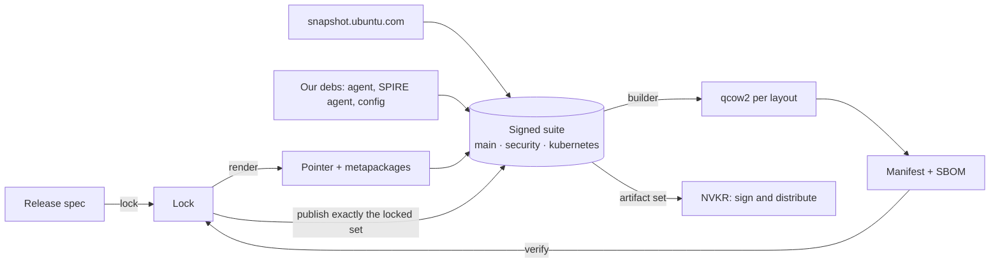

# Node OS build: design

> **Status:** proposal. The decision is recorded in [`os-image/docs/adrs/20261106-node-os-from-locked-repository.md`](../../os-image/docs/adrs/20261106-node-os-from-locked-repository.md); this document is the detail behind it. The work is tracked in [#2194](https://github.com/dsx-ai-factory/nvke/issues/2194). Sections marked **Proposed** have not been reviewed yet.
>
> **Scope.** This document covers building a release, up to the artifact set. In-place update of running nodes, patch delivery and the update actuator build on these artifacts and are designed separately.

## Summary

The NVKE node OS is a frozen upstream Ubuntu snapshot plus NVIDIA's own debs, shipped as a bootable disk image. A hand-written release spec states what a release contains. A committed lock pins every package, and a signed apt repository carries exactly that set. Images are built only from that repository, and a verify step proves that an image, and later a running node, holds exactly the locked set.

## Goals and non-goals

Goals:
- One definition produces the images, our debs and the repository.
- Builds are repeatable: the same spec and lock give the same package set for as long as the Ubuntu snapshot is retained.
- A running node can be checked against the release it claims to be, package by package.
- Downstream teams extend a release instead of forking the build.
- The build emits what in-place update needs (repository, pointer package, metapackages) as first-class artifacts.

Non-goals:
- A custom kernel, custom drivers or a general-purpose OS. The OS is upstream Ubuntu plus packages, configured for NVKE nodes.
- An immutable root filesystem.
- Kubernetes version policy. NVKE selects Kubernetes versions; the OS provides the packages and the repository contract.

## Terms

| Term | Meaning |
|---|---|
| Release spec | Hand-written YAML stating a release's intent. It carries no version and no snapshot ID. |
| Lock | Generated from the spec and committed: snapshot IDs, mirror digests, and every package's version and SHA256, per architecture. |
| Manifest | What an image or node actually holds, read from its dpkg database. A CycloneDX SBOM sits beside it. |
| Suite | One published release in the repository, named `nvke-<version>`. |
| Component | A subdivision of a suite: `main`, `security` and `kubernetes`. |
| Pointer package | `nvke-release`: the deb carrying the apt source, keyring and apt settings for a release. |
| Metapackage | A deb whose dependencies are the content of the OS: `nvke-node-base`, plus one `nvke-node-<group>` per group. |
| Layout | The disk and boot profile chosen at build time: LVM, or LVM with LUKS. |

## How a release is defined

| Document | Produced by | Role |
|---|---|---|
| Release spec | Hand-written, reviewed in a pull request | Intent: series, architectures, pockets, packages, metapackage groups, kernel, layouts, verify policy |
| Lock | `nvke-os lock`, committed with the spec change that caused it | Resolution: snapshot IDs, mirror digests, every package version and SHA256 per architecture |
| Manifest and SBOM | Generated from a built image or a running node | Observation, verified against the lock |

One spec and one lock exist per series (`os-image/release/<series>.yaml`), at the tip of each branch. An `os-image/v*` tag on the spec and lock names a release, and `git describe` supplies the version to every later step.

## Pipeline



### Lock

apt is the only resolver. For each architecture, `nvke-os lock` asks apt to install the base metapackage and every group into an isolated root: an empty dpkg status, and only the spec's sources (`apt-get install -s` or `--print-uris`). The lock records apt's answer, so verify later compares sets instead of predicting what apt will choose. Resolution sits behind a small interface, so another implementation can replace apt.

`lock --check` re-resolves from the lock's pinned inputs and fails on any difference. Lock fails clearly when a pinned third-party digest has moved, or when a snapshot is past retention.

snapshot.ubuntu.com keeps snapshots for two years, so a release can be rebuilt for two years and no longer. Keeping debs beyond that is out of scope until someone needs it.

### Render

`nvke-os render` turns the lock into debs with nfpm:
- `nvke-release`, the pointer package (see [Pointer package and mirror list](#pointer-package-and-mirror-list));
- `nvke-node-base`, which depends on every group metapackage and on locked versions, and conflicts with snapd and unattended-upgrades;
- one `nvke-node-<group>` per metapackage group, depending on its members.

The same lock and version render the same bytes.

### Publish

`nvke-os publish` publishes exactly the locked set as one signed suite, `nvke-<version>`, with three components:
- `main`: the frozen OS;
- `security`: vetted security updates;
- `kubernetes`: the Kubernetes streams and CNI debs (see [Kubernetes catalog](#kubernetes-catalog)).

The suite holds the locked Ubuntu packages, pinned third-party packages and our own debs. Ours win when a name collides, and third-party packages win only where the spec says so. A published suite never changes. Publishing a version that already exists fails, and the lock is published inside the signed tree before the suite becomes visible.

Publishing writes a local repository tree and serves it to the builder from a local HTTPS server. Pushing the tree to remote storage belongs to NVKR or the consumer. The repository engine sits behind a narrow interface (add debs, publish a suite with components, sign). Which engine to use is decided in [#2197](https://github.com/dsx-ai-factory/nvke/issues/2197). Signing goes through a provider boundary, so the key can live outside the build host.

### Build

An image builder installs the pointer package and the base metapackage from the served suite, and nothing else. Every other package is then auto-installed under the base, so removing a group later removes its members. The builder leaves no other apt source in the image.

Builders sit behind a process contract ([#2215](https://github.com/dsx-ai-factory/nvke/issues/2215)):
- Each builder is a folder, `os-image/builders/<name>/`. It holds a small descriptor (name, entrypoint, supported layouts and architectures) and the builder's own native files.
- `nvke-os` writes a versioned `config.json` (repo URL and CA, suite, pointer deb, base metapackage, layout, architecture, series, output paths) and runs the entrypoint.
- The builder writes the disk image and the root's dpkg status to the paths in `config.json`, and exits non-zero on failure.

`nvke-os` does no templating and runs no hooks; each tool takes the values through its own parameters. Packer is the first builder. mkosi can follow ([#2220](https://github.com/dsx-ai-factory/nvke/issues/2220)) and is adopted only if its manifest equals Packer's. A downstream can bring its own builder without changing lock, render or publish.

### Verify

`nvke-os verify` compares a manifest with the lock as sets, under the spec's verify policy. It reports:
- missing packages;
- foreign packages, which fail unless allow-listed;
- version drift.

The kubernetes component is checked only for the stream the node has installed. Held, unpacked and half-configured packages are reported, never dropped. The same code runs after a build and, as a small node binary, on a running node. A clean verify gates publishing the artifact set.

## Repository and node trust

### Pointer package and mirror list

`nvke-release` carries:
- a deb822 source whose URI is `mirror+file:/etc/nvke/apt-mirrors.txt`, so no hostname is baked into any artifact;
- the archive keyring, holding the current key and the next one, so a rotation is trusted a release before it is used;
- apt settings: no Recommends, and `Check-Valid-Until` and `Check-Date` off for our source only, so frozen and air-gapped repositories never expire;
- a pin that keeps the kubernetes component below priority 100, so apt installs from it only on explicit request and dist-upgrade never moves a Kubernetes package.

Its postinst disables the installer's generated sources.

The mirror list is the only per-site value on a node. The site writes it at first boot:

```yaml
#cloud-config
write_files:
  - path: /etc/nvke/apt-mirrors.txt
    owner: root:root
    permissions: "0644"
    content: |
      https://repo.site.example/nvke/
```

An image with the pointer installed and no mirror list boots cleanly, with no apt source live.

### Single origin

A node consumes only the in-site repository. Adding another apt source, installing a package by hand or letting a tool change packaged files takes the node off the verified path. Verify reports it as foreign packages or drift. The supported way to change a node is a downstream spec (see [Downstream extension](#downstream-extension)).

### Security notes

- The trust root is the keyring in the pointer package, and the mirror list selects an endpoint, not trust.
- With validity checks off for our source, an old signed suite could be replayed. Consumers name an explicit suite and verify against its lock, so a replay cannot pass as a newer release.
- unattended-upgrades and snapd are in Conflicts. Updates arrive only through the repository.
- The LVM with LUKS layout seals the disk key to the TPM; see [`os-image/docs/full-disk-encryption.md`](../../os-image/docs/full-disk-encryption.md).

## Metapackage groups

The spec lists packages in named groups. Each group renders `nvke-node-<group>`, and `nvke-node-base` depends on every group, so an image carries them all and nothing is selected per node. Members may carry version constraints, like a requirements file; the lock pins exact versions.

Removing a group from the spec drops it from the base. apt's autoremove then removes its members, except those another group still holds; no tooling of ours decides retention. A group is also the unit a patch may move (**Proposed**; see [Branches, tags and CI](#branches-tags-and-ci-proposed)).

## Kubernetes catalog

NVKE selects Kubernetes versions. The OS carries the catalog NVKE names for a release:
- the kubeadm-distro streams and CNI debs are published in the `kubernetes` component, from their own locks;
- the image keeps a bootstrap cache of that catalog, because the in-site repository does not exist before the first cluster comes up;
- the node agent installs one stream by name at cluster create.

The base metapackage depends on no Kubernetes package, and the pin keeps dist-upgrade away from them.

## Downstream extension

A downstream extends a tagged release in one of two modes:
- **Inherit.** The downstream adds debs, replaces a component behind a virtual name, adds a group or adds a layout. It stays on the parent's exact closure, and verify against the parent's lock shows only those changes.
- **Resolve.** The downstream re-locks everything on its own inputs, such as a newer snapshot or a third-party repository. It gets its own lock, and verify makes no claim about the parent. The parent is recorded as lineage.

Either way, the downstream gets its own pointer package, key and suite, and its nodes still have a single origin. A downstream image is delivered by reimaging.

Two conventions make replacement clean:
- Our configuration drop-ins are numbered 50–59, so a downstream sorts above them.
- Tightly coupled pieces sit behind virtual package names (`nvke-node-storage`, `nvke-node-sshd-config`, `nvke-node-cloudinit`). A downstream deb that provides the name and conflicts with ours replaces it.

Sites that cannot use cloud-init can build site-wide values (mirror list, SPIRE environment, agent defaults) into a site image as a downstream ([#2221](https://github.com/dsx-ai-factory/nvke/issues/2221)). Per-node values are never built in.

## Artifact set

Per release and architecture, the build emits:
- a qcow2 per layout;
- the repository tree, as a tar or an OCI artifact;
- the lock;
- the manifest and SBOM.

NVKR signs and distributes the set; the site expands the repository tree into its own storage. The exact shape is agreed with NVKR in [#2216](https://github.com/dsx-ai-factory/nvke/issues/2216).

## Branches, tags and CI (Proposed)

- `main` carries the next release; an `os-image/v*` tag on `main` names one.
- A `release/<version>` branch carries that release's patches, and each patch gets the next patch tag.
- On a release branch, `nvke-os lock --move <security|kubernetes|group>` re-locks only the named sets. It records what moved in a header in the lock: the parent tag, the moved sets and their sources. There is no separate patch file, and the tag name carries no meaning beyond the version.
- On every pull request, CI runs:
  - `lock --check`, which re-resolves from the committed lock and its header;
  - on a release branch, a gate against the parent tag's lock. It fails when anything outside the moved sets differs, a moved member's dependencies do not resolve against the parent's `main`, anything on `patch.exclude` moved, or a version went down.
  - render, publish to a scratch suite, build and verify.
- On a tag, tag lint runs first and the artifact set is emitted.

Which kernel moves a patch may carry is decided in [#2198](https://github.com/dsx-ai-factory/nvke/issues/2198).

## Integration with today's build

The current build is replaced from the inside, without a cut-over.

The Packer build has two halves:
- The machine half (Packer and autoinstall: disk layout, FDE, bootloader, serial console, compression, `boot-smoke`, publishing) stays.
- The content half (`fetch-artifacts.sh` and `provision.sh`: which packages are installed, where they come from, system configuration) is replaced one step at a time.

The outward contract stays fixed throughout: image names and locations, `os-image/v*` tags, `SPEC.md`, and the Packer project as NVKR runs it. Every merge keeps all eight images building and passing `boot-smoke`. New checks run in observe mode first and only gate at the end.

| Phase | What changes in the shipped image |
|---|---|
| 0. Foundations | Nothing |
| 1. Content into packages inside today's build | Same content, delivered as tested debs |
| 2. Observe | Nothing; lock and drift reports appear in CI |
| 3. Pin Ubuntu | Ubuntu versions come from one fixed snapshot, so builds are reproducible |
| 4. Our debs through a signed suite | Our packages come from a signed suite; content is exactly the metapackage closure |
| 5. Single origin and gates | The pointer is the only apt source; verify gates the build |
| 6. Formalize | Nothing; the builder contract and the artifact handoff to NVKR |

## Example release spec

Abridged and illustrative; the schema lands in [#2203](https://github.com/dsx-ai-factory/nvke/issues/2203).

```yaml
apiVersion: nvke.dev/v1
kind: Release
metadata:
  name: nvke-node
  series: noble                  # no version: the git tag names the release
spec:
  architectures: [amd64, arm64]
  ubuntu:
    pockets: [release, updates, security]
    components: [main, universe]
  local:
    - {name: nvke, path: out/debs}
  locks:                         # component locks, referenced not re-resolved
    - os-image/packages/spire-agent/lock
    - os-image/packages/kubeadm-distro/lock
  kernel:
    amd64: linux-nvidia
    arm64: linux-nvidia-64k
  pointer:
    name: nvke-release
    mirrorList: /etc/nvke/apt-mirrors.txt
    components: [main, security, kubernetes]
    pins: [{component: kubernetes, priority: 90}]
  packages:
    base:
      name: nvke-node-base
      depends: [ubuntu-server-minimal, nvke-agent, spire-agent, nvke-node-sysconfig, nvke-node-boot, lvm2, openssh-server, tpm2-tools]
      conflicts: [snapd, unattended-upgrades]
    components:
      storage: {provides: nvke-node-storage, default: nvke-node-storage-lvm, alternatives: [nvke-node-storage-lvm-luks]}
  metapackages:
    kata: ["erofs-utils (>= 1.8.2)"]
  kubernetes:
    streams: [1.37.2, 1.36.3, 1.35.3, 1.34.2]
    cni: {calico: [3.30.1], ovn: [2.4.2]}
  patch:
    exclude: ["linux-*", "nvidia-*"]
  verify:
    foreignPackages: fail
    allowForeign: []
    components: {kubernetes: installed-stream}
  layouts: [lvm, lvm-luks]
```

## Open questions

- **Versioning.** Which version and compatibility scheme the OS release handle follows beyond `os-image/v*`, and how compatibility with NVKE releases is expressed.
- **Kubernetes delivery.** Which pieces stay node packages in the `kubernetes` component and which move to cluster add-ons, and who publishes the Kubernetes stream.
- **Kernel cadence.** Which kernel moves a patch may carry, and the validation that gates them ([#2198](https://github.com/dsx-ai-factory/nvke/issues/2198)).
- **Repository engine.** Which tool stores, indexes and signs the suite ([#2197](https://github.com/dsx-ai-factory/nvke/issues/2197)).
- **Artifact shape.** The exact artifact set NVKR consumes, and how an air-gapped site receives the repository ([#2216](https://github.com/dsx-ai-factory/nvke/issues/2216)).
