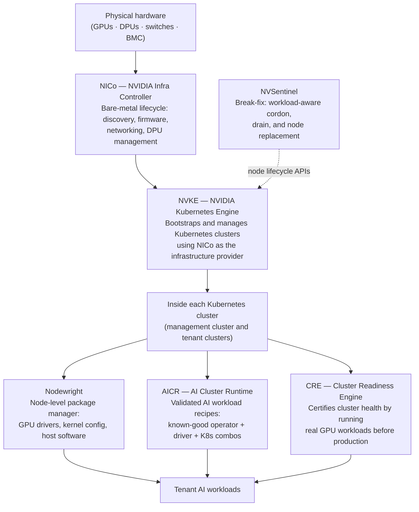

# NVKE in the DSX Stack

NVKE is one layer in a broader set of open-source components for AI factory infrastructure. Understanding where NVKE sits — and where it stops — helps you know which components to reach for and in what order.

## The Stack

## What Each Component Does

### NICo (NVIDIA Infra Controller)

NICo manages bare-metal machine lifecycle below the Kubernetes layer: BMC access, firmware updates, network configuration, DPU management, and host provisioning. It exposes a REST API and a set of Kubernetes custom resources that CAPI infrastructure providers can drive.

NVKE's primary CAPI infrastructure provider is [CAPNICo](https://github.com/dsx-ai-factory/cluster-api-provider-nico), which integrates NVKE with NICo. A working NICo site is a prerequisite for NVKE day-2 operations — tenant cluster creation, node add/remove, and upgrades all go through NICo.

[NICo documentation](https://docs.nvidia.com/infra-controller/documentation/home)

### NVKE (this project)

NVKE sits between NICo and the Kubernetes workload layer. It bootstraps the management cluster, then uses NICo (through CAPNICo and Cluster API) to provision and manage tenant Kubernetes clusters. NVKE provisions the cluster with OVN-Kubernetes, then hands off — the GPU software stack, workload configuration, and cluster readiness certification are handled by the components above.

**NVKE's scope:**
- Bootstrap a management cluster from pre-provisioned nodes (`nvkectl bootstrap site`)
- Provision and lifecycle-manage tenant Kubernetes clusters via NICo
- Drive rolling Kubernetes version upgrades, node add/remove, and pool scaling
- Maintain the etcd encryption key and cluster credentials

**Not in NVKE's scope:**
- GPU driver and software stack inside clusters → Nodewright + GPU Operator via AICR
- Cluster readiness certification → CRE
- Workload-aware node break-fix → NVSentinel

### Nodewright

Nodewright is a Kubernetes-native package manager for host-level changes. It installs, updates, and removes packages on nodes without re-imaging them, using Kubernetes-aware scheduling to protect running workloads. After NVKE provisions a tenant cluster, Nodewright (deployed via AICR) configures the GPU software stack on each node.

[Nodewright documentation](https://docs.nvidia.com/nodewright)

### AICR (AI Cluster Runtime)

AICR publishes validated recipes — version-locked combinations of GPU Operator, drivers, kernel configuration, and Kubernetes that are known to work together. Each recipe is rendered into deployment-ready GitOps bundles (ArgoCD, Flux, Helm). After NVKE bootstraps a management cluster and a tenant cluster exists, the operator deploys the appropriate AICR recipe bundle to configure the cluster for AI workloads.

[AICR documentation](https://docs.nvidia.com/aicr)

### CRE (Cluster Readiness Engine)

CRE certifies that a GPU cluster is working correctly before production workloads run on it. It runs real training and communication workloads across topology-aware node groups, measures performance, detects hardware failures, and reports every bad node with a reason. CRE never modifies nodes — quarantine is the platform's responsibility (typically NVSentinel).

[CRE documentation](https://docs.nvidia.com/cluster-readiness-engine)

### NVSentinel

NVSentinel is a break-fix system for node health. It watches nodes for hardware faults and, when a node needs repair, applies workload-aware cordon and drain before triggering NVKE's node replacement lifecycle. NVKE provides the lifecycle APIs; NVSentinel enforces the SLO policy.

[NVSentinel repository](https://github.com/NVIDIA/NVSentinel)

## A Typical Site Bring-Up Sequence

1. **NICo** is deployed and the bare-metal site is stood up — BMC access, switches configured, hosts ingested.
2. **NVKE** bootstraps the management cluster onto a set of pre-provisioned nodes.
3. The **NVKE SBOM** (the NVKE controller, NICo, Temporal, Postgres, SPIRE, CAPNICo) is deployed onto the management cluster via GitOps.
4. The site is ingested: NVKE is connected to NICo and can now drive tenant cluster operations.
5. A tenant cluster is created via `nvkectl create cluster`.
6. An **AICR recipe bundle** is deployed to the tenant cluster, installing Nodewright, GPU Operator, and the full validated software stack.
7. **CRE** certifies the cluster is ready.
8. **NVSentinel** is configured for ongoing node health monitoring and break-fix.
9. Tenant AI workloads are scheduled.

## Why NVKE Rather Than Plain kubeadm or CAPI?

Stock `kubeadm` bootstraps Kubernetes but has no concept of NICo capacity, NVLink fabric, validated software recipes, or the long-running operations (rolling upgrades, node replacement) that a GPU cluster needs at scale. Stock Cluster API needs an infrastructure provider — NICo is NVKE's primary one — and does not include the workflow engine or the etcd encryption lifecycle.

NVKE provides the operational layer that ties these pieces together: Temporal-backed durable workflows for long-running operations, etcd encryption key management, and the CAPNICo integration so CAPI can drive NICo-managed bare metal.
