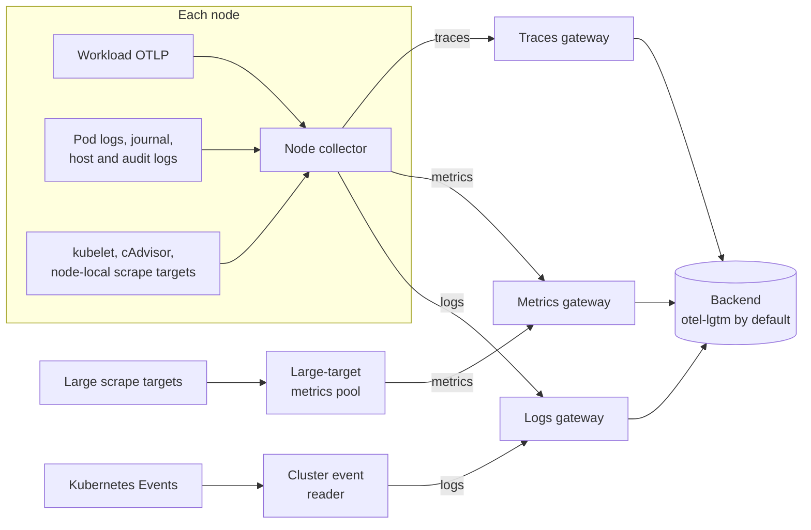
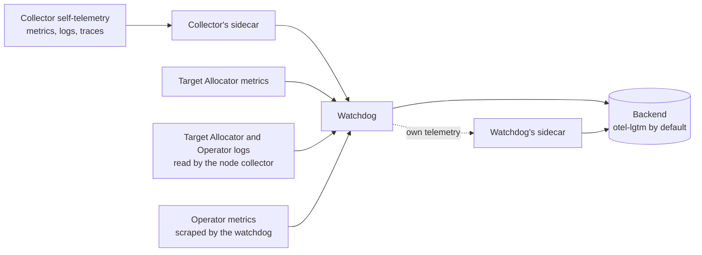

# Topology

NKTP deploys OpenTelemetry Collectors in two tiers. Collection-tier Collectors
gather telemetry inside the cluster and forward each signal to the gateway for
that signal. The gateways export to the backend. A separate Collector, the
watchdog, carries the pipeline's own telemetry.

The OpenTelemetry Operator, installed by the bundled opentelemetry-kube-stack
chart, creates each Collector and Target Allocator from an
`OpenTelemetryCollector` resource that the chart renders. Each Collector's
configuration is the native YAML under `<component>.otelcol.config` in
`values.yaml`, rendered unchanged; see the
[design principles](../design-principles.md). The flows below are the ones those
default configurations define.

## Data path

| Collector | Values key | Runs as | Collects | Sends to |
| --- | --- | --- | --- | --- |
| [Node collector](../components/node-collector.md) | `daemonset` | DaemonSet on every node, including tainted nodes | OTLP from workloads on its node, pod logs, journal, host authentication and audit logs, Kubernetes API audit log, kubelet and cAdvisor metrics, and scrape targets on its node | The gateway for each signal |
| [Large-target metrics pool](../components/large-target-metrics.md) | `large_target_metrics` | StatefulSet, 2 to 16 replicas | Monitors labeled `nktp.nvidia.io/large-target: "true"` | Metrics gateway |
| [Cluster event reader](../components/cluster-events.md) | `cluster_events` | StatefulSet, 2 replicas, one elected reader | Kubernetes Events | Logs gateway |
| [Logs, metrics, and traces gateways](../components/gateways.md) | `gateway_logs`, `gateway_metrics`, `gateway_traces` | One StatefulSet each, 2 to 64 replicas | OTLP over gRPC with mTLS | Backend |
| [Watchdog](../components/watchdog.md) | `watchdog` | StatefulSet, 2 to 16 replicas | Self-telemetry from NKTP components | Backend |

Each Collector's exporters name the next hop explicitly. For example, the node
collector's `otlp/metrics` exporter sends to
`nktp-gateway-metrics-collector:4317` over OTLP/gRPC. To change where a signal goes,
change the exporter in that Collector's configuration.

## Metrics scraping

Three Target Allocators decide which Collector replica scrapes each target. The
[target allocation design](../designs/target-allocation.md) explains why each
scraping Collector requires one.

| Target Allocator | Strategy | Discovers | Assigns to |
| --- | --- | --- | --- |
| Node (`daemonset`) | `per-node` | ServiceMonitors, PodMonitors, Probes, and ScrapeConfigs without the large-target label | The node collector on the target's node |
| Large-target (`large_target_metrics`) | `consistent-hashing` | The same resource kinds with `nktp.nvidia.io/large-target: "true"` | One replica of the large-target pool |
| Watchdog (`watchdog`) | `consistent-hashing` | The watchdog's own scrape jobs; Prometheus CR discovery is off | One watchdog replica |

The bundled exporters are split between the first two:

- node-exporter and the kube-state-metrics DaemonSet are scraped by the node
  collector on the same node.
- The central kube-state-metrics Deployments and the Kubernetes control plane
  ServiceMonitors carry the large-target label and are scraped by the
  large-target pool.
- The kubelet and cAdvisor are not discovered through a Target Allocator. Each
  node collector scrapes its own node's kubelet directly; see
  [Configure kubelet metrics](../guides/configure-kubelet-metrics.md).

Each Collector reaches its Target Allocator over mTLS by default; see
[Configure cert-manager](../guides/configure-cert-manager.md#target-allocators).

## Self-telemetry

The watchdog receives the pipeline's own telemetry at
`nktp-watchdog-collector:4317` over OTLP/gRPC with mTLS, except allocator metrics
which use plaintext OTLP/gRPC on port 4320:

- Every Collector except the watchdog exports its own metrics, logs and traces
  through `service.telemetry` to the sidecar in its Pod, and the sidecar exports
  them there. See [Self-telemetry sidecars](self-telemetry.md).
- Every Target Allocator pushes its metrics to `nktp-watchdog-collector:4320`.
- The node collector reads Target Allocator and Operator container logs on its
  node and sends them there through its `logs/targetallocator` and
  `logs/operator` pipelines. Its pod-log reader skips these files and the NKTP
  Collectors' own pod logs, so they are not also sent through the logs gateway.
- The watchdog scrapes the Operator's metrics endpoint itself.

The watchdog forwards what it receives directly to the backend. Its own
telemetry goes through its sidecar to the backend. Self-telemetry therefore does not pass through the gateways.
See [Backpressure](backpressure.md) for how self-telemetry is buffered
separately from collection.

## Supporting components

- **OpenTelemetry Operator** (`nktp-operator`) and the OpenTelemetry and
  Prometheus CRDs, from opentelemetry-kube-stack. See
  [Managed dependencies](../components/dependencies.md).
- **kube-state-metrics**: a DaemonSet for Pods scheduled on each node, plus
  central Deployments grouped by resource type. See
  [kube-state-metrics](../components/kube-state-metrics.md).
- **node-exporter**: host metrics from every node.
- **metrics-server**, off by default: the resource metrics API that the
  autoscalers read.
- **otel-lgtm**: the default backend, for evaluation only. See
  [otel-lgtm](../components/otel-lgtm.md).

## Scaling

The gateways, the large-target pool, and the watchdog scale horizontally on CPU
and memory utilization, which requires the Kubernetes resource metrics API. The
node collector scales with the number of nodes. The cluster event reader runs
two replicas, one active and one standby; more replicas do not increase watch
throughput. See [Size resources](../guides/size-resources.md).
