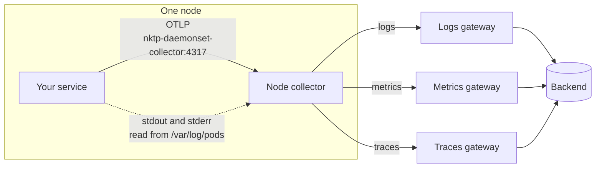
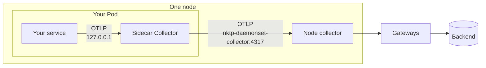

# Send telemetry to NKTP

This guide is for teams whose workloads run on a cluster with NVKE telemetry pipeline (NKTP). It covers
how to emit telemetry to NKTP.

Typical setup:

1. Write logs to stdout and stderr. NKTP collects them without configuration.
2. Instrument your service with an OpenTelemetry SDK for metrics and traces.
3. Configure the SDK to send to the NKTP node collector on the same node.

If your service exposes Prometheus metrics, create a `ServiceMonitor` or
`PodMonitor` for it instead of, or in addition to, the SDK metrics. See
[Prometheus metrics](#prometheus-metrics).

Optionally, you can [add a sidecar Collector](#add-a-sidecar) to your Pod if
you want buffering or processing before telemetry leaves your Pod.

## How telemetry reaches NKTP

NKTP runs a node collector on every node. The node collector reads the logs of
every Pod on its node and accepts OTLP from workloads on its node. It forwards
each signal to the gateway for that signal, and the gateways export to the
backend. See [Topology](../architecture/topology.md) for the full pipeline.



The node collector endpoint (`nktp-daemonset-collector:4317`) routes traffic
only to the collector on the sender's node. If that collector is not ready, for example while its Pod
restarts, the send fails and does not reach another node.

## Logs

Write logs to stdout or stderr, one record per line. The node collector reads
them from `/var/log/pods` and sends them to the logs gateway. Logs written to a
file inside the container are not collected.

Each record carries `k8s.namespace.name`, `k8s.pod.name`, and
`k8s.container.name`. The whole line is the log body.

## Instrument your service

Add an OpenTelemetry SDK for your language to emit metrics and traces. The
[language documentation](https://opentelemetry.io/docs/languages/) has a
getting-started guide for each supported language.

## Send OTLP to the node collector

Configure the SDK to send OTLP logs, metrics, and traces to the node collector at
`nktp-daemonset-collector:4317` over gRPC or
`http://nktp-daemonset-collector:4318` over HTTP. Qualify the host name with
the NKTP namespace when you send from another namespace, for example
`nktp-daemonset-collector.nktp:4317`.

Set `OTEL_SERVICE_NAME` to a stable name for your service. Replace `nktp` in
the endpoint with NKTP's release namespace.

```yaml
env:
  - name: OTEL_SERVICE_NAME
    value: checkout
  - name: OTEL_EXPORTER_OTLP_ENDPOINT
    value: http://nktp-daemonset-collector.nktp:4318
  - name: OTEL_EXPORTER_OTLP_PROTOCOL
    value: http/protobuf
```

See the
[SDK configuration](https://opentelemetry.io/docs/languages/sdk-configuration/general/)
and
[OTLP exporter](https://opentelemetry.io/docs/languages/sdk-configuration/otlp-exporter/)
pages for all options.

## Use auto-instrumentation

Java, Node.js, Python, and .NET services can use an agent instead of an SDK.
The OpenTelemetry Operator that NKTP installs injects the agent when a Pod is
created. An `Instrumentation` resource configures the agent, including where it
sends telemetry.

Add the annotation for your language to the Pod template of your workload. Its
value names the `Instrumentation` to use, such as a shared `nktp/default` that
your cluster provides, or your own. Existing Pods need a rollout.

```yaml
spec:
  template:
    metadata:
      annotations:
        instrumentation.opentelemetry.io/inject-java: "nktp/default"
```

See
[Injecting auto-instrumentation](https://opentelemetry.io/docs/platforms/kubernetes/operator/automatic/)
for the annotation for each language, Pods with more than one container, and
creating your own `Instrumentation`.

## Add a sidecar

A sidecar is a Collector that runs as an extra container in your Pod. The SDK
sends to the sidecar over loopback, and the sidecar sends to the node
collector. Optionally, you can add a sidecar to your Pod for any of these
reasons.

- Buffering and retries when the node collector is not ready. The sidecar holds
  data in memory and retries, beyond what the SDK's own queue can hold.
- Processing before telemetry leaves your Pod, such as
  [sampling traces](#sample-traces-in-the-sidecar), or dropping or adding
  attributes.



The OpenTelemetry Operator that NKTP installs creates the sidecar.

### 1. Create the sidecar

Create an `OpenTelemetryCollector` in the namespace of your service. Replace
`nktp` in the exporter endpoint with NKTP's release namespace. Set `image` to
the same image as the NKTP collectors, which is `otelcol_image` in the NKTP
`values.yaml`. Without it, the Operator injects its own default image, which can
be a different version.

```yaml
apiVersion: opentelemetry.io/v1beta1
kind: OpenTelemetryCollector
metadata:
  name: nktp-sidecar
spec:
  mode: sidecar
  image: otel/opentelemetry-collector-k8s:0.162.0
  resources:
    requests:
      cpu: 10m
      memory: 32Mi
    limits:
      cpu: 100m
      memory: 128Mi
  config:
    receivers:
      otlp:
        protocols:
          grpc:
            endpoint: 127.0.0.1:4317
          http:
            endpoint: 127.0.0.1:4318
    processors:
      memory_limiter:
        check_interval: 500ms
        limit_percentage: 80
        spike_limit_percentage: 25
    exporters:
      otlp:
        endpoint: nktp-daemonset-collector.nktp:4317
        tls:
          insecure: true
        retry_on_failure:
          max_elapsed_time: 30m
        sending_queue:
          batch:
            flush_timeout: 1s
    service:
      pipelines:
        logs:
          receivers: [otlp]
          processors: [memory_limiter]
          exporters: [otlp]
        metrics:
          receivers: [otlp]
          processors: [memory_limiter]
          exporters: [otlp]
        traces:
          receivers: [otlp]
          processors: [memory_limiter]
          exporters: [otlp]
```

- The receivers listen on `127.0.0.1`, so only containers in the same Pod can
  reach them.
- The node collector's OTLP receivers do not use TLS, so the exporter sets
  `tls.insecure: true`.

### 2. Inject the sidecar

Add this annotation to the Pod template of your workload, not to the workload
itself. Its value names the Collector from step 1. The following is a
Deployment excerpt. The Operator adds the sidecar when a Pod is created, so
existing Pods need a rollout.

```yaml
spec:
  template:
    metadata:
      annotations:
        sidecar.opentelemetry.io/inject: "nktp-sidecar"
```

### 3. Point the SDK at the sidecar

Change the endpoint on your service container.

```yaml
- name: OTEL_EXPORTER_OTLP_ENDPOINT
  value: http://127.0.0.1:4318
```

## Sample traces in the sidecar

To keep a share of traces, add a sampler to the sidecar. Add the processor and
put it in the traces pipeline. The rest of the configuration stays the same.

```yaml
processors:
  probabilistic_sampler:
    sampling_percentage: 10
service:
  pipelines:
    traces:
      receivers: [otlp]
      processors: [memory_limiter, probabilistic_sampler]
      exporters: [otlp]
```

This keeps 10% of traces. The sampler decides from the trace ID, so every
service that uses the same percentage keeps the same traces.

## Prometheus metrics

A service's own metrics are scraped only when it has a `ServiceMonitor` or
`PodMonitor`, which can live in any namespace and needs no NKTP-specific label.
If a NetworkPolicy guards the metrics port, admit the NKTP release namespace.

The node Target Allocator assigns each target to the node collector on the
target's node. Targets without a matching collector node remain unassigned.

The node and large-target allocators allow ServiceMonitor and PodMonitor file
references by default (`denyFSAccessThroughSMs: false`). Referenced files must
exist in the scraping Collector container; paths in your application's
container are not available there. Prefer Secret or CA ConfigMap references.
For the node allocator to read Secrets and CA ConfigMaps referenced by monitors,
the NKTP chart configuration must include the monitors' namespaces in
`daemonset.kubernetes.targetAllocator.prometheusCR.secretNamespaces`. See
[Monitor credentials](../components/node-collector.md#monitor-credentials) for
the access this grants.

Before enabling `denyFSAccessThroughSMs` on either allocator, ensure that none
of its selected ServiceMonitors or PodMonitors reference files in the Collector
container. Otherwise, affected scrape jobs are dropped. Follow
[Restrict monitor file access](restrict-monitor-file-access.md) to audit and
replace incompatible monitors.

## Large targets

A large target is an endpoint with a large scrape response, or with a response
that grows with the size of the cluster, the number of objects in the cluster,
or the amount of activity in the cluster. Label the monitor of a large target
`nktp.nvidia.io/large-target: "true"`. The
[large-target pool](../components/large-target-metrics.md) scrapes labeled
monitors instead of the node collector and reserves more memory for each
scrape.

An individual endpoint must still fit in one Collector. Scrape defaults limit
each response to 1,000,000 samples and 1 GiB. Split endpoints that exceed these
limits into smaller scrape targets where possible. For large targets scraped
every 60 seconds, consider `scrapeTimeout: 55s` on the ServiceMonitor or
PodMonitor endpoint. Keep the timeout below the scrape interval.
