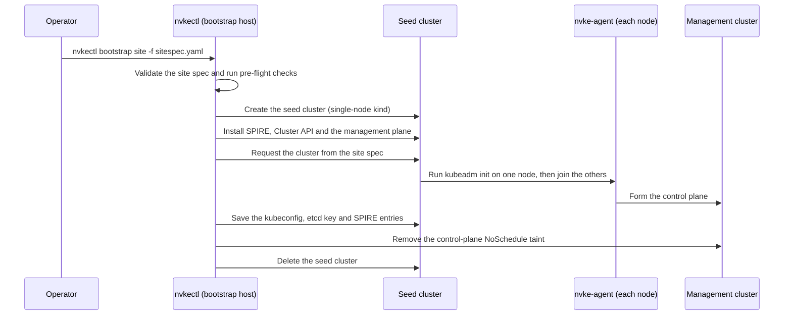

# Bootstrap the management cluster

This page describes how to turn your prepared nodes into the management cluster, the Kubernetes cluster that runs the NVIDIA Kubernetes Engine (NVKE) management plane. You run one command, `nvkectl bootstrap site`, after the nodes are prepared and before you install the management-plane services.

## Before you begin

- You have read [Plan your installation](plan-installation.md).
- Your nodes are prepared as described in [Prepare nodes](prepare-nodes.md): each has `nvke-agent` enabled, has the Kubernetes packages installed, and has `spire-agent` configured with your SPIFFE trust domain and the SPIRE address of the bootstrap host. `nvke-agent` starts once the bootstrap's SPIRE server attests the node.
- You have an odd number of nodes, such as one, three or five, and you know each node's name, IP address and TPM endorsement-key (EK) thumbprint.
- You have an IPv4 virtual IP address (VIP) for the Kubernetes API, routed to the nodes over BGP. A single-node cluster can omit it and use its node's IP.
- You have your SPIRE CA certificate and key as files on the bootstrap host, and the certificate is already on each node.
- You have a Linux bootstrap host that reaches every node on the `nvke-agent` port (15005 by default) and reaches the Kubernetes API address on 6443. Nodes with a TPM thumbprint must reach the bootstrap host on 30081. You can use one of the nodes as the bootstrap host.
- The bootstrap host has rootful `nerdctl` with containerd, plus `kind`, `helm`, `kubectl` and `clusterctl` on `PATH`. Docker is not supported. Only `nerdctl` is checked before the run starts, so a missing `helm`, `kubectl` or `clusterctl` fails the run part-way through.
- The bootstrap host has Go and GNU Make to build `nvkectl`, and outbound access to the registries and chart repositories the bootstrap pulls from.

Run every command on this page on the bootstrap host, as root, in a session that survives a disconnect, such as `tmux`.

## Install nvkectl

1. Clone the repository and build `nvkectl` with Make.

   ```bash
   git clone https://github.com/dsx-ai-factory/nvke.git
   ```

   ```bash
   make -C nvke/cli build
   ```

   Build with `make`, not `go build`. The Makefile stamps the version and the Cluster API version into the binary, and a binary built without them fails later when it installs Cluster API.

2. Put the binary on your `PATH` and check the version.

   ```bash
   export PATH="$PWD/nvke/cli/bin:$PATH"
   ```

   ```bash
   nvkectl version
   ```

   The output shows a version string, not `dev`.

## Write the site spec

The site spec is a YAML file that lists the nodes and the Kubernetes settings for the management cluster. `nvkectl generate sitespec` writes it from a CSV of your nodes. The full schema is in [Site Spec](../../cli/docs/sitespec.md).

1. Write a CSV with one row per node.

   ```text
   name,ip,tpm_ek_thumbprint
   cp-01,10.0.10.2,<CP_01_EK_THUMBPRINT>
   cp-02,10.0.10.3,<CP_02_EK_THUMBPRINT>
   cp-03,10.0.10.4,<CP_03_EK_THUMBPRINT>
   ```

   Save it as `hosts.csv`. `name` and `ip` are required. `<CP_01_EK_THUMBPRINT>` and the others are each node's TPM EK thumbprint: 64 lowercase hex digits, as printed by `get_tpm_pubhash` from `spire-tpm-plugin`. A node without a thumbprint cannot attest with its TPM.

2. Generate the site spec.

   ```bash
   nvkectl generate sitespec <CLUSTER_NAME> --nodes hosts.csv \
     --set cluster.k8sVersion=<K8S_VERSION> \
     --set cluster.controlPlaneVIP=<API_VIP> \
     --set cluster.podCidr=<POD_CIDR> \
     --set cluster.serviceCidr=<SERVICE_CIDR> \
     --set cluster.kubeletConfig.systemReservedMemory=<RESERVED_MEMORY> \
     --set spire.trustDomain=<TRUST_DOMAIN> \
     --set spire.upstreamCA=true > sitespec.yaml
   ```

   - `<CLUSTER_NAME>`: the management cluster's name, a lowercase RFC 1123 label such as `example-mgmt`.
   - `<K8S_VERSION>`: the Kubernetes version your node images carry, without a leading `v`, such as `1.36.3`. See [Supported platforms and versions](../overview/supported-platforms.md).
   - `<API_VIP>`: the Kubernetes API address. It must be outside the pod and service CIDRs. For a single-node cluster you can omit this line.
   - `<POD_CIDR>` and `<SERVICE_CIDR>`: the cluster networks. They must not overlap each other or your node network.
   - `<RESERVED_MEMORY>`: memory the kubelet reserves for the system, such as `16Gi`.
   - `<TRUST_DOMAIN>`: the SPIFFE trust domain configured on every node's `spire-agent`, such as `mgmt.example.com`.
   - `spire.upstreamCA=true`: the site's SPIRE chains to your SPIRE CA. The bootstrap and every later install then require `NVKECTL_SPIRE_CA_CERT_FILE` and `NVKECTL_SPIRE_CA_KEY_FILE`.

   If you omit a `--set` line, the field keeps its default: `k8sVersion` `1.36.3`, `podCidr` `192.168.0.0/16`, `serviceCidr` `10.96.0.0/12`, `systemReservedMemory` `16Gi`. If the reserved memory is close to a node's total memory, the node has nothing left to schedule and never reaches `Ready`. The CNI defaults to `ovn-kubernetes`, and etcd encryption at rest is on. Encryption can only be chosen at bootstrap: a cluster built with `--set cluster.etcdEncryption=false` stays unencrypted.

   The site spec carries the bootstrap's fields and nothing else. What the management plane needs beyond them goes in a file of its own, which you write before you [Run NVKE end to end on one machine](../get-started/local-site.md).

   `generate sitespec` validates every field before it writes the file. `bootstrap site` also reads environment variables, such as `CLUSTER_POD_CIDR`, that override fields in the file; [Site Spec](../../cli/docs/sitespec.md) lists them. Unset them before you run the bootstrap unless you mean to override the file.

3. Validate the site spec without touching any node.

   ```bash
   export NVKECTL_SPIRE_CA_CERT_FILE=<CA_CERT_PATH> NVKECTL_SPIRE_CA_KEY_FILE=<CA_KEY_PATH>
   nvkectl bootstrap site -f sitespec.yaml --dry-run
   ```

   `<CA_CERT_PATH>` and `<CA_KEY_PATH>` are absolute paths to your SPIRE CA files. The install exports the same values from inside the `nvke/` checkout, where a relative path no longer points at the files. Nodes built from the node image need them: without them SPIRE uses a self-signed CA that no node can trust in advance, and the nodes cannot attest. The site spec sets `spire.upstreamCA`, so the dry run and the bootstrap both require them; keep them exported in the shell you run the bootstrap from.

   The command prints the site spec with defaults applied, then `Dry run: site spec is valid. No workflow dispatched.` If the file is invalid, it lists every problem in one error. Read the printed values before you continue.

## Prepare the bootstrap container images

The temporary seed cluster runs two containers: the NVKE controller and the provisioned infrastructure provider. These use OCI container images, separate from the QCOW2 disk image you used earlier to prepare the nodes. Choose one of the following ways to supply the two container images.

### Build the containers on the bootstrap host

From the directory containing your `nvke/` checkout, run:

```bash
make -C nvke/cli images
```

This builds `nke-controller:latest` and `cluster-api-provider-provisioned:latest` in the bootstrap host's local containerd image store using `nerdctl`. The bootstrap uses those names by default. In the next step, run `nvkectl bootstrap site` without image flags.

### Use containers already stored in a registry

If the two container images have already been built and pushed to a registry, obtain their complete image references. Each reference includes the registry host, repository and tag or digest. For example:

```bash
CONTROLLER_IMAGE="registry.example.com/nvke/controller:<TAG>"
PROVISIONED_PROVIDER_IMAGE="registry.example.com/nvke/cluster-api-provider-provisioned:<TAG>"
```

Replace these examples with the references for the NVKE version you are installing. If that registry requires authentication, log in on the bootstrap host:

```bash
nerdctl login registry.example.com
```

Replace `registry.example.com` with the host in your image references. In the next step, pass the two references with `--nvke-controller-image` and `--provisioned-provider-image`. The bootstrap pulls a registry image if it is absent locally, then loads it into the seed cluster. This step selects existing container images; it does not build or publish them.

## Run the bootstrap

1. Start the bootstrap using the container images you prepared above.

   For the local build:

   ```bash
   nvkectl bootstrap site -f sitespec.yaml
   ```

   For existing registry images, use the two variables from the registry example:

   ```bash
   nvkectl bootstrap site -f sitespec.yaml \
     --nvke-controller-image "$CONTROLLER_IMAGE" \
     --provisioned-provider-image "$PROVISIONED_PROVIDER_IMAGE"
   ```

   Run either command in the shell where you exported the SPIRE CA variables to validate the site spec. `NVKECTL_NVKE_CONTROLLER_IMAGE` and `NVKECTL_CAPI_PROVISIONED_IMAGE` can also select the images from the environment; explicit flags take precedence. For the local-build command, leave those image variables unset to use the default local image names.

   Before it creates anything, the command refuses to start if a seed cluster from an earlier run still exists, if the etcd encryption key file it would write already exists, if any node already accepts connections on port 6443, or if a local image is missing.

2. Wait for the command to finish.

   The wait for the nodes to provision and join is bounded by `--timeout`, 30 minutes by default (`NVKECTL_BOOTSTRAP_CLUSTER_TIMEOUT` sets the default). Raise it for a larger cluster, for example `--timeout 45m`.

   On success the command prints that the cluster is ready and the `kubectl` command to reach it.

3. Secure the output files.

   The command writes these files to the working directory:

   | File | Contents |
   |---|---|
   | `<CLUSTER_NAME>.kubeconfig` | A break-glass admin kubeconfig for the management cluster: a client certificate in the group `nvke:breakglass`, which the bootstrap binds to `cluster-admin`. The certificate is requested for one year. Change the path with `--kubeconfig-out`. |
   | `<CLUSTER_NAME>-etcd-encryption-key.json` | The etcd encryption key, as a Secret manifest. Written only when etcd encryption is on. Change the path with `--encryption-key-out`. |
   | `clusterstaticentry-crd.yaml` and `clusterstaticentries.yaml` | The SPIRE registration CRD and entries exported from the seed cluster. Written next to the kubeconfig unless you ran with `--disable-mtls`. |

   The kubeconfig and the key file are secrets. Every control-plane node holds the etcd key, so the running cluster does not depend on the file, and installing the management-plane services does not use it. It is the only copy of the key that is not on a node. After you finish [Verify](#verify), copy the key file to secure storage and delete it from the bootstrap host.

   Keep `<CLUSTER_NAME>.kubeconfig` on the host you install from. [Run NVKE end to end on one machine](../get-started/local-site.md), [Configure an infrastructure provider: NICo](provider-nico.md) and [Secure the NVKE API](api-authentication.md) all use it. When you finish those pages, copy it to secure storage and delete it from that host.

## What happens during the bootstrap

`nvkectl` forms the management cluster with a temporary copy of the management plane running in a seed cluster on the bootstrap host. The sequence below shows the order of operations.



The management plane in the seed cluster drives each node through `nvke-agent`, so the bootstrap needs no SSH access to the nodes. It chooses which node runs `kubeadm init`; the site spec does not. Every node in the site spec becomes a control-plane node, and `nvkectl` removes the control-plane `NoSchedule` taint so that the management-plane services can run on them.

## If the bootstrap fails

Each failure message says what to do next. How you retry depends on when the run failed.

- **Before the cluster was requested**, for example an image pull or a component that did not become healthy: `nvkectl` writes diagnostics to `cluster-diagnostics/` (`--diagnostics-dir` changes it), deletes the seed cluster, and exits. Fix the cause and run the bootstrap again.
- **After the cluster was requested**: `nvkectl` writes diagnostics and keeps the seed cluster, because it holds the state needed for recovery. The error names the seed cluster, its kubeconfig and the command that deletes it.

To retry after the second case:

1. If the error says the etcd encryption key was not saved, run the save command the error prints. Do not delete the seed cluster or re-run the bootstrap until the key is saved.

2. Delete the seed cluster. The `KIND_EXPERIMENTAL_PROVIDER` prefix is required: without it, `kind` looks for the cluster in Docker and exits successfully without deleting anything.

   ```bash
   KIND_EXPERIMENTAL_PROVIDER=nerdctl kind delete cluster --name nvkectl-bootstrap
   ```

3. On every node that has `/etc/kubernetes/manifests`, reset kubeadm.

   ```bash
   kubeadm reset -f
   ```

4. If you reset the nodes, delete the `<CLUSTER_NAME>-etcd-encryption-key.json` left by the failed run. The bootstrap never overwrites a key file.

5. Run the bootstrap again.

`--keep-bootstrap-cluster` keeps the seed cluster after any run, for debugging. Delete it with the command in step 2 before the next run. For deeper diagnosis, see [Troubleshoot](troubleshoot.md).

## Verify

1. Check that every node is `Ready`.

   ```bash
   kubectl --kubeconfig <CLUSTER_NAME>.kubeconfig get nodes
   ```

   Every node in the site spec is listed with the `control-plane` role and status `Ready`.

2. Check that the control-plane taint is gone.

   ```bash
   kubectl --kubeconfig <CLUSTER_NAME>.kubeconfig get nodes -o jsonpath='{.items[*].spec.taints}'
   ```

   The output contains no `node-role.kubernetes.io/control-plane` taint. If it does, the error from the bootstrap printed the command to remove it:

   ```bash
   kubectl taint nodes --all node-role.kubernetes.io/control-plane:NoSchedule- --kubeconfig <CLUSTER_NAME>.kubeconfig
   ```

3. Check that the seed cluster is gone.

   ```bash
   KIND_EXPERIMENTAL_PROVIDER=nerdctl kind get clusters
   ```

   `nvkectl-bootstrap` is not listed.

The management cluster is a plain Kubernetes cluster at this point. It does not upgrade, scale or replace its own nodes; see [Preview status and known limitations](../overview/preview-status.md).

## Next steps

- [Run NVKE end to end on one machine](../get-started/local-site.md) on the new cluster, using the kubeconfig from the bootstrap.
- [Configure an infrastructure provider: NICo](provider-nico.md).
