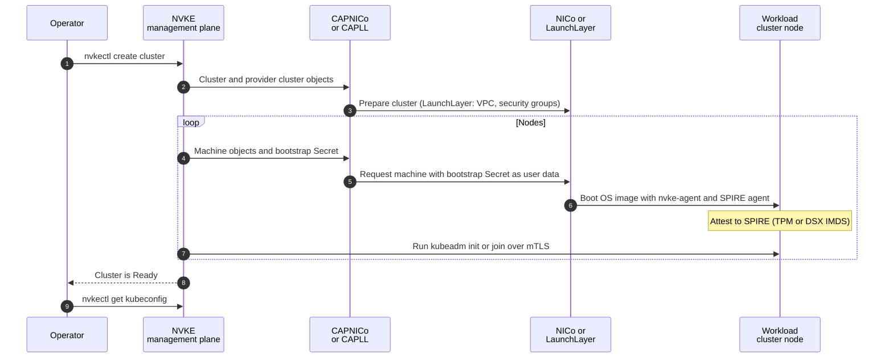

# Infrastructure providers

An infrastructure provider supplies the machines that NVIDIA Kubernetes Engine (NVKE) turns into workload cluster nodes. NVKE supports two: NVIDIA Infra Controller (NICo), through CAPNICo, and LaunchLayer, through CAPLL. Both are Cluster API (CAPI) infrastructure providers that run on the management cluster.

## How a workload cluster gets its machines

The diagram shows what happens when you create a workload cluster. The NVKE management plane and CAPNICo or CAPLL run on the management cluster. The table after the diagram explains each numbered step.



| Step | What happens |
|---|---|
| 1 | You create the cluster with `nvkectl create cluster`, or with the same request to `POST /api/clusters`, as described in [Create a workload cluster](../workload-clusters/create.md). The request carries a `nico` or `launchLayer` object, and the cluster's provider is fixed at creation. Every later step is automatic. |
| 2 | The management plane creates a Cluster API `Cluster` and a `NicoCluster` or `LaunchLayerCluster`, named after the workload cluster, in the `nvke-system` namespace. |
| 3 | The provider reconciles the cluster. For LaunchLayer, CAPLL creates or adopts the VPC and creates the cluster's security groups. |
| 4 | For each node, the management plane creates a bootstrap Secret, a Cluster API `Machine` and a `NicoMachine` or `LaunchLayerMachine`, named after the node. The bootstrap Secret is the node's cloud-init user data: for NICo, rendered from the first-boot template of the node's release; for LaunchLayer, the SPIRE agent configuration and trust bundle. |
| 5 | The provider requests a machine from NICo or LaunchLayer, with the bootstrap Secret as its user data. |
| 6 | The machine boots its OS image, which carries `nvke-agent` and the SPIRE agent. The SPIRE agent attests the node to the SPIRE server on the management cluster, by TPM for `deploy/nico` or by DSX IMDS for `deploy/launchlayer`, and receives the node's SPIFFE identity. |
| 7 | The management plane connects to `nvke-agent` over mTLS and runs `kubeadm init` on the first control-plane node and `kubeadm join` on the others. For LaunchLayer, CAPLL then sets each node's provider ID through the kubeconfig Secret the management plane publishes for the cluster, so `tenantAccess.enabled` must stay `true`; with it off, LaunchLayer clusters stay `Provisioning`. |
| 8 | The cluster reaches `Ready`. |
| 9 | You download the admin kubeconfig with `nvkectl get kubeconfig`, as described in [Access a workload cluster](../workload-clusters/access.md). |

## Supported providers

| | NICo | LaunchLayer |
|---|---|---|
| Cluster API provider | CAPNICo, in `capnico-system` | CAPLL, in `capll-system` |
| Deploy path | `deploy/nico` | `deploy/launchlayer` |
| Request object | `nico` | `launchLayer` |
| Credentials Secret | `nico-credentials` | `launchlayer-credentials` |
| Node attestation in the deploy path | TPM | DSX IMDS |
| Configure it | [Configure an infrastructure provider: NICo](provider-nico.md) | [Configure an infrastructure provider: LaunchLayer](provider-launchlayer.md) |

## How a deployment selects a provider

You select the provider when you [install the management plane](install-management-plane.md), by choosing the deploy path: `deploy/nico` for NICo or `deploy/launchlayer` for LaunchLayer. Each deploy path installs its provider, writes its credentials Secret and sets the controller chart values the provider needs.

The controller chart value `supportedInfraProviders` lists the provider objects the NVKE API accepts. The API rejects a request that carries any other provider object with `400`. The node attestation method applies to every new node of a deployment. With SPIFFE on, LaunchLayer requires DSX IMDS, so a deployment whose NICo nodes attest with TPM cannot also accept `launchLayer`.

## The provider set is closed

`supportedInfraProviders` accepts only `nico`, `launchLayer` and `infra`. With any other value, the controller chart fails to render and the controller does not start. `infra` accepts raw Cluster API manifests from the caller and is not an infrastructure provider in its own right.

Adding a provider is a change to NVKE, not configuration. It needs a Cluster API infrastructure provider for the platform and, in the `dsx-ai-factory/nvke` repository:

- A provider object in the REST API, `controller/api/openapi.yaml`.
- A provider client under `controller/internal/clients/` that implements `ProviderClient`.
- The provider name in the `supportedInfraProviders` checks of the controller chart and the controller configuration.
- RBAC in the controller chart for the provider's custom resource definitions (CRDs).
- An entry in `nvkectl get providers`, in `cli/internal/providers`.
- A deploy path under `deploy/` that installs the provider.

To propose a provider, open an issue in the `dsx-ai-factory/nvke` repository.

## Check providers and their clusters

`nvkectl get providers` lists each provider with its state, read from the management cluster. `CONFIGURED` means the provider's CRDs are established, its controller is available and its credentials Secret exists. The provider pages describe the other states.

```bash
nvkectl get providers
```

To see which provider each workload cluster uses, list the Cluster API clusters with their infrastructure kind:

```bash
kubectl -n nvke-system get clusters.cluster.x-k8s.io \
  -o custom-columns=NAME:.metadata.name,PROVIDER:.spec.infrastructureRef.kind,PHASE:.status.phase
```

`PROVIDER` reads `NicoCluster` or `LaunchLayerCluster`. Each provider page shows how to read that cluster's provider objects.

## Next steps

- [Install the management plane](install-management-plane.md) with the deploy path for your provider.
- [Configure an infrastructure provider: NICo](provider-nico.md) or [Configure an infrastructure provider: LaunchLayer](provider-launchlayer.md).
