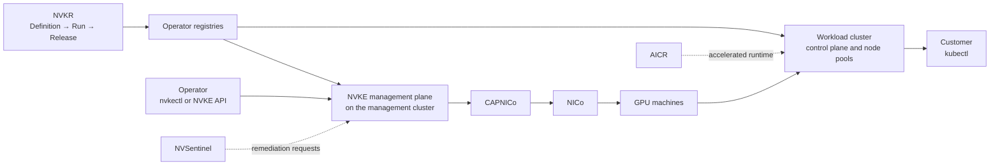

# What is NVKE

> **Preview:** NVKE is available as a preview. APIs, configuration and behavior can change between releases, and we do not recommend NVKE for production workloads. See [Preview status and known limitations](preview-status.md).

NVIDIA Kubernetes Engine (NVKE) is open-source software that an AI factory installs to run a managed Kubernetes service on its own NVIDIA GPU infrastructure. You call the NVKE API to create Kubernetes clusters for your customers, and NVKE provisions the nodes, forms each cluster, and operates it afterward: scaling node pools, upgrading Kubernetes, replacing nodes and renewing certificates.

NVKE runs the artifacts that NVIDIA Kubernetes Recipes (NVKR), its companion project, builds. NVKR turns pinned source into node OS images, packages and NVKE's own components, either in a Run on your own host or in the hosted pipeline that NVKR generates, and publishes them as Releases to registries you control. Only a Release from the hosted pipeline is signed and carries build provenance; a local Run is unsigned. No NVKR Release is qualified at preview. NVKE then deploys those artifacts by name.

One NVKE installation manages a fleet of clusters inside a single data center. Each cluster has its own control plane and etcd. NVKE is the Kubernetes management system validated to provide the Kubernetes clusters that DSX OS runs on. NVKE and NVKR are licensed under Apache 2.0.

## Why NVKE

To offer managed Kubernetes as a service an AI factory must deliver cluster provisioning, node identity, upgrades and failure handling for GPU hardware, and keep the software current with each GPU generation. NVKE provides these features:

- **An API for managed clusters.** You request a cluster by Kubernetes version, node pools and network settings. NVKE hides Cluster API, kubeadm and node configuration behind the API and the `nvkectl` CLI.
- **Artifacts from pinned sources that you verify.** NVKR builds every node image and NVKE component from pinned sources. A Release from NVKR's hosted pipeline carries signatures and build provenance, which you check against your own verification policy before it reaches a cluster. You can rebuild any artifact from its sources without depending on an NVIDIA-hosted image.
- **Nodes that prove their identity before they join.** On bare metal, each node attests with its TPM through SPIFFE/SPIRE before it receives a join credential. etcd encryption at rest is available per cluster.
- **GPU-aware day-2 operations.** NVKE upgrades and replaces nodes through node pools. When NVSentinel detects a GPU fault, NVKE runs the reboot or node replacement it requests.
- **Built on open standards.** NVKE uses upstream Kubernetes, kubeadm and Cluster API, so clusters are standard Kubernetes and you can use `kubectl` and `clusterctl` alongside `nvkectl`.

## Who NVKE is for

| You are | You use NVKE to | Start with |
|---|---|---|
| **An AI factory operator**: the Kubernetes service team at an AI factory that provides NVIDIA GPUs to customers | Build your artifacts with NVKR, install and run NVKE, and create and operate clusters for your customers. Most of this documentation is written for you. | [Plan your installation](../operate/plan-installation.md) |
| **A customer** of an AI factory | Receive a Kubernetes API endpoint and node pools, and run AI workloads on them. Your operator creates and manages the cluster for you. | [Access a workload cluster](../workload-clusters/access.md) |
| **An evaluator or contributor** | Try NVKE on one Linux machine with at least 6 CPUs and 12 GiB of memory, against a simulated infrastructure provider, or build and change NVKE and NVKR. | [Quickstart: evaluate locally with mock-NICo](../get-started/quickstart-local.md) |

## Key terms

- **Management cluster.** The Kubernetes cluster the operator bootstraps first. It runs the NVKE management plane. At preview, the management cluster does not upgrade, scale or replace its own nodes.
- **Management plane.** The NVKE API and controllers running on the management cluster. It holds the inventory of clusters, node pools and nodes, and drives every lifecycle operation.
- **Seed cluster.** A temporary single-node kind cluster that `nvkectl` starts during bootstrap to form the management cluster. `nvkectl` deletes it when bootstrap succeeds.
- **NVKE cluster (workload cluster).** A Kubernetes cluster that NVKE creates and manages for a customer. Each has its own control plane, etcd and node pools.
- **Node pool.** A group of nodes in an NVKE cluster that share an instance type, a node pool release and a Kubernetes version. You scale and upgrade nodes by node pool. A node pool also stores `nodeLabels` and `nodeTaints`, which NVKE does not apply to the Kubernetes nodes at preview; see [Preview status and known limitations](preview-status.md#workload-clusters-and-node-pools).
- **Infrastructure provider.** The system that supplies machines to NVKE through Cluster API. At preview, NVKE supports NVIDIA Infra Controller (NICo).
- **NVKR Release.** An immutable set of artifacts and the evidence of how they were built, available through one pinned reference. You deploy artifacts from an NVKR Release once it passes your verification policy.

## How NVKE works

The operator brings NVIDIA GPU machines, networks, registries holding NVKR-built artifacts, and an infrastructure provider. NVKE connects to the infrastructure provider through Cluster API (CAPI) to provision machines with your node images, then uses the NVKE node agent on each machine to form and configure the Kubernetes cluster. The operator calls the NVKE API to create clusters, and customers receive a Kubernetes API endpoint for their cluster.

The diagram shows how artifacts and requests flow from NVKR to a customer's cluster.

| Stage | What happens | Read more |
|---|---|---|
| **Build** | The operator builds node OS images, packages and NVKE components from pinned sources with NVKR, in a local Run or in NVKR's hosted pipeline, verifies each Release, and publishes the artifacts to its own registries. The operator repeats this stage for each new Kubernetes version or security fix. | [Get NVKE artifacts from NVKR and write release manifests](../operate/build-node-images.md) |
| **Day 0: Bootstrap** | The operator prepares the management cluster's nodes. `nvkectl` starts a seed cluster, uses it to form the management cluster with kubeadm, then deletes it. The operator installs the NVKE management plane and the Cluster API controllers onto the management cluster. | [Bootstrap the management cluster](../operate/bootstrap-management-cluster.md), [Install management-plane services](../operate/install-management-plane-services.md) |
| **Day 1: Configure** | The operator connects the management plane to the infrastructure provider, configures API authentication, and registers the NVKR-built node images and profiles that clusters will use. | [Configure an infrastructure provider: NICo](../operate/provider-nico.md), [Secure the NVKE API](../operate/api-authentication.md) |
| **Day 2: Run clusters** | The operator creates NVKE clusters through the API, gives customers access, and installs the accelerated runtime with [NVIDIA AI Cluster Runtime (AICR)](https://docs.nvidia.com/aicr). NVKE scales node pools, upgrades the control plane and workers to new NVKR-built images, replaces nodes and renews certificates. With NVSentinel installed, NVKE reboots or replaces nodes that NVSentinel reports as faulty. | [Create a workload cluster](../workload-clusters/create.md), [Manage node pools](../workload-clusters/node-pools.md) |

## What the project ships

| Component | What it does | Read more |
|---|---|---|
| NVKR | NVIDIA Kubernetes Recipes. The build system and published Definitions for NVKE node OS images, packages and components. Its CLI is `nvkr`. Separate repository: [dsx-ai-factory/nvkr](https://github.com/dsx-ai-factory/nvkr). | [Get NVKE artifacts from NVKR and write release manifests](../operate/build-node-images.md) |
| `nvkectl` | The command-line client. Bootstraps the management cluster, and creates and operates NVKE clusters and node pools through the NVKE API. | [Bootstrap the management cluster](../operate/bootstrap-management-cluster.md) |
| Management plane | The NVKE REST API and controllers on the management cluster. Holds the inventory of clusters, node pools and nodes, and drives every lifecycle operation. | [Install management-plane services](../operate/install-management-plane-services.md) |
| Node agent (`nvke-agent`) | A service on every node. The management plane calls it to run kubeadm, configure encryption and install components such as the CNI, without SSH. | [Prepare nodes](../operate/prepare-nodes.md) |
| CAPNICo | The Cluster API infrastructure provider for NICo. Turns each machine NVKE requests into a NICo bare-metal instance. Separate repository: [dsx-ai-factory/cluster-api-provider-nico](https://github.com/dsx-ai-factory/cluster-api-provider-nico). | [Configure an infrastructure provider: NICo](../operate/provider-nico.md) |
| NKTP | NVIDIA Kubernetes Telemetry Pipeline. OpenTelemetry pipelines for metrics, logs and traces from the management cluster and NVKE clusters. | [Observe NVKE and its clusters](../operate/observe.md) |

## What you bring

NVKE is software that you install and operate. NVIDIA provides the software; the AI factory runs the service. Before you install NVKE, you need:

- NVIDIA GPU machines and the networks that connect them, managed by NICo.
- Nodes for the management cluster, prepared as described in [Prepare nodes](../operate/prepare-nodes.md).
- A build environment for NVKR, and registries you control to hold the node OS images, containers and packages it builds.
- An identity provider that issues signed JWTs, if you turn on NVKE API authentication.

| Who | Is responsible for |
|---|---|
| NVKE and NVKR (the software) | NVKR: builds from pinned sources; its hosted pipeline signs each Release and records build provenance. NVKE: provisioning nodes through the infrastructure provider, forming clusters, node identity and encryption settings, upgrades, node replacement and certificate renewal. |
| The operator | The infrastructure, the management cluster, building, verifying and publishing artifacts with NVKR, installing the accelerated runtime, cluster availability, and the access model customers receive. |
| The customer | Workloads, their images, namespaces and application secrets, and RBAC for their own users within the operator's limits. |

[Plan your installation](../operate/plan-installation.md) lists the full requirements, and [Supported platforms and versions](supported-platforms.md) lists what each release supports.

## What NVKE does not do

- **Manage bare metal.** NICo discovers machines, updates firmware, configures networks and provisions hosts. NVKE requests machines from NICo through CAPNICo.
- **Ship OS images or Kubernetes binaries.** You build node images and packages with NVKR and publish them to your registries.
- **Run your customers' workloads.** NVKE operates the cluster. What runs inside it belongs to the customer.

## NVKE in DSX OS

NVKE is the Kubernetes layer of DSX OS, NVIDIA's software stack for AI factories. Each component below is a separate project:

| Layer | Component | Role |
|---|---|---|
| Infrastructure | NICo (NVIDIA Infra Controller) | Bare-metal machine and network lifecycle: discovery, firmware, network configuration and host provisioning. |
| Build | NVKR (NVIDIA Kubernetes Recipes) | Builds the node OS images, packages and components that NVKE deploys, as Releases. Releases from its hosted pipeline are signed and verifiable. |
| Kubernetes | NVKE | Creates and operates Kubernetes clusters on NICo machines. |
| Accelerated runtime | [AICR (AI Cluster Runtime)](https://docs.nvidia.com/aicr) | Validated, version-locked combinations of the GPU Operator, Network Operator, DRA and other runtime components, installed into each NVKE cluster. |
| Health | NVSentinel | Detects GPU faults on each node and requests remediation from NVKE. |
| Telemetry | NKTP | Collects metrics, logs and traces across clusters. |

## Next steps

- **Try NVKE without hardware:** [Quickstart: evaluate locally with mock-NICo](../get-started/quickstart-local.md).
- **Build your first artifacts:** [Get NVKE artifacts from NVKR and write release manifests](../operate/build-node-images.md).
- **Install on your hardware:** [Plan your installation](../operate/plan-installation.md).
- **Check what preview supports:** [Preview status and known limitations](preview-status.md) and [Supported platforms and versions](supported-platforms.md).
