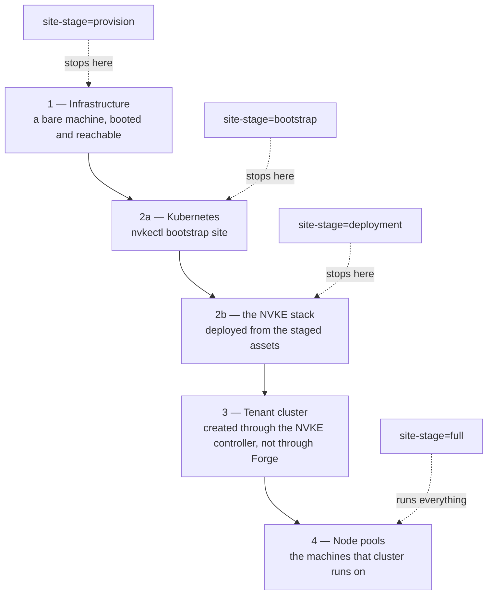
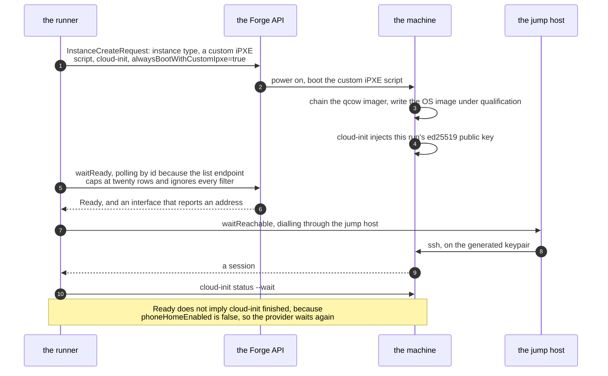
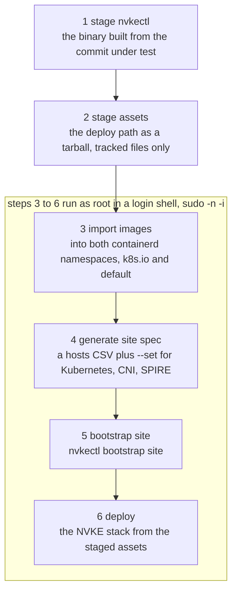
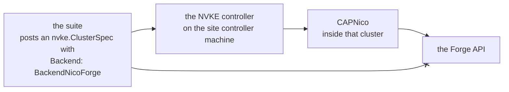
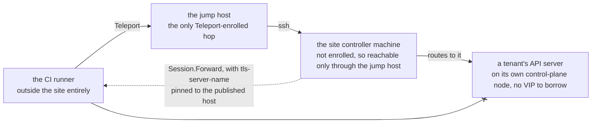

<!--
SPDX-FileCopyrightText: Copyright (c) 2026 NVIDIA CORPORATION & AFFILIATES. All rights reserved.
SPDX-License-Identifier: Apache-2.0
-->

# Qualifying a candidate on real hardware

How the site controller lane works, step by step. The
[e2e README](../../controller/test/e2e/README.md#site-controller-lane) says how
to run it and what to set; this says what it does and why it does it that way.

The code it describes lives in `controller/test/e2e/`, and paths below are
relative to the repository root.

Alongside this: [environments.md](environments.md) for declaring the hardware
a run can execute against, and [triage.md](triage.md) for working out whether
a red run is our defect or the site's.

## What this part of the workflow is called

The responsibility documented here is **environment provisioning**: taking a
declaration of infrastructure that already exists plus a request for
capabilities, producing a live system under test, and releasing it again. That
is the vocabulary the code settled on by itself — `internal/environment` loads
the declaration, `infra.Provider.ProvisionNode` creates the machine, and
`Session.Teardown` "closes every forward, drops the connection, and releases
the machine."

**The hardware lane** is the informal name for the lane that does this on real
machines, and the name used below. It is a lane in the same sense as the capd
and nico lanes: a CI path that stands up an environment and runs the e2e suite
inside it. What distinguishes it is not the specs, which are identical, but
that its environment has to be acquired and given back.

So three words, three jobs. The **hardware lane** is the whole CI path. The
**Forge lane** is its only implementation today. **Provision** is the first
step alone, not the whole thing.

Everything below describes the `nico-forge` path, the only backend that touches
real machines. The CAPD, nico-containers and nico-vms backends simulate the
infrastructure step entirely and skip straight to
[Tenant clusters](#3-tenant-clusters).

## The four steps

Each is built on the one before it, and `-e2e.site-stage` decides how far a run
goes:

`bootstrap` is the one worth noticing: it stops after vanilla Kubernetes and
*before* the NVKE stack, so it proves `nvkectl` can build a cluster on this
hardware without spending the rest of the run on the product.

| Step | Owned by | What it produces |
|---|---|---|
| [Infrastructure](#1-forge-infrastructure) | `internal/infra/forge` | One bare machine, booted and reachable |
| [Site controller](#2-the-site-controller) | `internal/site` | Kubernetes plus the NVKE stack on that machine |
| [Tenant cluster](#3-tenant-clusters) | `tenant_test.go`, the controller | A tenant cluster created through the product API |
| [Node pools](#4-node-pools) | `forgeNodePoolSpecs` | The machines that tenant cluster runs on |

## 1. Forge infrastructure

`internal/infra/forge` provisions the machine through the
`ncx-infra-controller-rest` SDK against NGC, with `cfg.SetAPIName("forge")`
rewriting the generated `carbide` paths.

The whole handshake, because almost every surprise in this lane happens inside
it:

Steps 5 and 7 are the "two waits" below, and step 10 exists only because of
step 1's `phoneHomeEnabled=false`.

**Where the identifiers come from.** `environments/forge.yaml` declares the
org, site, VPC, subnet, SSH key group and instance types. Nothing secret is in
it, and the jump host is deliberately absent too, so the access path is not
published alongside the site. The Forge API key and the Teleport join come from
the environment.

**Choosing a machine.** A run asks for capabilities rather than naming a type.
`ForgeSite.MatchInstanceType` walks the declared types in order and returns the
first whose `provides` map satisfies every infrastructure capability the run
asked for, so requesting `{machineType: cpu}` cannot be answered by a GPU
machine. Declaration order is the tie-break, which is why the file lists the
cheapest type first.

**Creating it.** One `InstanceCreateRequest` carries the instance type, a
custom iPXE script, cloud-init user data, and `alwaysBootWithCustomIpxe=true`.
The iPXE script chains a qcow imager which writes the OS image under
qualification; both URLs are run inputs with no defaults, because a run that
did not say which image to boot has not said what it is qualifying.

`phoneHomeEnabled` is set to `false`, and that is a workaround rather than a
choice. Phone-home is what normally flips an instance to Ready, and since
2026-09-19 new instances cannot reach the metadata endpoint, so the callback
never completes. The cost of turning it off is that Ready no longer implies
cloud-init finished, which is why the provider separately holds the node until
`cloud-init status --wait` returns over the session.

**Two waits, not one.** `waitReady` polls the instance *by id*; the list
endpoint caps at twenty rows and ignores every filter, so a new instance often
is not in it. It keeps polling past the Ready status until an interface
actually reports an address, because Ready can be reported before one is
assigned. Then `waitReachable` dials until sshd answers, which is much later:
Ready means Forge handed the machine over, not that the image is written and
booted.

**Reaching it.** The nodes are not Teleport-enrolled, so every connection goes
through the site's jump host, which is. A fresh ed25519 keypair is generated
per run and its public half injected through cloud-init; nothing is persisted
and no password reaches a node.

**Not leaking machines.** Any failure after the create issues a delete on a
context detached with `context.WithoutCancel` and a budget of its own — a
cancelled run is exactly when this matters most, and inheriting the
cancellation would abandon the instance. `Teardown` does the same at the end of
a successful run.

## 2. The site controller

`site.Bootstrap` runs six ordered steps over the single session opened in
step 1:

A *login* shell, not a plain `sudo`, and the subgraph label is the reason: the
step titles alone would not tell you why.

1. **stage nvkectl** — upload the binary built from the commit under test and
   run `nvkectl version`.
2. **stage assets** — upload the deploy path as a tarball, exported from the
   commit under test with tracked files only, so nothing in a working tree
   reaches the node.
3. **import images** — into *both* containerd namespaces: `k8s.io` for the
   cluster and `default` for the kind bootstrap cluster nerdctl runs.
4. **generate site spec** — `nvkectl generate sitespec` from a hosts CSV
   (`name,ip,tpm_ek_thumbprint`) plus `--set` for the Kubernetes version, the
   CNI, and the SPIRE trust domain.
5. **bootstrap site** — `nvkectl bootstrap site`.
6. **deploy** — install the NVKE stack from the staged assets.

Steps 3 through 6 run as root in a *login* shell (`sudo -n -i`). Under a plain
`sudo` the bootstrap's nerdctl inherits the calling user's environment and goes
looking for a rootless containerd.

**mTLS.** The lane currently bootstraps with `--disable-mtls`, which has to
agree with the node agent's `AGENT_ARGS` or every dial fails as an opaque TLS
handshake error. This mirrors the documented provisioning procedure, which
brings SPIRE and TPM attestation up in the management-plane install rather than
at bootstrap.

**Verification is not "nvkectl exited 0".** The breakglass admin kubeconfig is forwarded
off the node to the runner, the controller is polled on `/healthz` and then `/api/version`,
and the reported version is compared against the candidate's expected version.

**Evidence.** On failure `CollectDiagnostics` tars nvkectl's diagnostics
directory off the node before the machine is released, since nothing else
preserves it and the release is minutes away. It distinguishes "there is no
diagnostics directory" — the ordinary case, meaning the deploy worked and the
run failed later — from a real failure to archive, which means diagnostics
exist and are being lost.

The archive is uploaded as a workflow artifact, so it outlives both the node
and the scope of the credentials the run put there. Every such value — the
Forge API key, the registry token, the generated tenant and database
passwords — is substituted out of the archive on the runner before it is
written, in its plain and base64 forms, because a journal line or a dumped
Secret is a plausible place for one to surface. Redaction works by exact
value rather than by pattern: the suite generated or was handed each of them
and knows them precisely, which is also why a credential the suite did not
place is not covered.

## 3. Tenant clusters

The architectural point worth stating plainly: **tenant clusters are created
through the controller's API on the site controller machine, not through the Forge API.** The suite
posts an `nvke.ClusterSpec` with `Backend: BackendNicoForge` naming the org,
site and VPC; CAPNico inside the cluster is what calls Forge. That keeps the
lane on the product's own front door rather than a test-only path.

The blocked arrow is the point. The suite *could* create tenant machines
through Forge directly, and a lane that did would pass while the product's own
path was broken.

What the suite passes down is `NodePayloads` — the iPXE script and
`preKubeadmCommands` rendered by the same `BuildForgeNodePayloads` the site
node was built from, so tenant nodes are constructed the same way. The
pre-kubeadm script installs the pinned `nvke-kubeadm-distro`, both OVN
packages and `openvswitch-switch`, which on a DOCA image resolves to the
already-installed `doca-openvswitch-switch`.

It configures no apt repository. Those packages come from the flat `file:`
repo the image stages under `/usr/lib/nvke/debs` and indexes at bake time, so
a node installs the builds the image was baked with. A version the image does
not carry resolves to no candidate and fails in cloud-init, which is the
intended answer: reaching a repository for these would install whichever build
it currently holds, which is a different build than the one under
qualification, and nothing in the run would say so.

`nvke-agent` and `spire-agent` are absent from the install list for the same
reason. The image builds both from the checkout it was baked from and installs
them with dpkg, so they are the builds under qualification.

"Both OVN packages" is load-bearing and was learned on hardware. The agent
checks that `nvke-cni-ovn-charts` is *already installed* and terminates the
provisioning workflow when it is not, so installing it afterwards does not
recover the run.

**No control-plane VIP, and what follows from it.** The spec leaves
`ControlPlaneVIP` empty, which the controller reads as "do not configure kube-vip". The
simulator backends advertise a VIP through a BGP speaker the runner hosts, and
a real site has no equivalent to borrow. So a tenant's API server lives on its
control-plane node's own address — reachable from the site controller machine, and not from a
CI runner outside the site.

That is what the endpoint relay solves. `tenantRESTConfigAs` is the single
point at which both tenant client paths resolve an endpoint, so one hook there
covers every tenant spec. It substitutes a local forward address carried
through the site controller machine and pins `tls-server-name` to the published host, because
the API server certificate has no `127.0.0.1` SAN. Lanes that share a network
with their clusters set no relay and talk to the published address directly.

Every hop, since this is the part that reads as magic until you have seen it:

The blocked arrow from the runner is why the relay exists at all, and the
dotted edge is the relay: a local address on the runner whose traffic comes out
of the site controller machine.

**Teardown.** Before the site controller machine is released, `SweepTenants` asks the controller to
delete every tenant cluster it knows about and waits for each to go, so a
tenant's Forge instances are not left allocated by the site controller machine going away
first. The sweep is an attempt, not a guarantee: it runs inside a 20-minute
budget, and when it fails the site controller machine is released anyway. The run log then
carries `tenant sweep failed; releasing the site anyway` with the tenants it
could not delete, and the instances of their tenant control-plane pools and
tenant worker pools have to be released by hand in the Forge site.

## 4. Node pools

`forgeNodePoolSpecs` fills each pool's defaults from the resolved site and
instance type: the matched instance type, the site's subnet and SSH key group,
and 16Gi of reserved system memory against the 1Gi the container simulator
uses. A pool naming its own `InstanceTypeID` keeps it, which is how a table
entry asks for a shape the capability match would not have chosen.

The Forge shape today is the smallest that still proves something: one
control-plane pool and one worker pool, each of one node, with
`provisioningOnly` — create, both nodes report Ready, delete.

Timeouts are much larger than the simulator lanes because they cover a bare
machine booting an OS image over the network and installing packages. Delete in
particular is generous: Forge takes 20 to 40 minutes to genuinely release a
machine, and the cluster is not gone until both of its machines are.

## What this lane does not cover

Worth knowing before reading a green run as broader assurance than it is.

**Deeper node-pool behaviour.** `nodePoolLifecycle`, `nodePoolCascade`,
`nodeReplacement` and `manualScaleDown` all exist and are exercised by
nico-vms, but none are enabled for `nico-forge`.

**Site controller upgrade and scale.** There are no specs for either. The site
is a single node, and the upgrade specs act on a tenant cluster's control-plane
version through the controller.

**GPUs.** A run names the accelerator its workers need with `-e2e.capabilities
gpu=<model>`, and the lane has qualified a GB200 tenant at site-2 on both amd64
and arm64 CPU nodes.

`Resolve` returns two shapes rather than one, so "CPU control plane, GPU
workers" is expressed through capabilities rather than by pinning
`InstanceTypeID`. `arch` applies to the CPU machines alone, because that is
the one a caller chooses: a GPU model already determines its own architecture,
so asking for both could only contradict the hardware.

One thing still stands between that and a meaningful GPU test:

- Nothing in the deploy path installs a GPU operator or device plugin, so a GPU
  node comes up Ready without advertising `nvidia.com/gpu`. What has been
  proved is that the machines provision, join and release cleanly, not that a
  GPU workload runs.
