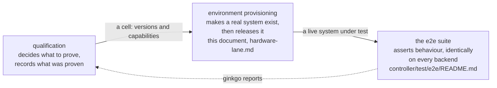

<!--
SPDX-FileCopyrightText: Copyright (c) 2026 NVIDIA CORPORATION & AFFILIATES. All rights reserved.
SPDX-License-Identifier: Apache-2.0
-->

# Release Qualification

## Overview

Qualification asks one question: **do these particular component versions work
together, on real hardware, installed the way a customer installs them?**

It is not the same thing as the e2e test suite, though it uses it. The
difference is what the tests run against.

| | The e2e CI lanes | Qualification |
|---|---|---|
| Machines | none — containers or VMs on the runner | bare metal from an infrastructure provider |
| Site controller | Tilt installs the stack into a Kind cluster | `nvkectl bootstrap site`, then the NVKE stack from the SBOM |
| Backends | `capd`, `nico-containers`, `nico-vms` | `nico-forge` |
| What it proves | the code is correct | the code is correct **on the path a customer takes** |
| Cost | minutes, free | around 80 minutes, real hardware |

Three concerns, kept apart on purpose, and it is worth knowing which one you
are reading about:

The CI lanes run on every pull request and are where defects are normally
caught. Qualification runs when someone asks, because everything a
Tilt-built cluster proves about the engine, it proves about the engine running
somewhere no customer runs it.

## What a run does

Four steps, each built on the one before:

1. **Provision** a bare machine from Forge — iPXE boot, the OS image under
   qualification written to disk, reachable over the site's jump host.
2. **Bootstrap** a site controller on it: stage `nvkectl`, generate a site spec,
   run `nvkectl bootstrap site`, install the NVKE stack, and confirm the engine
   answers at the expected version.
3. **Create a tenant cluster** through that engine's own API — not through
   Forge directly — so the product's front door is part of what is tested.
4. **Bring up its node pools** on real machines, assert every node reaches
   Ready, then tear everything down.

[hardware-lane.md](hardware-lane.md) explains each step and why the awkward
parts are the way they are.

## Running one

The lane never starts on its own. It runs on a `workflow_dispatch`, when one of
these labels is applied to a pull request from this repository, or when a
`vX.Y.Z-beta.N` tag is pushed. It is deliberately not on a schedule or on every
push: it costs hardware, and a run nobody is watching is a run nobody acts on.
A beta tag is cut once a night, so it adds one run rather than a stream of them.

| label | what it runs |
|---|---|
| `qualify-e2e` | `QUALIFY_E2E_SCOPE`, or `golden-path` when that is unset: Ubuntu 24.04 on GB200, both arches |
| `qualify-e2e-l40s` | the `l40s` scope: Ubuntu 24.04 on L40S at site-1, amd64 |
| `qualify-e2e-dsx` | the `dsx` scope: the redstone-dev1-dh2 datahall, at stage `provision` |
| `qualify-e2e-dry-run` | everything except joining Teleport and running the suite |

The DSX label names its scope and stage outright, where `qualify-e2e` takes
whatever `QUALIFY_E2E_SCOPE` says. The stage is pinned to `provision` because
that datahall has one CPU machine bound, which is enough to place a node and
reach it; a `full` run places three at once, and its tenant half speaks Forge
only, so it is refused before a machine is taken. The dsx stream is outside the
`full` scope for that reason.

A run starts with a `plan` job that runs `qualify plan` and uploads
`plan.json`, and then a single `qualify-run` job runs once for each stream of
the plan's scope: it checks that everything the plan names is published,
resolves versions and capabilities, builds the site inputs, and reaches
Forge, DSX or Teleport. The versions, the architecture and the GPU model of a
job are the plan's, and the dispatch inputs that name a version override
what the plan resolves.

`qualify-run` is gated behind a GitHub environment from its first step, so
every run -- dry or real -- waits for approval before it can touch any
credential -- including the NGC key it logs into NVCR with -- or a machine.
A `workflow_dispatch` or a labelled pull request resolves `forge`, which
carries a required reviewer. A beta tag push instead resolves
`forge-nightly`, which carries the same secrets but no required reviewer --
an unattended nightly cannot wait on a person, so the control there is the
deployment tag policy (`v*-beta.*`) rather than a reviewer. There is no
ungated job and no ungated trigger left in this lane: a label or a dispatch
alone, dry run included, cannot reach any credential without an approval.

**Qualifying a beta.** A beta tag names a commit and carries no component tags,
so resolving the components from their own tags would answer with the last
release rather than with what that commit built. A tag push therefore asks for
`resolution: commitDescribe`, which describes each component at the commit the
tag marks, and the commit is derived from the version being qualified rather
than given.

A tag push also ignores the `QUALIFY_E2E_*` variables that stand in for a
dispatch input on a labelled run: the scope, the stage, keep-site, the image
registry and the version overrides. They hold whatever the last labelled run
asked for, so a beta qualifies `golden-path` at stage `full` from NVCR and keeps
no machine, whatever they say. The run's resolved inputs name any of them that
was set and not applied.

`commitDescribe` is also the default, because a beta is what this lane
qualifies nightly. A release qualification therefore has to select `gitTag`,
by the `resolution` input or by the `QUALIFY_E2E_RESOLUTION` repository
variable. Left on the default, a release resolves its components by describe
and verifies the describe-named artifacts, which exist, so the run passes while
qualifying builds other than the release-tagged ones.
The plan records the commit and, for each component, the strategy that answered,
so a run says afterwards how every version was arrived at.

A **dry run** does everything except join Teleport and run the suite, so it
takes no Forge machine, but it still reaches the same `forge`/`forge-nightly`
environment gate a real run does and waits on the same approval -- it skips
Teleport and the suite, not the credentials it needs to get that far. It is
the `dry-run` dispatch input, or the `qualify-e2e-dry-run` label on a pull
request. Each stream's `qualify-run` still builds the site inputs, which
confirms every image and archive exists (a real NGC_API_KEY-backed NVCR
login, same as any other run), and still writes the e2e config. It then
prints the `-e2e.versions` and `-e2e.capabilities` the suite would have been
given into `qualify-e2e.log`. A dry run has its own concurrency group, so it
does not wait behind a real run,
and its jobs are named `<stream> (dry run)`.

`-e2e.site-stage` chooses how far to go, so you can pay for the part you need:

| Stage | Does everything above, plus | Roughly |
|---|---|---|
| `provision` | a Forge node, reachable, then released | 20 min |
| `bootstrap` | vanilla Kubernetes via `nvkectl bootstrap site` | 45 min |
| `full` | the NVKE stack, the engine, and a tenant cluster | 80 min |

## Reading a result

Every run uploads the same artifacts whether it passed or failed:

| Artifact | What it is |
|---|---|
| `qualify-e2e.log` | the Ginkgo run |
| `qualify-e2e.junit.xml` | the same result, machine-readable |
| `run-inputs.txt` | which versions and settings the run actually resolved, and which were overridden |
| `nvkectl-diagnostics.tar.gz` | what `nvkectl` collected on the node — present only when it failed |
| `site-cluster-state.txt` | the controller namespace and every pod, read on the node — present after a failure past the bootstrap |
| `site-bundle*.tar.gz` | the failure bundle: the node's state and logs, the cluster's objects, events and pod logs, and a timeline — present after a failure; a `site-bundle*.txt` note in its place says why there is none |
| `tenant-diagnostics.json` | the tenant's nodes as the controller API reports them — present when a tenant failed |
| `tbot.log` | the Teleport bot, for when nothing could be reached at all |

A red run is as likely to be the site as the code. [triage.md](triage.md) is how
to tell the difference without spending an afternoon on it.

## What is qualified today

Stated plainly, because a green run should not be read as more assurance than
it carries.

**Covered.** A site controller built the product way on real hardware at one
site, and a tenant cluster created through the engine on that site, taken
through create, node readiness, and delete.

**Not covered:**

- **GPU workloads.** A GPU instance type is declared and has carried a tenant
  by hand, but nothing installs a GPU driver or device plugin, so a GPU node
  would come up Ready advertising no GPU. See
  [environments.md](environments.md#how-a-machine-gets-chosen).
- **Deeper tenant node-pool behaviour** — replacement, cascade, manual
  scale-down. These specs exist and the simulator lanes run them; the Forge
  lane does not.
- **Site controller upgrade and scale.** The site is a single node, and the
  upgrade specs act on a tenant cluster's control plane.
- **A second provider.** Two sites are declared, site-1 and site-2, and the lane
  resolves between them by capability. Forge is still the only provider.
- **GPU software.** A GB200 tenant has been qualified at site-2, but only to the
  point of its nodes going Ready. Nothing checks the driver, the device plugin
  or the `nvidia.com/gpu` resource.

## Where to go next

| Document | Read it when |
|---|---|
| [hardware-lane.md](hardware-lane.md) | you want to know how a run works, step by step, and what it deliberately does not cover |
| [environments.md](environments.md) | you are adding a site, an instance type, or a second infrastructure provider |
| [triage.md](triage.md) | a run went red and you need to know whether it is ours or the site's |

Related, outside this directory:

| Path | Contents |
|---|---|
| `controller/test/e2e/README.md` | running the e2e suite: labels, configuration, and the lane's prerequisites |
| `.github/workflows/qualify-e2e.yml` | the workflow itself |
| `RELEASE.md` | how a release is cut once a candidate qualifies |
