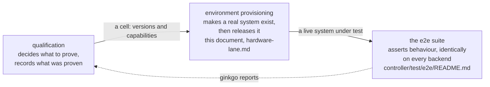

<!--
SPDX-FileCopyrightText: Copyright (c) 2026 NVIDIA CORPORATION & AFFILIATES. All rights reserved.
SPDX-License-Identifier: Apache-2.0
-->

# Release Qualification

## Overview

Qualification asks one question: **do these particular component versions work
together, on real hardware, installed the way a customer installs them?**

It is not the same thing as the e2e test suite, though it uses it. The
difference is what the tests run against.

| | The e2e CI lanes | Qualification |
|---|---|---|
| Machines | none — containers or VMs on the runner | bare metal from an infrastructure provider |
| Site controller | Tilt installs the stack into a Kind cluster | `nkectl bootstrap site`, then the NKE stack from the SBOM |
| Backends | `capd`, `nico-containers`, `nico-vms` | `nico-forge` |
| What it proves | the code is correct | the code is correct **on the path a customer takes** |
| Cost | minutes, free | around 80 minutes, real hardware |

Three concerns, kept apart on purpose, and it is worth knowing which one you
are reading about:

The CI lanes run on every pull request and are where defects are normally
caught. Qualification runs when someone asks, because everything a
Tilt-built cluster proves about the engine, it proves about the engine running
somewhere no customer runs it.

## What a run does

Four steps, each built on the one before:

1. **Provision** a bare machine from Forge — iPXE boot, the OS image under
   qualification written to disk, reachable over the site's jump host.
2. **Bootstrap** a site controller on it: stage `nkectl`, generate a site spec,
   run `nkectl bootstrap site`, install the NKE stack, and confirm the engine
   answers at the expected version.
3. **Create a tenant cluster** through that engine's own API — not through
   Forge directly — so the product's front door is part of what is tested.
4. **Bring up its node pools** on real machines, assert every node reaches
   Ready, then tear everything down.

[hardware-lane.md](hardware-lane.md) explains each step and why the awkward
parts are the way they are.

## Running one

The lane never starts on its own. It runs on a `workflow_dispatch`, or when
the `forge-e2e` label is applied to a pull request from this repository. It is
deliberately not on a schedule or on push: it costs hardware, and a run nobody
is watching is a run nobody acts on.

`-e2e.site-stage` chooses how far to go, so you can pay for the part you need:

| Stage | Does everything above, plus | Roughly |
|---|---|---|
| `provision` | a Forge node, reachable, then released | 20 min |
| `bootstrap` | vanilla Kubernetes via `nkectl bootstrap site` | 45 min |
| `full` | the NKE stack, the engine, and a tenant cluster | 80 min |

## Reading a result

Every run uploads the same artifacts whether it passed or failed:

| Artifact | What it is |
|---|---|
| `site-e2e.log` | the Ginkgo run |
| `site-e2e.junit.xml` | the same result, machine-readable |
| `run-inputs.txt` | which versions and settings the run actually resolved, and which were overridden |
| `site-diagnostics.tar.gz` | what `nkectl` collected on the node — present only when it failed |
| `tbot.log` | the Teleport bot, for when nothing could be reached at all |

A red run is as likely to be the site as the code. [triage.md](triage.md) is how
to tell the difference without spending an afternoon on it.

## What is qualified today

Stated plainly, because a green run should not be read as more assurance than
it carries.

**Covered.** A site controller built the product way on real hardware at one
site, and a tenant cluster created through the engine on that site, taken
through create, node readiness, and delete.

**Not covered:**

- **GPU workloads.** A GPU instance type is declared and has carried a tenant
  by hand, but nothing installs a GPU driver or device plugin, so a GPU node
  would come up Ready advertising no GPU. See
  [environments.md](environments.md#how-a-machine-gets-chosen).
- **Deeper tenant node-pool behaviour** — replacement, cascade, manual
  scale-down. These specs exist and the simulator lanes run them; the Forge
  lane does not.
- **Site controller upgrade and scale.** The site is a single node, and the
  upgrade specs act on a tenant cluster's control plane.
- **A second site or a second provider.** One site is declared. The
  environment schema cannot yet express a site that attaches by VPC prefix,
  which is where the GB200 capacity lives.

## Where to go next

| Document | Read it when |
|---|---|
| [hardware-lane.md](hardware-lane.md) | you want to know how a run works, step by step, and what it deliberately does not cover |
| [environments.md](environments.md) | you are adding a site, an instance type, or a second infrastructure provider |
| [triage.md](triage.md) | a run went red and you need to know whether it is ours or the site's |

Related, outside this directory:

| Path | Contents |
|---|---|
| `controller/test/e2e/README.md` | running the e2e suite: labels, configuration, and the lane's prerequisites |
| `.github/workflows/forge-site-controller-e2e.yml` | the workflow itself |
| `RELEASE.md` | how a release is cut once a candidate qualifies |
