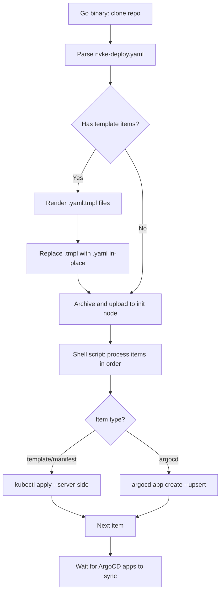

# Deploy Repository

> **Note:** The deploy repository is a **post-bootstrap concern**. `nvkectl bootstrap site` brings up the Kubernetes cluster; deploying NVKE's services (CWE, Temporal, CNPG) onto that cluster via ArgoCD is a separate subsequent step. This page describes that second step.

A deploy repository contains the ArgoCD Application manifests, secrets, and Kubernetes manifests that deploy the NVKE services stack onto a freshly bootstrapped site controller cluster.

## Reference Repository

A complete, ready-to-fork reference repository is available at `github.com/dsx-ai-factory/nvke` under `deploy/reference/`. It includes the `nvke-base-config` templates for secrets and namespaces, storage manifests, and ArgoCD Application manifests for all required NVKE components.

> **Important:** The deploy repository must be accessible from the machine running the post-bootstrap deployment tooling. Ensure the repository is hosted on a git service reachable from your provisioned nodes (public GitHub, GitLab.com, or another externally accessible host).

To use the reference repo:

1. Fork or copy it into your own git repository
2. Edit subdirectories under `deploy/` for your environment (chart versions, image tags, storage classes, database sizing)
3. Push to your git remote
4. Point the post-bootstrap deployment tooling at your fork:

```yaml
argocd:
  repos:
    - url: "https://github.com/my-org/my-nvke-deploy.git"
      token: "ghp-xxxxxxxxxxxx"
      deployPaths:
        - "deploy"
```

## Repository Layout

A deploy repository has one or more **deploy paths** — directories that the post-bootstrap deployment tooling processes. Each deploy path contains subdirectories, one per deploy item.

```text
my-deploy-repo/
├── deploy/                              # <-- deployPath
│   ├── nvke-deploy.yaml                  # declares item order and types
│   ├── nvke-base-config/                 # template: namespaces, secrets
│   │   ├── 00-namespaces.yaml
│   │   ├── 10-image-pull-secret.yaml.tmpl
│   │   ├── 20-argocd-repo-secrets.yaml.tmpl
│   │   ├── 30-cnpg-secrets.yaml.tmpl
│   │   └── 50-monitoring-secrets.yaml.tmpl
│   ├── nvke-storage/                     # manifest: StorageClasses and PVs
│   │   ├── storage-classes.yaml
│   │   └── persistent-volumes.yaml
│   ├── kubernetes-replicator/           # argocd: replicates pull secrets
│   │   └── application.yaml
│   ├── cloudnative-pg/                  # argocd: CNPG operator
│   │   └── application.yaml
│   ├── cnpg-temporal/                   # argocd: PostgreSQL for Temporal
│   │   └── application.yaml
│   └── ...
```

Flat files at the deploy path root (other than `nvke-deploy.yaml`) are ignored — only subdirectories are processed.

## The `nvke-deploy.yaml` File

Place an `nvke-deploy.yaml` at the root of each deploy path to declare item order and types explicitly:

```yaml
items:
  - name: nvke-base-config
    type: template
  - name: nvke-storage
    type: manifest
  - name: kubernetes-replicator
    type: argocd
  - name: cloudnative-pg
    type: argocd
  - name: cnpg-temporal
    type: argocd
  - name: temporal
    type: argocd
  - name: cloud-workflow-engine
    type: argocd
```

| Field | Required | Description |
|-------|----------|-------------|
| `name` | Yes | Subdirectory name. For `argocd` items, also becomes the ArgoCD Application name. |
| `type` | Yes | `template`, `manifest`, `helm`, or `argocd` |
| `path` | No | Subdirectory path relative to deploy root. Defaults to `name`. |

Names must be unique across all repos — duplicates are skipped with a warning.

If `nvke-deploy.yaml` is absent, the post-bootstrap deployment tooling falls back to **auto-detection**: subdirectories are processed in sorted order; those containing `application.yaml` are treated as ArgoCD apps, everything else as plain manifests.

## Deploy Item Types

### `template` — Go Template Rendering

Template items contain `.yaml.tmpl` files (and optionally plain `.yaml` files). Before the deploy repo is uploaded to the init node, the post-bootstrap deployment tooling renders each `.yaml.tmpl` file using Go's `text/template` engine with the full [`BootstrapConfig`](#bootstrapconfig-variable-reference) as template data. Rendered output replaces the `.tmpl` files in-place, and the item is then applied as a manifest.

This is how secrets and cluster-specific configuration that depend on `BootstrapConfig` values (NGC keys, database passwords, repo tokens, etc.) are created without hardcoding them in the repository.

Files within a template item are applied in lexicographic order. Use numeric prefixes (e.g. `00-`, `10-`, `20-`) to control ordering.

### `manifest` — Plain Kubernetes Manifests

Manifest items contain `.yaml` and `.yml` files applied directly via `kubectl apply --server-side`. Files are applied in lexicographic order.

### `helm` — Helm charts

A helm item installs one chart as one Helm release. Its `release.yaml` names the chart, the release and the values:

```yaml
chart:
  name: temporal            # the chart's name
  version: "0.74.0"         # pinned; passed to helm for a repository chart
  repository: https://go.temporal.io/helm-charts   # or path: ../../nktp/deploy/charts/nktp
  artifact: temporal        # NVKR artifact of the chart; default: the item name
  imageArtifact: cwe        # NVKR artifact of the image the chart runs, if any
  profilesArtifact: controller-profiles             # and of its profiles content image
  setFile:                  # <helm key>=<absolute path>, passed as --set-file; the file is read at install time
    - spire-server.upstreamAuthority.disk.secret.data.key=/etc/nvke/ca.key
release:
  name: temporal
  namespace: temporal
values:
  - values.yaml             # applied in order; later files win
requires:
  - {kind: certificate, name: oidc-provider-upstream-ca, namespace: spire-server, condition: Ready}
```

`repository` and `path` name where the chart comes from; one of them. The three artifact keys bind the item to an NVKR release by NVKR's output names. A manifest item binds the image its YAML runs the same way, with top-level `image: <repository>:<tag>` and `artifact: <name>`. `setFile` keeps a secret the operator holds out of the deploy path.

`nvkectl render deploy-path` writes a resolved copy of the deploy path. Charts from the release land in `charts/<item>/` and `chart.path` points at them. An item gets `release-images.yaml` and `site-values.yaml` as needed. A manifest item bound to an image gets a `kustomization.yaml`. Template items are rendered and become manifest items. At the top: `images.txt`, `site.env`, `nvkr-release.json` and a `.gitignore` that ignores the tree. `deploy/nvke-deploy.sh` applies the copy as a plain deploy path.

### `argocd` — ArgoCD Applications

ArgoCD items must contain an `application.yaml` file with a valid `argoproj.io/v1alpha1` Application manifest. The application is created via `argocd app create -f <path> --upsert`.

| Field | Requirement |
|-------|-------------|
| `metadata.name` | Must match the parent directory name |
| `metadata.namespace` | Must be `argocd` |
| `spec.source(s)[].repoURL` | Must match a URL that has a corresponding ArgoCD repo secret |
| `spec.destination.server` | Typically `https://kubernetes.default.svc` |

Single-source example (inline Helm values):

```yaml
apiVersion: argoproj.io/v1alpha1
kind: Application
metadata:
  name: cloud-workflow-engine
  namespace: argocd
spec:
  project: default
  destination:
    namespace: cloud-workflow-engine
    server: https://kubernetes.default.svc
  source:
    repoURL: nvcr.io/<org>
    chart: nvke-controller-chart
    targetRevision: "0.1.0"
    helm:
      values: |
        image:
          repository: nvcr.io/<org>/nvke-controller
          tag: v0.1.0
  syncPolicy:
    automated: {}
    syncOptions:
      - CreateNamespace=true
```

Multi-source example (separate values file via `$values` ref):

```yaml
apiVersion: argoproj.io/v1alpha1
kind: Application
metadata:
  name: aoa-infra
  namespace: argocd
spec:
  project: default
  destination:
    namespace: argocd
    server: https://kubernetes.default.svc
  sources:
    - repoURL: https://github.com/my-org/my-deploy-repo.git
      targetRevision: main
      path: aoa-infra/v1
      helm:
        valueFiles:
          - $values/environments/prod/my-site/aoa-infra/values.yaml
    - repoURL: https://github.com/my-org/my-deploy-repo.git
      targetRevision: main
      ref: values
  syncPolicy:
    automated: {}
    syncOptions:
      - CreateNamespace=true
```

## How Deploy Processing Works



For each repo with `deployPaths`, the post-bootstrap deployment tooling:

1. Clones the repository locally (shallow, `--depth 1 --single-branch`)
2. Parses `nvke-deploy.yaml` in each deploy path (if present)
3. Renders `type: template` items using the `BootstrapConfig`
4. Archives the processed repo and uploads it to the init node
5. The shell script processes items in declared order
6. Waits for ArgoCD applications to sync, then waits for required child apps

## BootstrapConfig Variable Reference

Template files use Go [`text/template`](https://pkg.go.dev/text/template) syntax. The template context (`.`) is the full `BootstrapConfig` struct.

### Top-Level Fields

| Expression | Type | Description |
|------------|------|-------------|
| `.ClusterName` | string | Cluster name |
| `.OrgID` | string | Organization ID |
| `.BaremetalMode` | bool | Whether baremetal mode is active |

### `.Cluster`

| Expression | Type | Description |
|------------|------|-------------|
| `.Cluster.Nodes` | list | Control-plane nodes (iterate with `range`) |
| `.Cluster.K8sVersion` | string | Kubernetes version |
| `.Cluster.CNIName` | string | CNI name (`ovn-kubernetes`; `calico` for development) |
| `.Cluster.PodCIDR` | string | Pod CIDR |

Each node in `.Cluster.Nodes`:

| Expression | Type | Description |
|------------|------|-------------|
| `.Name` | string | Node hostname |
| `.IP` | string | Node IP address |

### `.Registry`

Credentials for images the site cannot stage locally. On a site controller the
node's containerd is the cluster's containerd, so an imported image resolves
with `imagePullPolicy: IfNotPresent` and needs no credential at all. CAPNICo is
the exception: its published manifest names an image on `ghcr.io` that is not
anonymously pullable, so a deploy path that installs it must template a
`kubernetes.io/dockerconfigjson` Secret.

| Expression | Type | Description |
|------------|------|-------------|
| `.Registry.NGCAPIKey` | string | NGC API key |
| `.Registry.Server` | string | Registry host (e.g. `ghcr.io`) |
| `.Registry.Username` | string | Registry username |
| `.Registry.Token` | string | Registry token or password |

### `.Nico`

Credentials for the NICo instance API that the CAPNICo infrastructure provider
calls. CAPNICo reads them from a `nico-credentials` Secret it does not create,
so a deploy path that installs CAPNICo must template that Secret.

| Expression | Type | Description |
|------------|------|-------------|
| `.Nico.Endpoint` | string | NICo API base URL |
| `.Nico.OrgID` | string | Organization ID |
| `.Nico.Token` | string | API token |
| `.Nico.APIName` | string | API name (e.g. `forge`) |

### `.Tenant`

The login CWE renders into every tenant node's cloud-init. CWE requires
`DGXC_TENANT_USER` and `DGXC_TENANT_PASSWORD`, and the controller chart injects
them only when `secrets.dgxcTenantCredSecretName` names a Secret carrying keys
`user` and `password`. Without it, tenant creation fails at user-data
rendering.

| Expression | Type | Description |
|------------|------|-------------|
| `.Tenant.User` | string | Tenant node username |
| `.Tenant.Password` | string | Tenant node password |

### `.ArgoCD`

| Expression | Type | Description |
|------------|------|-------------|
| `.ArgoCD.Version` | string | ArgoCD version |
| `.ArgoCD.Repos` | list | Configured repositories |

Each repo in `.ArgoCD.Repos`:

| Expression | Type | Description |
|------------|------|-------------|
| `.URL` | string | Repository URL |
| `.Token` | string | Access token |
| `.Username` | string | Git username for ArgoCD repo secrets |
| `.Branch` | string | Branch name |
| `.DeployPaths` | list of strings | Deploy path directories |

### `.Database`

| Expression | Type | Description |
|------------|------|-------------|
| `.Database.SuperuserPassword` | string | CNPG superuser password |
| `.Database.CloudPassword` | string | Cloud DB application password |
| `.Database.SitePassword` | string | Site DB application password |
| `.Database.TemporalPassword` | string | Temporal DB password |

### `.Monitoring`

| Expression | Type | Description |
|------------|------|-------------|
| `.Monitoring.PrometheusUsername` | string | Prometheus remote-write username |
| `.Monitoring.PrometheusPassword` | string | Prometheus remote-write password |
| `.Monitoring.LokiUsername` | string | Loki push username |
| `.Monitoring.LokiPassword` | string | Loki push password |
| `.Monitoring.LokiHost` | string | Loki push endpoint |

### `.KubeVip`

| Expression | Type | Description |
|------------|------|-------------|
| `.KubeVip.Enabled` | bool | Whether kube-vip is enabled |
| `.KubeVip.VIP` | string | Virtual IP address |
| `.KubeVip.Version` | string | kube-vip version |
| `.KubeVip.Interface` | string | Network interface |
| `.KubeVip.VIPRanges` | string | Comma-separated VIP CIDR ranges |

## Template Examples

### Conditional secret

Only rendered when monitoring credentials are configured:

```yaml
{{- if and .Monitoring.PrometheusUsername .Monitoring.PrometheusPassword }}
apiVersion: v1
kind: Secret
metadata:
  name: prometheus-auth
  namespace: monitoring
stringData:
  username: "{{ .Monitoring.PrometheusUsername }}"
  password: "{{ .Monitoring.PrometheusPassword }}"
{{- end }}
```

### Iterating over repos

Creates an ArgoCD repo secret for each configured repository:

```yaml
{{- range $i, $repo := .ArgoCD.Repos }}
---
apiVersion: v1
kind: Secret
metadata:
  name: repo-aoa-{{ $i }}
  namespace: argocd
  labels:
    argocd.argoproj.io/secret-type: repository
stringData:
  type: git
  url: "{{ $repo.URL }}"
  username: "{{ $repo.Username }}"
  password: "{{ $repo.Token }}"
{{- end }}
```

### Multi-document YAML

A single `.yaml.tmpl` file can produce multiple Kubernetes resources:

```yaml
apiVersion: v1
kind: Secret
metadata:
  name: superuser-secret
  namespace: cnpg-cloud
type: kubernetes.io/basic-auth
stringData:
  username: postgres
  password: "{{ .Database.SuperuserPassword }}"
---
apiVersion: v1
kind: Secret
metadata:
  name: superuser-secret
  namespace: cnpg-site
type: kubernetes.io/basic-auth
stringData:
  username: postgres
  password: "{{ .Database.SuperuserPassword }}"
```

## Built-in `nvke-base-config` Templates

The reference repository includes an `nvke-base-config` template item that creates all the base resources needed before ArgoCD applications are deployed. It must be the first item in the deploy sequence.

| File | Resources Created |
|------|-------------------|
| `00-namespaces.yaml` | Namespaces: `kubernetes-replicator`, `cnpg-cloud`, `cnpg-site`, `cnpg-temporal`, `cloud-workflow-engine`, `monitoring` |
| `10-image-pull-secret.yaml.tmpl` | `ngc-registry-nke-imagepull` image pull secret |
| `20-argocd-repo-secrets.yaml.tmpl` | ArgoCD repo secrets for each configured repo, plus NGC Helm repo secrets |
| `30-cnpg-secrets.yaml.tmpl` | CNPG superuser and per-app bootstrap secrets across 3 namespaces |
| `50-monitoring-secrets.yaml.tmpl` | Grafana/Prometheus/Loki credentials (conditional) |

## Secret-Only Repos

Repos that omit `deployPaths` are "secret-only." the post-bootstrap deployment tooling does not clone them; they exist solely so that ArgoCD can fetch from them at runtime.

> **Important:** the post-bootstrap deployment tooling does **not** automatically create ArgoCD repo secrets. Your deploy repository must include a template that creates them. The reference repo's `20-argocd-repo-secrets.yaml.tmpl` handles this by iterating over `.ArgoCD.Repos`. If you build a bespoke deploy repository without `nvke-base-config`, you must create these secrets yourself or ArgoCD will fail to fetch from your repos.

```yaml
argocd:
  repos:
    - url: "https://github.com/my-org/deploy.git"
      token: "ghp-xxx"
      deployPaths:
        - "deploy"
    - url: "https://github.com/my-org/helm-charts.git"
      token: "ghp-yyy"
      # Secret-only: not cloned, but needs an ArgoCD repo secret
```

## Sync and Health Monitoring

After all deploy items are processed, the post-bootstrap deployment tooling monitors ArgoCD through three phases:

1. **App-of-apps sync** — waits up to 10 minutes for each deployed application to reach `Synced` + `Healthy`
2. **Child app sync** — waits up to 60 minutes for all apps listed in `argocd.requiredApps` to reach `Synced` + `Healthy`
3. **Retry logic** — automatically retriggers sync for stuck, OutOfSync, or failed apps on a 60–120s cadence

## Adding a Deploy Item

1. Create a new directory under your deploy path (e.g., `deploy/my-app`)
2. Add the appropriate files (see item types above)
3. Add an entry to `nvke-deploy.yaml` at the desired position:

```yaml
items:
  - name: nvke-base-config
    type: template
  - name: my-app              # <-- new item
    type: manifest
  - name: nvke-storage
    type: manifest
  # ...
```

4. Push to your repo — the post-bootstrap deployment tooling deploys items in the declared order
