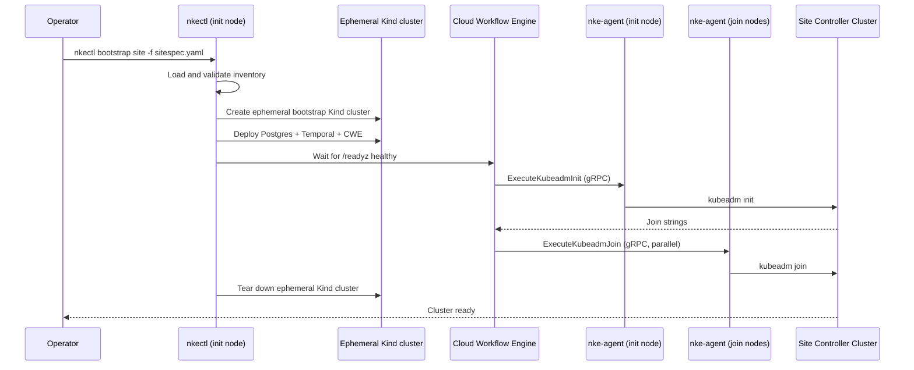

# Site Controller Bootstrap

## Overview

This guide walks you through deploying a self-managing site controller cluster — the Kubernetes control plane that runs NKE's workflow engine, databases, and security services.

The process has three steps:

1. [Prepare nodes](pre-provisioned-nodes.md#step-1-prepare-all-nodes) — install `nke-agent` and Kubernetes components
2. [Write a site spec file](configuration.md) — declare your nodes, versions, and registry
3. [Run `nkectl bootstrap site`](pre-provisioned-nodes.md#step-2-run-bootstrap-on-init-node) — bootstrap the cluster

**Total time**: Approximately 30–45 minutes for cluster bring-up, plus time to deploy the NKE services stack afterward.

## What Happens During Bootstrap

`nkectl bootstrap site` does more than call kubeadm. It first stands up an ephemeral Kind cluster on the init node, deploys a self-contained NKE site controller (Postgres, Temporal, CWE) onto it, and then uses that controller to drive the init and join workflows against your actual nodes over `nke-agent`'s gRPC API — no SSH required.

The ephemeral Kind cluster is torn down automatically when bootstrap completes.

## After Bootstrap

Once the cluster is up, install Cluster API and an infrastructure provider on it before deploying the NKE services (CWE, Temporal, CNPG) via your GitOps tooling — see [Infrastructure Providers](infrastructure-providers.md) for why the order matters, and [Deploy Repository](deploy-repository.md) for the ArgoCD application structure.

The cluster's etcd data is encrypted at rest from its first `kubeadm init`, and every control-plane node holds the key. Bootstrap also saves it into the working directory as `<clusterName>-etcd-encryption-key.json` (`--encryption-key-out` to choose the path): a convenience, since a controller installed later can be given the file instead of having the key pulled off a node, and the disaster-recovery copy, since a restore onto new hosts has no node to pull it from. Move the file off the host and keep it. See [Pre-Provisioned Nodes](pre-provisioned-nodes.md#troubleshooting).

If you are running a self-managed site (with NICo as the infrastructure provider), keep `nkectl` available for subsequent operations. See [Infrastructure Providers](infrastructure-providers.md) for installing NICo itself onto the site cluster.

## Next Steps

- [Installation](installation.md) — download and install `nkectl`
- [Configuration](configuration.md) — write your site site spec file
- [Pre-Provisioned Nodes](pre-provisioned-nodes.md) — prepare nodes and run the bootstrap
- [Custom Base OS](custom-base-os.md) — cloud-init based node preparation
- [Deploy Repository](deploy-repository.md) — post-bootstrap NKE services deployment
- [Infrastructure Providers](infrastructure-providers.md) — install Cluster API and CAPNICo before CWE
