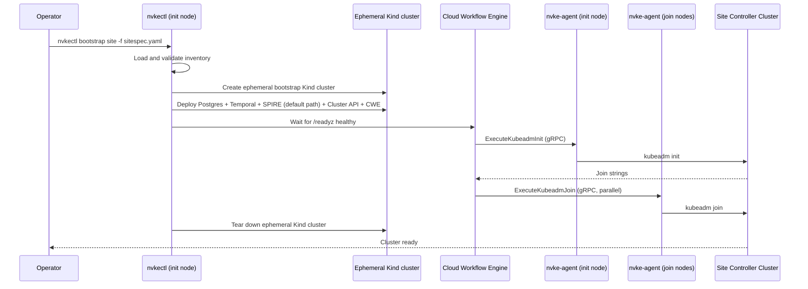

# Site Controller Bootstrap

## Overview

This guide walks you through deploying a self-managing site controller cluster — the Kubernetes control plane that runs NVKE's workflow engine, databases, and security services.

The process has four steps:

1. [Prepare nodes](pre-provisioned-nodes.md#step-1-prepare-all-nodes) — install `nvke-agent` and Kubernetes components
2. [Write a site spec file](configuration.md) — declare your nodes, versions, and registry
3. [Run `nvkectl bootstrap site`](pre-provisioned-nodes.md#step-2-run-bootstrap-on-init-node) — bootstrap the cluster
4. [Install the site controller](install-site-controller.md) — the management plane, from the `deploy/nico` deploy path

**Total time**: Typically 10–15 minutes for cluster bring-up on a three-node site, plus the install of the site controller afterward. `nvkectl bootstrap site` waits `--timeout` (default `30m`) for the cluster to provision, so raise it for a larger site.

## What Happens During Bootstrap

`nvkectl bootstrap site` does more than call kubeadm. It first stands up an ephemeral Kind cluster on the init node, deploys a self-contained NVKE site controller (Postgres, Temporal, SPIRE, the Cluster API providers, and CWE) onto it — `--disable-mtls`, the development-only plaintext mode, skips SPIRE — and then uses that controller to drive the init and join workflows against your actual nodes over `nvke-agent`'s gRPC API — no SSH required.

The ephemeral Kind cluster is torn down when bootstrap succeeds. It is retained if you pass `--keep-bootstrap-cluster`, or if the run fails after the site cluster was created — see [Pre-Provisioned Nodes](pre-provisioned-nodes.md) for the recovery steps.

## After Bootstrap

`nvkectl bootstrap site` leaves a plain Kubernetes cluster and its kubeconfig. [Install the Site Controller](install-site-controller.md) installs the management plane onto it from the `deploy/nico` deploy path: Cluster API, CAPNICo, Postgres, Temporal, SPIRE, NKTP and the NVKE controller. It is a short list of commands; the page gives them in order, and how a GitOps tool delivers the same items.

The cluster's etcd data is encrypted at rest from its first `kubeadm init`, and every control-plane node holds the key. Bootstrap also saves it into the working directory as `<clusterName>-etcd-encryption-key.json` (`--encryption-key-out` to choose the path): a convenience, since a controller installed later can be given the file instead of having the key pulled off a node, and the disaster-recovery copy, since a restore onto new hosts has no node to pull it from. Move the file off the host and keep it. See [Pre-Provisioned Nodes](pre-provisioned-nodes.md#troubleshooting).

Keep `nvkectl` on the machine afterwards. The install registers the site with it, and tenant clusters are created through it.

## Next Steps

- [Installation](installation.md) — download and install `nvkectl`
- [Configuration](configuration.md) — write your site site spec file
- [Pre-Provisioned Nodes](pre-provisioned-nodes.md) — prepare nodes and run the bootstrap
- [Custom Base OS](custom-base-os.md) — cloud-init based node preparation
- [Install the Site Controller](install-site-controller.md) — install the management plane from the `deploy/nico` deploy path
- [Deploy Path](deploy-repository.md) — the format of the directory the NVKE services are installed from
- [Infrastructure Providers](infrastructure-providers.md) — CAPNICo, and how to prove the NICo credentials
