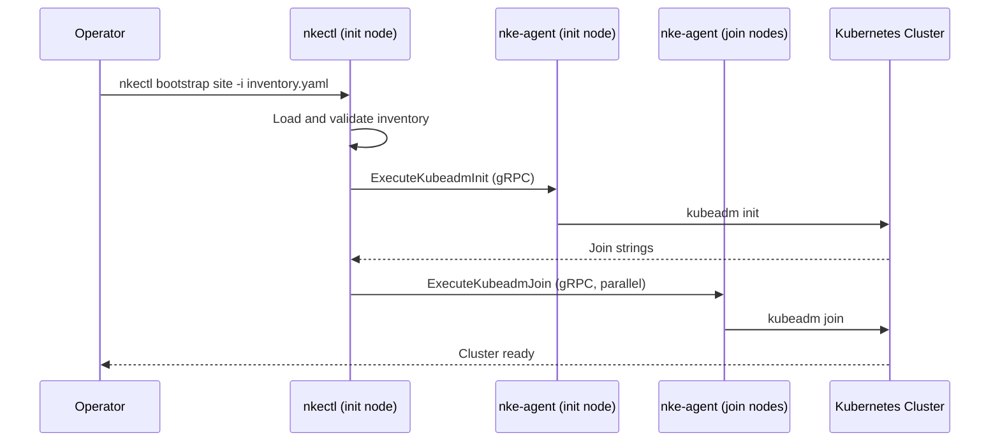

# Site Controller Bootstrap

## Overview

This guide walks you through deploying a self-managing site controller cluster — the Kubernetes control plane that runs NKE's workflow engine, databases, and security services.

The process has three steps:

1. [Prepare nodes](pre-provisioned-nodes.md#step-1-prepare-all-nodes) — install `nke-agent` and Kubernetes components
2. [Write an inventory file](configuration.md) — declare your nodes, versions, and registry
3. [Run `nkectl bootstrap site`](pre-provisioned-nodes.md#step-2-run-bootstrap) — bootstrap the cluster

**Total time**: Approximately 30–45 minutes for cluster bring-up, plus time to deploy the NKE services stack afterward.

## What Happens During Bootstrap

`nkectl` loads and validates the inventory, then dispatches init and join workflows over `nke-agent`'s gRPC API. Each node receives `kubeadm` instructions from the agent — no SSH required.

## After Bootstrap

Once the cluster is up, deploy the NKE services (CWE, Temporal, CNPG) via your GitOps tooling. See [Deploy Repository](deploy-repository.md) for the ArgoCD application structure.

If you are running a self-managed site (with NICo as the infrastructure provider), keep `nkectl` available for subsequent operations.

## Next Steps

- [Installation](installation.md) — download and install `nkectl`
- [Configuration](configuration.md) — write your site inventory file
- [Pre-Provisioned Nodes](pre-provisioned-nodes.md) — prepare nodes and run the bootstrap
- [Custom Base OS](custom-base-os.md) — cloud-init based node preparation
- [Deploy Repository](deploy-repository.md) — post-bootstrap NKE services deployment
