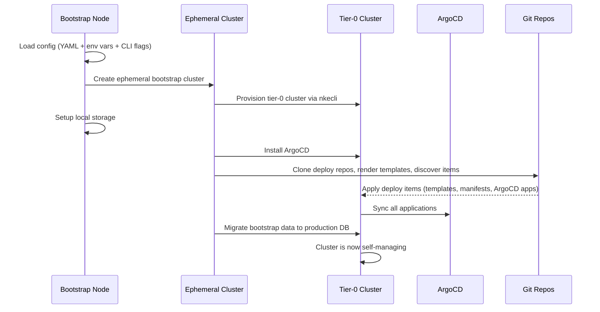
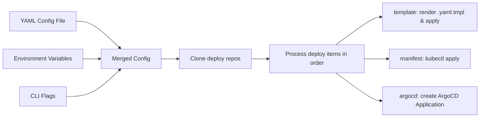

# Tier-0 Bootstrap

## Overview

This guide walks you through deploying a self-managing tier-0 site controller cluster — the Kubernetes control plane that runs NKE's workflow engines, databases, and security services.

The process involves:

1. Preparing your [configuration](configuration.md) (ArgoCD repositories, secrets, cluster settings)
2. Provisioning nodes (via [cloud-init / Forge UI](custom-base-os.md) or [pre-provisioned nodes](pre-provisioned-nodes.md))
3. [Downloading and installing](installation.md) `tier0-bootstrap`, then running it on the init node to trigger bootstrap

**Total time**: Approximately 60–90 minutes after starting the bootstrap.

> **NKE team bringing up an NKE-operated Site Controller on Forge?**
> Use the `self-bootstrap` CLI guide instead. `self-bootstrap` wraps the steps on this page with Forge API instance creation and SSH-driven provisioning. External users should continue with this guide.

## What Happens During Bootstrap

## Configuration Flow

`tier0-bootstrap` accepts configuration from multiple sources with clear precedence:

See [Configuration](configuration.md) for details on setting up repositories, secrets, and deploy manifests.

## Next Steps

- [Installation](installation.md) — download and install `tier0-bootstrap`
- [Configuration](configuration.md) — full config file reference
- [Deploy Repository](deploy-repository.md) — structure your ArgoCD deploy repo
- [Pre-Provisioned Nodes](pre-provisioned-nodes.md) — bootstrap on nodes you've already set up
- [Custom Base OS](custom-base-os.md) — bootstrap on vanilla Ubuntu via cloud-init
