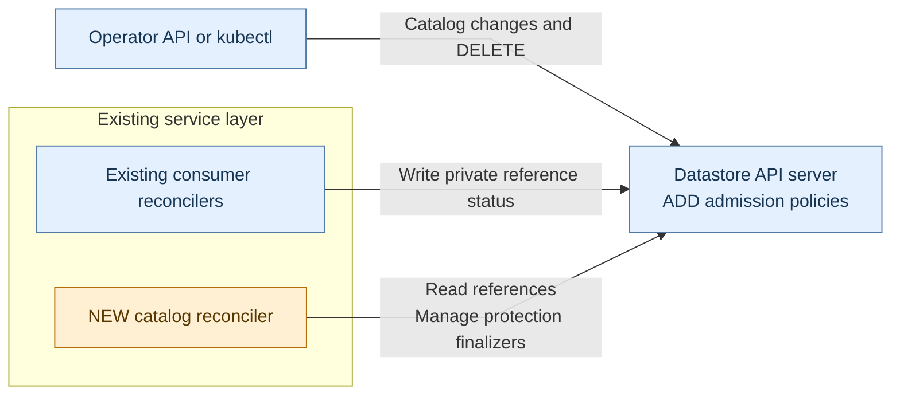
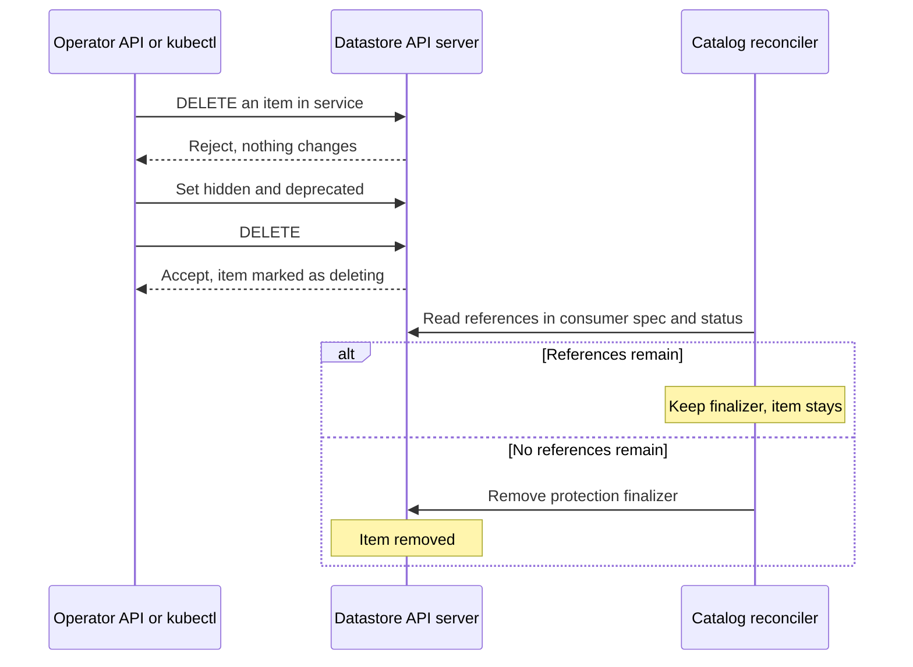

# Catalog retirement and deletion

**Status:** proposed
**Date:** 2026-11-10

## Context

Today the Operator API can delete a catalog item without checking references.
Removing a release or image still needed by a cluster can cause its next
reconciliation to fail. Operators need to delete unused items, and an item that
is still in use must not disappear, whether the delete comes through the
Operator API or kubectl. An item in service should not be deleted by mistake.

A consumer is a resource that references catalog items, such as NVKECluster.

## Decision

We will protect catalog items with a finalizer and admission policies on the
datastore API server:

- **An admission policy** refuses DELETE unless the item is hidden and
  deprecated.
- **A protection finalizer** on every catalog item holds an accepted DELETE
  until nothing references the item.

An operator retires an item by setting `hidden` and `deprecated`. Hidden items
leave tenant catalog listings. Deprecated items reject new use, while existing
consumers can continue. Until the item is deleted, clearing the flags returns it
to service. Neither change touches the finalizer.

Deleting a retired item follows the standard Kubernetes flow. The API server
accepts the DELETE and marks the item as deleting. The item stays, and existing
consumers keep using it, until the catalog reconciler finds no references and
removes the finalizer. Kubernetes then removes the item. A deleting item stays
out of tenant listings and accepts no new use, whatever its flags, and its
deletion cannot be withdrawn.

Two components in the service layer carry this out:

- **A dedicated catalog reconciler** keeps the finalizer on every item that is
  not being deleted, checks references for items that are being deleted, and
  removes the finalizer when none remain.
- **Existing consumer reconcilers** record the catalog references still needed
  during operation, replacement and cleanup in private status on their
  resources. They do not start using an item that lacks the finalizer or is
  being deleted.



The reconciler checks references only for an item that is being deleted: when
the DELETE is accepted and when a reference to it changes. It removes the
finalizer only after reading current datastore state and finding no references.
Admission policies also restrict changes to the finalizer, and to private
status, to the reconcilers.



References come from consumer spec and `status.internal.catalogUsage`. During
replacement, status can retain both releases:

```yaml
status:
  internal:
    catalogUsage:
      references:
        - {kind: ClusterRelease, name: release-v1}
        - {kind: ClusterRelease, name: release-v2}
```

Consumer reconcilers, such as the NVKECluster reconciler, drop an old reference
only after its replacement and cleanup have finished. A cluster keeps the release
selected from a channel until its own release request changes. A consumer with
no recorded references at all, such as a cluster created before this change,
holds every item being deleted until it records them.

Tenant catalog views include only fields that are opted in, and they reveal no
consumer identities or consumer counts. The Operator API shows that a deletion
is pending. Authorized operators can also get blocker details through CRDs and potentially a future API, which name each blocking reference and its consumer.

Markers on API types register catalog kinds and consumer reference fields and
generate their common protection rules. Consumer reconcilers still determine
when replacement and cleanup have finished.

### Accepted deletion gap

One rare case is not protected: a new reference that a consumer has not yet
added to its record and does not name in its spec. This happens when a consumer picks an item
indirectly, such as a release resolved from a channel, or when its spec moves
from one item to another before the first is recorded. If the item is deleted
and found unreferenced in that window, the cluster is left pointing at a missing
item.

The cluster reports `Ready=False`, names the missing item, and retries. It
recovers when an item with the same name is recreated, or when its request is
changed to resolve to another item. Closing the gap would require consumers to
record a reference before they start work. We accept error and retry instead.

A reference named in a consumer's spec holds the item if it is stored before the
check that finds the item unreferenced. One added after the item is deprecated
or deleting is rejected by the consumer, which reports `Ready=False` and never
uses the item. Admission policies cannot look up the item, so that reference is
still stored. It holds the item if the check has not yet passed. Otherwise the
cluster reports the item missing until the reference is changed.

## Consequences

- Operators can retire and delete unused catalog items without deploying a new
  service version.
- A delete cannot be withdrawn. An item deleted by mistake keeps serving the
  clusters that use it but accepts no new use, and the operator replaces it by
  publishing a new item under a new name. Requiring both flags first makes that
  unlikely.
- An item is removed without further operator action once its last reference is
  gone.
- Each consumer kind needs a private reference-status field.
- Spec references hold a deleting item even before successful reconciliation,
  and even when the consumer has rejected the item. The item stays until the
  cluster's owner changes the reference or deletes the cluster. There is no
  operator override.
- A consumer that never records its references holds every deletion until it is
  fixed or deleted.
- The accepted gap can leave a cluster at `Ready=False` until the item is recreated
  or the reference changes.
- Confirming that no references remain requires reading every consumer, across
  all registered kinds and namespaces, which takes about a second in a local
  prototype with 10,000 consumers. This full check runs only for an item that is
  being deleted, before its finalizer is removed.
- If the admission policies are missing, an item can be deleted without being
  retired first. The finalizer still holds it while it is referenced.
- A node profile's content is copied when a pool is created from it or moved to
  it, so nodes do not depend on the NodeProfile afterwards. A superseded
  NodeProfile is released once the pool has moved to its new profile. After
  it is deleted, the pool cannot be pointed back at it.
- Deleting a catalog item does not delete its underlying image or external artifacts.

## Options considered

For tracking references:

- **Private status on existing consumers, chosen:** keeps references with the reconcilers responsible for cleanup. Kubernetes [VolumeAttributesClass protection](https://github.com/kubernetes/kubernetes/blob/6facac27051f2fea5f347c2e1f609bb9f9c158b0/pkg/controller/volume/vacprotection/vac_protection_controller.go#L430-L454) also tracks references in spec and status. Cluster API [refuses deletion of an in-use ClusterClass](https://github.com/kubernetes-sigs/cluster-api/blob/975e2ef2b60725cb1886dd17b163b21ab7ae886a/core/webhooks/admission/clusterclass.go#L77-L92).
- **Separate reference records:** allow a target-specific query, but add one record per consumer/item pair, duplicate consumer tracking, and require orphan cleanup, as in Crossplane's [ProviderConfigUsage](https://github.com/crossplane/crossplane-runtime/blob/f78c9aebf4ff28c8000cd890319b9b69a0d7d18e/pkg/reconciler/providerconfig/reconciler.go#L273-L360). Records alone do not close the accepted gap.
- **Reservations on catalog items:** contend on shared items and grow with the fleet. A local synchronized 32-writer test produced 321 conflicts in 353 PATCH attempts. This is contention evidence, not a production capacity estimate.
- **Snapshots:** would stop ControlPlaneClass edits from reaching existing clusters, contrary to the required live policy.

For gating DELETE:

- **Protection finalizer with a retirement policy, chosen:** the standard Kubernetes pattern, used by VolumeAttributesClass protection above. The two parts work independently: the policy stops deletes of items in service, and the finalizer holds an in-use item even if the policy is missing. The item is removed as soon as the check finds no references, so the only window is the accepted gap.
- **Refusing DELETE until a reconciler clears the item:** keeps a refused delete fully reversible and makes removal an attended step. It needs a clearance marker on each item that is tied to the item's version, withdrawn when a late reference appears, re-checked until the DELETE arrives, and protected from other writers. It also opens a window between clearance and DELETE, and it deletes an in-use item outright if the admission policies are missing. We judged a reversible refusal not worth that machinery.
- **Admission webhook that looks up references at DELETE:** needs no finalizer, as in Cluster API's ClusterClass webhook, but the datastore API server must call a webhook server. That server runs either with the reconcilers in the service layer, which may be in a different cluster, or as its own workload in the datastore cluster. Either adds a network path, certificates and an availability dependency to every DELETE. Admission policies are evaluated inside the API server.
- **Finalizer without a retirement policy:** lets any DELETE start a deletion that cannot be withdrawn, so an accidental or automated delete closes an item in service to new use. Requiring both flags first makes deletion deliberate.
